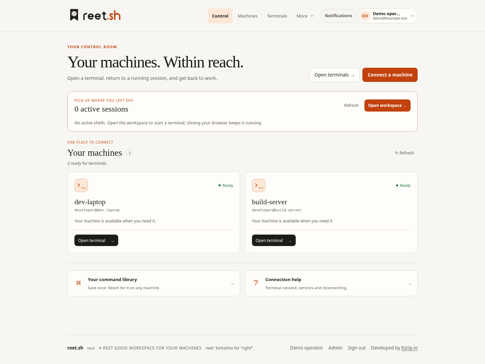

<div align="center">

<picture>
  <source media="(prefers-color-scheme: dark)" srcset="brand/logo/horizontal-color-dark.svg">
  
</picture>

### Ey up. Your AI fleet, in good order.

A self-hosted control room for your machine fleet, AI agents, skills and reusable setups. Connect your machines, use installed agents, review what gets synced, and return to ongoing work.<br>
One Go binary. One SQLite file. No telemetry.

[](https://github.com/eyupio/reet.sh/actions/workflows/image.yml)
[](LICENSE)
[](go.mod)
[](https://github.com/eyupio/reet.sh/pkgs/container/reet.sh)
[](CONTRIBUTING.md)

[Quick start](#quick-start) · [Features](#features) · [Adding skills](#adding-skills) · [Configuration](#settings-env) · [Contributing](CONTRIBUTING.md)

<br>

<picture>
  <source media="(prefers-color-scheme: dark)" srcset="docs/images/control-dark.png">
  
</picture>
<p><em>Example machine inventory.</em></p>

</div>

## Why

Your AI workspace spans machines, agents, skills, configuration and ongoing work. Keep the whole lot in good order in a control room you host yourself. Browser terminals put the agents already installed on each machine within reach; reusable setups and reviewed sync help bring the fleet together.

reet.sh is a self-hosted workspace for the machines where you use AI agents. Open a browser terminal, continue ongoing shells, and work with agents already installed on each connected machine. Its supporting skill library lets you choose what goes to one machine or all machines, bring discoveries back, and review sync changes before applying them.

The signed-out landing page introduces machines and persistent terminals, with routes to sign in, request an invite, create an account when enabled, or set up a new instance. Account signup, owner setup and token sign-in share the same workspace language. Public pages do not load private inventories.

The signed-in home is **Control**, with active sessions and machine connection cards. **Machines** handles connections and inventory; **Terminals** provides persistent remote shells. **More → Skills** maintains the central library and **More → Sync** handles reviewed distribution and reconciliation. Lists and portable setups also remain under More. Skill shelf stages are personal organisation; they do not install or remove files.

**Scan all** requests inventory from available enrolled machines. **Sync all · preview** queues previews for available saved targets. Review and approve each exact plan in Sync activity. Distinct scopes on one machine can queue previews together; execution stays serial. Offline, paused, stale/incomplete and already-pending targets are skipped with reasons. Individual queue failures are reported, with successful requests preserved. Agent software installation, update and removal are future work; current controls manage skills and terminal sessions.

Nothing is sent to skills.sh except read-only page fetches for names and descriptions.

## Features

- **Terminal-first control.** Home shows active shells and machine connections. Continue exact sessions, or connect and open a machine's terminals.
- **An organised session workspace.** Filter across machines, sort and group, colour-code sessions, drag to reorder, resize or collapse the sidebar. Right-click or use keyboard-accessible row actions to rename, disconnect, stop and remove closed history. Layout stays in this browser, separately per account.
- **Comfortable remote terminals.** Four colour palettes, font/cursor controls, search, clipboard and guarded paste. Search a machine’s saved Bash/Zsh history to paste/edit or explicitly review and rerun a command. Keep a separate account command library for reusable snippets, inserted without an extra Enter. Stopping can remove history after the machine confirms closure; set its default in Account → Profile.
- **One or all machines.** In Sync, choose a library, list, published collection or reported machine scope as the source; select one destination or All machines, then adjust individual scopes. Differences are shown per destination. Saving desired state is separate from previewing and approving changes.

- **Three-stage shelf.** On the shelf, To test, In use. Stage is derived from your flags, never stored out of step.
- **List or board.** Choose Board for On the shelf → To test → In use columns on desktop, stacked on smaller screens. Move skills with the same keyboard- and touch-accessible buttons; the layout choice is saved to your account (or this browser without accounts). Moving a card changes shelf status, not installed files.
- **Compact skill cards.** Cards start collapsed by default, with a link to their source, stage, available install/trend data, machine/tag/list counts and a personal-note indicator. Move stages, like, copy an install command or copy a ready-to-run prompt without opening the card. Expand an individual card for descriptions, tags, machine details, notes and history, or use Expand all / Collapse all. Expansion choices survive filtering, stage moves and layout changes during your visit.
- **Focused navigation.** Account and Admin dropdowns lead to individual pages with a section menu. Mobile/tablet navigation folds into Menu; team usage becomes compact cards with expandable report details. Server-only heartbeats stay in diagnostics, outside shelf filters and status badges.
- **Your defaults.** In Account → Profile, choose List/Board and collapsed/expanded cards across browsers. Individual expansion choices remain temporary for the current visit.
- **Environment badges.** Each card shows Installed (green), Missing (amber) or Not confirmed (neutral) for each known machine. Missing requires complete agent scans from the last 14 days; stale, incomplete and heartbeat-only reports cannot confirm absence. These are reported inventories, not live filesystem checks.
- **Capture anywhere.** Paste an `npx skills add` command, skills.sh URL or `owner/repo/skill`, or use the bookmarklets (Like, Save, In use) on any skill page.
- **Know what is installed.** `reet scan` reads the skills folders for your tools, per machine and per tool. New discoveries start In use; later scans preserve your existing shelf choices.
- **Copy feedback.** Copy buttons confirm success with a brief checkmark reveal; reduced-motion preferences use a gentle fade.
- **Machine maintenance.** Merge hostname/`--env` duplicates, rename or forget machines in Account → Machines. Old names remain aliases, preventing duplicate reports on later scans. `reet scan --prune --reconcile --env NAME` repairs the local hostname and refreshes inventories; fleet commands never install/remove skills.
- **Controller sync.** Compare selected reet.sh shelf/list/published skills with machine scopes. Enroll a scanner-only agent for scan, preview, approval, pause/resume and recovery controls. Additive mode preserves extras; exact and bidirectional modes require reviewed changes. [Setup and controls](docs/controller-sync.md).
- **Skill-content observations.** Updated enrolled connectors report read-only file fingerprints after successful scans. Machines and Sync distinguish observed, incomplete, stale and unreported contents, with expandable details. File bytes are not uploaded, and matching names/sources do not prove matching contents. Explicit CLI import is available from an enrolled machine with `reet agent skill import --name NAME` (preview) and `--upload` (confirmed private copy); [selection and recovery](docs/machine-skill-import.md). Browser import controls and file-aware apply remain future work. [Protocol and limits](docs/machine-content-observations.md).
- **Environment sync.** Account includes site-aware scanner setup, machine/server status and saved reference skill sets. Preview differences and run `reet sync --apply` locally to confirm installs/removals. [Setup and limits](docs/environment-sync.md).
- **Copy missing installs.** Pick an environment and copy the install commands for everything on your shelf that is not there yet.
- **Metadata that stays fresh.** Description, install count and a weekly sparkline, refreshed every six hours, politely.
- **Tags and notes.** Skills.sh topics are seeded as tags; add your own and filter by several at once.
- **Accounts and profiles.** Owner setup, argon2id passwords, HttpOnly SameSite sessions, rate-limited sign-in. Each person's Account has their profile, password, sessions, personal API tokens, activity and backups. Or token mode, or no auth on a trusted LAN.
- **Yours to take away.** Export JSON, Markdown or CSV, and restore from JSON. The database is one file.
- **Notifications that reach the right person.** A bell and notification centre for ticket replies, new support tickets, new accounts and security notices. Each person chooses email or centre-only; the owner sets the defaults and which staff roles hear about operations. [Notifications](docs/notifications.md).
- **Support that stays with the team.** Open a personal or team ticket from **Support**; a team's owner and managers can answer its tickets, and instance admins get one queue with replies, internal notes, assignment and statuses. [Support tickets](docs/support.md).
- **Email that waits.** The owner sets one SMTP server under **Admin → Email**; invitations, password resets, password-change notices and welcomes go through an outbox with retries, a test send and DNS checks. Each team's owner or managers choose what that team is emailed about under **Teams & organisations**. With no server, resets hand over a temporary password, invitations show a link to copy, and the admin page says so. [Email setup](docs/email.md).
- **Sealed backups, here and off-site.** The owner backs up the whole instance; every person can back up their own shelf. Copies are encrypted before they are written or shipped, verified after every take, pruned by a count you choose, and sent to any S3-compatible destination.
- **Yorkshire at heart.** A reet good toolkit, with a white-rose bookmark and a practical, quietly quirky voice. See [voice and copy](docs/voice-and-copy.md) when changing user-facing text.
- **Pleasant to use.** Light and dark themes, works on a phone, keyboard friendly, respects reduced motion.

<details>
<summary>Dark mode and phone</summary>

<p align="center">
  
  
</p>

</details>

## Quick start

```sh
git clone https://github.com/eyupio/reet.sh && cd reet.sh   # or just download docker-compose.yml, .env.example and scripts/init-env.sh
sh scripts/init-env.sh          # creates .env, generates REET_TOKEN, sets your UID/GID, creates ./data
docker compose up -d
```

Open http://localhost:8080. On a new instance, create the owner account; if `REET_TOKEN` is set, the setup page asks for it as the bootstrap token (`grep REET_TOKEN .env`). Later visits sign in with email and password.

The compose file uses the prebuilt image `ghcr.io/eyupio/reet.sh` (no local build). The database lives in a host folder, `./data` by default, bind-mounted at `/data`, so you can back it up or move it like any other folder. The container runs as `REET_UID:REET_GID` (your user, set by the script), so that folder stays owned by you.

### Settings (`.env`) <a id="settings-env"></a>

`docker compose` reads `.env` automatically. `.env.example` lists every setting with comments.

### Shared lists

A **list** keeps a set of skills and shared list notes together. New lists default to **Personal**. Choose **Selected people**, a **Team or organisation** (with extra named people and individual exclusions), **Public community**, or an enabled **Unlisted link**. Each choice previews its audience before saving. Editors change skills and list notes; list owners manage audiences. Instance administrators retain administrative access, and read-only accounts stay read-only.

Use **Lists** to browse My lists, Shared with me and Teams & organisations. **Community** is a separate, anonymous directory of deliberately published lists and their skills. Personal shelf notes, people, memberships, exclusions and machine reports are never published with a list. Existing signed-in-only lists keep their previous access under **Legacy instance audience**; they do not become public.

**Teams** manages organisations, teams and their members. Sharing with a group follows its membership automatically; exclusions override group and individual access for ordinary accounts. Existing unlisted links remain controlled by the owner's link-sharing switch. See [sharing and audience rules](docs/sharing.md) for permissions, publication, migration and limitations.

### Accounts

The default `REET_AUTH=accounts` creates one owner through the setup page on first visit, then signs people in with email and password. Each account has its own shelf. Roles are owner, admin, member and viewer; viewers are read-only. Shared lists are where people work together without sharing a shelf. Sessions are HttpOnly, SameSite=Lax cookies; passwords are stored with argon2id; sign-in is rate-limited.

**More → Portable setups** lists and explains server-synced AI setup profiles. Run `reet setup profile` for the interactive create/push wizard; creation, push and pull remain CLI commands. Use the **Account** menu (inside **Menu** on smaller screens). Its sections are **Profile** (name, theme, time zone and date order), **Password** (which ends every other session), **Sessions**, **Machines** (connect and inspect agent inventories), **Compare & sync** (comparison and reference snapshots), **API tokens** (shown once), **Backups** for your own shelf, and **Activity**. Admins get **Admin → Users** to invite people by link, reset passwords, disable accounts, change roles, revoke tokens and transfer ownership, and **Admin → Backups** for the instance. If `REET_TOKEN` is set it is required once on the setup page and works for `reet scan` only until a personal API token exists.

- **Solo or trusted LAN:** `REET_AUTH=none` removes sign-in and maps everything to an implicit owner. Use it only on a network you trust.
- **Legacy single token:** `REET_AUTH=token` keeps the single `REET_TOKEN` login card and requires it for the UI, API and bookmarklets.
- **Upgrading:** an existing shelf is kept and becomes the owner's shelf on first setup; flags, notes, tags and environments are carried over. Nothing is deleted.

| Variable | Default | Purpose |
| --- | --- | --- |
| `REET_DATA_PATH` | `./data` | Host folder for the database. Must exist and be writable by `REET_UID:REET_GID`. |
| `REET_UID`, `REET_GID` | `1000` | User the container runs as. `init-env.sh` sets these to `id -u` / `id -g`. |
| `REET_PORT` | `8080` | Host port for the UI. |
| `REET_VERSION` | `latest` | Compose image tag; when exported, also selects CLI installs/upgrades (`latest`, `dev`, or a release tag). Compose additionally accepts `sha-<short>`. |
| `REET_AUTH` | `accounts` | `accounts` (owner setup and sessions), `token` (the single `REET_TOKEN`) or `none` (trusted LAN, no sign-in). |
| `REET_TOKEN` | empty | Accounts mode: setup bootstrap and fallback scan token until a personal token exists. Token mode: the only credential. Empty means no token. |
| `REET_SIGNUP` | empty | Set to `open` to allow self-serve member accounts. Empty keeps accounts invite-only. |
| `REET_CONTACT_EMAIL` | empty | Optional admin address shown on the sign-in screen for account and password-reset requests. |
| `REET_PUBLIC_URL` | empty | Canonical public origin, also the default for links in email. |
| `REET_MAIL_OUTBOX_DIR` | empty | Local development only: write each email here as `.eml`/`.html` instead of sending it. Never set this on a public instance. |
| `SKILLS_SH_TOKEN` | empty | Optional skills.sh API token (needs a Vercel OIDC token, so it can't be generated). Without it, reet reads the public skills.sh pages. |
| `REET_LOG` | empty | Set to `debug` for one line per metadata fetch; writes are always logged without tokens. |
| `REET_TOPICS` | empty | Set to `off` to stop the daily skills.sh topic seed (nine read-only page fetches a day). |
| `REET_ENV` | hostname | Stable name for this machine in scan/sync/server reports. |
| `REET_CONTROLLER_URL` | empty | Optional remote controller to receive a server process's scans every minute. |
| `REET_CONTROLLER_TOKEN` | empty | Personal token from the remote controller account; separate from this instance's bootstrap token. |
| `REET_REFRESH` | empty | Set to `off` to stop the six-hourly metadata refresh (the 50 oldest skills, two seconds apart). |
| `REET_RELAY_MAP_URL` | empty | Optional HTTPS Tailcat relay map for private agent connections. Empty uses the Tailcat default. It must be reachable by the controller; it is never returned to a browser. |
| `REET_BACKUP_KEY` | generated | Passphrase that seals every backup and every stored destination secret. Use `reet backup keygen`, and keep a copy away from this machine. Empty generates `data/backup.key` on first start. |
| `REET_BACKUP_DIR` | `<data>/backups` | Where this machine keeps copies. |
| `REET_BACKUP_EVERY`, `REET_BACKUP_KEEP` | `24h`, `48` | Instance backup schedule and the count kept here. `0` turns the schedule off; `0` kept means every copy. |
| `REET_BACKUP_USER_EVERY`, `REET_BACKUP_USER_KEEP` | `0`, `14` | Defaults for a person's own backups; they can change them under Account → Backups. |
| `REET_BACKUP_DESTINATION` | `both` | Where copies go by default: `local` (this machine only), `remote` (an enabled destination only, kept here when none took it) or `both`. Each owner can change it on the Backups page. |
| `REET_BACKUP_COMPRESSION` | `gzip` | Compress copies before sealing by default: `gzip` or `none`. Each owner can change it, and give copies a password, on the Backups page. |
| `REET_BACKUP_S3_*` | empty | One destination from the environment (`ENDPOINT`, `REGION`, `BUCKET`, `PREFIX`, `ACCESS_KEY_ID`, `SECRET_ACCESS_KEY`, `PATH_STYLE`, `NAME`), readable by a machine rebuilt from nothing. More destinations are added in the UI. |
| `REET_BACKUP_ALLOW_LOCAL` | empty | Set `1` to allow an `http://` destination on another machine. Backups are sealed, but the access key id would travel in the clear. |

### Commands for keys and settings

All of these edit the same `.env`, then `docker compose up -d` applies them:

```sh
sh scripts/init-env.sh                                  # first-time setup; keeps values already set
sh scripts/init-env.sh --rotate                         # new REET_TOKEN (old bookmarklets stop working)
sh scripts/init-env.sh --set SKILLS_SH_TOKEN=your-token # set or change any KEY=value
sh scripts/init-env.sh --set REET_PORT=9090
docker compose up -d                                    # apply changes
```

Without the script, the equivalent manual steps are:

```sh
cp .env.example .env
openssl rand -hex 32            # paste the output after REET_TOKEN= in .env
id -u; id -g                    # paste after REET_UID= and REET_GID=
mkdir -p data
```

If the container exits with "unable to open database file", the data folder isn't writable by `REET_UID:REET_GID`; fix it with `chown -R "$(id -u):$(id -g)" data` and restart.

(The `reet` server itself reads `REET_ADDR` (default `:8080`), `REET_DATA_DIR`, `REET_TOKEN` and `SKILLS_SH_TOKEN`; compose maps the settings above onto them.)

## Install the binary

Install `reet` on a Linux or macOS machine (amd64 or arm64) without Go or Node:

```sh
curl -fsSL https://raw.githubusercontent.com/eyupio/reet.sh/main/scripts/install.sh | sh
export PATH="$HOME/.local/bin:$PATH"
reet --version
```

The installer downloads a GitHub release, verifies its SHA-256 checksum, and installs to `~/.local/bin`. The binary includes the Library web UI (`reet serve`) and the scanner (`reet scan`). See [binary installation](docs/binary-installation.md) for pinned versions, custom destinations, manual installation, and publishing releases. Binaries become available after the first version tag runs the release workflow.

## Hosting your own skills

Open **Host skills** in the navigation and claim a permanent publishing username. Create a skill using the editor or upload an existing `SKILL.md`. Its YAML frontmatter must contain a `name` matching the skill's URL name and a `description` (up to 1024 bytes). Add instructions below the frontmatter. Supporting files are optional; paths can be edited to preserve folders such as `scripts/` and `references/`. Each bundle can contain up to 100 supporting files and 2 MiB total.

New hosted skills take the name prefix from **Account → Profile** (`reet-` by default, changeable or disablable). Imported folders use the same prefix. Skill names can be renamed later; the public URL and install command move with the name, and shelf, list and tag references follow the new identity.

Skills are private drafts until you select **Publish publicly** and save. Publishing also puts the skill in the shared catalogue and on your own shelf under **To test**. A published skill has a public page at `https://reet.sh/username/skill-name`, with this install command:

```sh
npx skills add https://reet.sh/username/skill-name
```

Use `npx skills add` before the URL; `npx https://…` alone is not a skills CLI command. Self-hosted instances use their own hostname. Scoped Agent Skills discovery endpoints below the public URL let the CLI download `SKILL.md` and all supporting files. You can also paste the URL or its install command into the shelf.

Uncheck **Publish publicly** and save to unpublish, or delete the skill to remove its files. Both stop future downloads immediately; existing installations remain on users' machines. Disabled author accounts stop serving public skills. Publishing usernames cannot change or be reused after account deletion, so old links cannot be claimed by another account. Skill hosting follows the instance's normal write permissions; viewers cannot publish. Bundles live in `reet.db` and are covered by whole-instance database backups. Shelf JSON exports and personal shelf backups contain skill references, not authored bundles.

## Adding skills

### MCP integration

Open **Account → MCP access** and copy the hosted MCP URL into Claude or another
compatible client. OAuth sign-in and consent are the default; manual bearer
tokens and opt-in browser WebMCP are also available. Each person manages their
own connection permissions, expiry, pause, rotation and revocation. The existing
Go server hosts `/mcp`; no sidecar is needed. An agent can read a compact shelf,
find duplicates, edit many skills in one call, manage lists and tags, and preview
or apply environment cleanup. See [MCP setup and access](docs/mcp.md) and the
[full tool list](mcp/README.md#tools), including example calls.

### Capture and scan

- **Paste a command or link.** Paste an install command such as `npx skills add https://github.com/anthropics/skills --skill mcp-builder`, a skills.sh URL or `owner/repo/skill` into the box at the top. reet extracts the repository and skill name and fetches the details from skills.sh without running the command.
- **Bookmarklets.** Open "Show bookmarklets and tools" in the UI and drag the Like, Save and In use links to your bookmarks bar. On any skills.sh skill page, click one to send that skill to reet.sh. In accounts mode the links use your session cookie and carry no secret; in token mode they contain `REET_TOKEN`, so keep them private.
- **Tags.** The daily skills.sh topic seed adds tags like Design & UI or Testing to matching skills. Use **Edit tags** on a skill to add tags or remove them with ×; changes save immediately. Removed tags stay removed through topic refreshes until you explicitly add them again. Outside edit mode, click a tag to filter the shelf, or combine several tag filters. Rename or merge tags under Show bookmarklets and tools → Manage tags.
- **Import what you have installed.** Run the scanner on the machine that has your skills:

  ```sh
  reet scan --server http://your-host:8080 --token "$REET_TOKEN" --env sam-mbp --prune
  ```

  It reads the skills folders for your tools (`~/.claude/skills`, `~/.agents/skills`, `~/.cursor/skills`, `~/.codex/skills`, `~/.config/opencode/skills`, plus `.claude/skills` and `.agents/skills` in the current directory) and the skills CLI lock file at `~/.agents/.skill-lock.json` if present, then marks each skill as "in use". Existing likes, saves and notes are kept.

  In accounts mode, `--token` is a personal API token from Account; the bootstrap `REET_TOKEN` works only until the first personal token is created. `--env NAME` names this machine (the hostname is the default) and turns each folder into an environment on the card, such as `sam-mbp · Claude Code`. `--prune` removes the environment link for skills that are no longer in a scanned folder; the skill and its notes stay. Add `--dir PATH` for other folders and `--dry-run` to preview. The scanner needs to see your skills folders, so run it on the machine that has them, not inside the container. Build it with `go install github.com/eyupio/reet.sh/cmd/reet@latest` (the scanner does not need the web UI).

  Skills found only by folder name show as "unlinked". Use **Link** on the card to attach the skills.sh URL.

  Once environments exist, the shelf gets an environment filter and a **Copy missing installs** action that copies the install commands for everything on the shelf that is not on that machine yet.

Private skill revisions have an [account-scoped storage/API contract](docs/private-skill-revisions.md) for exact file bytes, immutable history and conflict-checked heads. This foundation is separate from publication and machine apply; full database backups include its files, while personal shelf exports do not.

Start a new shell with the + beside a machine in Control or Terminals. Right-click cards or terminal output for actions; Show sessions reopens a hidden session sidebar.

Connect a machine’s terminal with `reet agent terminal setup`. Interactive install, enrollment and upgrades offer this resumable wizard; it checks tmux, asks for local shell consent and repairs native services while preserving running sessions. See [terminal connection setup](docs/terminal-controller-commands.md#first-class-machine-connection-setup).

Manage the binary or a server with `reet install --mode binary|native|compose`, inspect updates with `reet upgrade --check`, apply a verified update with `reet upgrade` (`--version` overrides `REET_VERSION`/saved defaults; otherwise dev stays dev; replacing the running dev CLI with stable requires an explicit `--version`), and diagnose problems with `reet doctor [--json]`. Managed server upgrades preserve configuration, back up SQLite and restore the previous deployment on a failed restart. Use `reet healthcheck --url https://your-site.example` for a remote health check; without `--url` it uses `REET_URL`/saved defaults. Use `--local` for the local server. Commands preview their intent and require confirmation before applying; see [managed installation and upgrades](docs/binary-installation.md#managed-install-upgrade-and-doctor).

**Account → Machines** groups agents under machines; an enrolled agent shows its build and update state, **Update reet** reviews the move first, and automatic updates verify the new build and restore the previous binary if it cannot report back. **Account → Compare & sync** offers a two-machine comparison with shared/missing skills and explicit stale/incomplete scan warnings. Library filters follow the same machine → agent hierarchy.

See [environment sync](docs/environment-sync.md) for account setup, confirmed installs/removals, server reporting and freshness advice. The rolling `dev` binary release and Docker `:dev` tag update from main after every merge; stable binary releases remain immutable.

## Backup

### CLI defaults and terminal presentation

Set your release channel and target server once:

```sh
reet configure --version dev --url https://reet.sh
# Or run reet configure interactively for prompts.
reet upgrade --check
reet healthcheck
```

Defaults are saved privately in the platform user configuration directory's
`reet/client.env` (`~/.config/reet/client.env` on Linux). Relevant CLI commands load
it automatically. Explicit flags override exported environment variables, which
override saved defaults. `REET_VERSION` selects the release and `REET_URL` selects
the server. Commands prompt for missing required values in a terminal and save the
answers. Scripts receive an actionable error; container checks use `--local`.
The CLI does not modify your parent shell or automatically source a project's
`.env`. A personal API token entered at a hidden prompt (for example by `reet scan`)
is saved as plain text in `reet/token` with owner-only permissions
(`~/.config/reet/token` on Linux), then reused by later commands. `REET_TOKEN`, an
explicit `--token` or `--env-file` selection overrides it. Forget it with
`reet configure --forget-token`.

Interactive terminals show the reet wordmark and burnt-orange progress indicators
for update checks/downloads and remote health checks. Set `REET_NO_ANIMATION=1` to
stop animation, or `NO_COLOR=1` for plain output. Redirected output and JSON stay
free of banners and animation. See [CLI defaults](docs/binary-installation.md#saved-cli-defaults).

### Local AI agent setup discovery

`reet setup scan` provides a standalone, read-only inventory of known configuration
locations and executables for Claude Code, Codex, OpenCode, Pi, Cursor and Gemini
CLI. It does not require a reet account or server:

```sh
reet setup scan
reet setup scan --json
reet setup scan --project /path/to/project
reet setup scan --components --json
reet setup scan --export-policy --json
reet setup scan --probe-versions --json
reet setup scan --inspect-installation --json
reet setup backup --preview --json
reet setup backup
reet setup backup --password-file ~/.config/reet/setup.pass
reet setup backup --probe-versions --inspect-installation --password-file ~/.config/reet/setup.pass
reet setup backup --include-credentials --password-file ~/.config/reet/setup.pass
reet setup backup --s3 --password-file ~/.config/reet/setup.pass
reet setup fetch --s3 SNAPSHOT
reet setup fetch --s3 --profile work
reet setup remote list
reet setup remote test
reet setup remote prune --keep 10 --apply
reet setup remote delete --yes SNAPSHOT
reet setup profile
reet setup profile save work
reet setup profile save --exclude-kind instructions --machine laptop work2
reet setup profile save --exclude-kind skills work3
reet setup profile rename work2 personal
reet setup profile remove --yes personal
reet setup profile push --server https://reet.example work
reet setup profile pull --server https://reet.example work
reet setup prune --keep 10 --apply
reet setup restore --profile work --password-file ~/.config/reet/setup.pass
reet setup list
reet setup inspect --password-file ~/.config/reet/setup.pass SNAPSHOT
reet setup restore --password-file ~/.config/reet/setup.pass SNAPSHOT
reet setup restore --apply --password-file ~/.config/reet/setup.pass SNAPSHOT
reet setup restore --apply --on-conflict replace --password-file ~/.config/reet/setup.pass SNAPSHOT
reet setup restore --resume JOURNAL --password-file ~/.config/reet/setup.pass SNAPSHOT
reet setup restore
reet setup restore --probe-versions --inspect-installation --password-file ~/.config/reet/setup.pass SNAPSHOT
reet setup restore --apply --on-conflict skip --conflict ~/.claude.json=replace --password-file ~/.config/reet/setup.pass SNAPSHOT
reet setup verify --probe-versions --inspect-installation --password-file ~/.config/reet/setup.pass SNAPSHOT
reet setup rollback --journal FILE --password-file ~/.config/reet/setup.pass SNAPSHOT
reet setup rollback --last --password-file ~/.config/reet/setup.pass SNAPSHOT
reet setup journals
reet setup health --probe-versions --inspect-installation
reet setup support
reet setup support --json
```

The default checks path metadata and executable availability only. Opt into
`--components` to read bounded, known configuration files (JSON, Codex TOML and
OpenCode JSONC) and summarise settings, MCP declarations and credential requirements
without returning values. Unsupported formats and incomplete reads are explicit.
Neither of these modes runs agents. Separately opt into `--probe-versions` to invoke
discovered executables with `--version`, with a three-second timeout each. Reported
application versions are separate from reet's scanner/server version and do not
verify installation provenance. `--inspect-installation` independently reads bounded
local Node package metadata and checks its declared executable against the discovered
file. It runs no commands; a match is local evidence, not authenticated provenance
or proof of which package manager was used. `--export-policy` declares the
selection rules for configuration sources, settings fields, MCP declarations,
credential references and excluded classes in a future encrypted snapshot. It reads
no configuration contents and is a policy declaration, not an export.
`reet setup backup --preview` applies those policies in memory and reports included,
encrypted-only, reference and excluded fields, MCP declaration counts, installed skill
folders with file counts, unknown fields and omissions without printing values or
writing an archive. Without `--preview`,
`reet setup backup` prompts for a passphrase in a terminal (or takes
`--password-file FILE`/`-`) and writes one encrypted local snapshot under
`REET_SETUP_DIR` or the user config `reet/setup` directory; source paths, selected
values, discovered instruction text and whole skill folders stay inside the encrypted
payload. Skill folders are limited to 256 files and 8 MiB each, with a 64 MiB snapshot
budget; a symlinked or special file makes that skill an explicit omission rather than
a partial copy. Source provenance is read from the skills CLI lock files when present,
sanitised and recorded. Restore creates a missing global or project lock file from those
entries and merges missing entries into an existing one; an existing source conflict is
left unchanged and reported.
`--include-credentials` explicitly includes literal credential values from URLs,
environment and header fields; it is rejected with `--preview`. Optional
`--probe-versions` and `--inspect-installation` record application/package evidence.
`--s3` uploads the sealed snapshot to the configured `REET_SETUP_S3_*` destination and
verifies the read-back; `reet setup fetch --s3` downloads it, optionally by profile;
`reet setup remote list` reads remote object metadata.

`reet setup list` reads clear headers without a passphrase; `reet setup inspect` opens
the encrypted preview and source summaries only with a passphrase and never prints
values. `reet setup restore` with no arguments runs a local wizard (profile, optional S3 fetch,
passphrase, plan, confirmation, conflict choice, verification); the flag form previews a
destination plan and can add software and cross-OS compatibility warnings. `--apply` creates new files or handles conflicts with
`--on-conflict skip|replace` and repeatable `--conflict PATH=skip|replace` overrides,
keeping mode-0600 rollback copies. A running apply journal can be continued with
`restore --resume JOURNAL`; already-applied files are checked against the snapshot and
only pending actions are written. `reet setup verify` compares selected fields without
repairing or running agents. `reet setup rollback` reverses a completed apply journal
after snapshot, digest and current-file checks; `reet setup journals` lists records and
`--last` picks the newest completed one. `reet setup health` gives conservative local
evidence and reauthentication guidance without repairing anything. `reet setup support`
prints the per-agent component and restore support matrix; it is a limitation statement,
not runtime verification.

`reet setup profile` runs an interactive wizard (create/choose snapshot, optional
preview, profile name, optional push using `REET_URL`/`REET_TOKEN`, saved defaults or
`.env`; a saved token is retried before prompting). `reet setup profile save NAME` uses the newest local snapshot
without a passphrase, or
add `--password-file` to record preview/software evidence; it keeps a named local revision
pointing at an immutable snapshot. `reet setup profile save` continues to accept an
explicit snapshot ID.
`restore`, `verify`, `inspect` and `rollback` accept `--profile NAME` and optional
`--revision N`; profiles can exclude component kinds or exact source paths globally or
for named machines/projects, selected with `--machine NAME`/`--project PATH`. `profile rename` keeps history and `profile remove --yes` keeps snapshots;
`profile push`/`pull` sync the profile (not the snapshot) with a reet server. The
**Profiles** page lists synced profiles, their latest revision, overrides and revision
history, and can rename or delete the server copy, or add a server revision with changed
global exclusions. These edits affect the server copy only; local profiles change after a
pull, and renaming does not rename the local profile. For revisions with a recorded preview it also
shows each agent's stored components: settings field names, MCP server names, instruction
sources, installed skill folders with file counts and recorded source, encrypted-field
names, omissions and software evidence. Credential values and skill file contents are never shown. Profiles are
not synced to an account or another machine. `reet setup prune --keep N` previews local
snapshot deletion and `--apply` removes old unprotected snapshots; profile and journal
references are protected.

This is still not complete setup backup/restore: memory databases, conversation/session
history and skill dependency resolution are not implemented; runtime health
verification and verified cross-OS restore remain unproven. Discovered global and
project instruction files (`CLAUDE.md`, `AGENTS.md`, `.cursorrules`, `GEMINI.md`) are
included as encrypted text; other instruction locations are not inventoried. Existing
instance and shelf backups below remain separate.
See [setup discovery and limits](docs/setup-discovery.md), the
[implementation plan](docs/agent-setup-plan.md) and [handoff](handoff.md).

### Instance and personal shelf backups

There are two kinds: a one-off export, and sealed copies taken on a schedule.

**Personal shelf export and restore.** Use **JSON (personal shelf backup) → Download** and **Restore from JSON** in Shelf tools, or call `GET /api/export` and `POST /api/restore`. The export includes personal skills, flags, notes, tags, attached environment reports and the ignored list; tick **Include local history** to add the event log. It does not include accounts, shared lists, teams, sync references or standalone machine heartbeats; use an instance backup for those. **Markdown** and **CSV** downloads follow the current search, stage, tag and environment filters.

**Sealed, scheduled backups.** The instance owner configures the schedule, retention and off-site destinations under **Admin → Backups**; each person can back up their own shelf under **Account → Backups**, to their own destination. Every copy is verified after it is taken, then kept on this machine, copied to each enabled S3-compatible destination, or both, as the owner chooses. Copies are gzip-compressed by default; an owner can protect them with a password instead of the instance key and open a downloaded copy with `reet backup open`. **Download** hands over the sealed `.reetbackup` file; **Export JSON** is the unsealed snapshot. The key is separate from the database: keep a copy of `data/backup.key` (or `REET_BACKUP_KEY`) somewhere else, or an off-site copy cannot be opened after the machine is lost.

```sh
reet backup keygen                     # print a key for REET_BACKUP_KEY
reet backup list                      # instance copies on this machine
reet backup run                       # take one now, and ship it
reet backup open --password-file p f  # open a downloaded copy to stdout
reet backup escrow --out f --passphrase-file p   # key and destinations, sealed
reet backup restore --yes <id>        # with the server stopped
```

An instance restore replaces the live database, so the admin page tells you the command rather than doing it behind a running server; the database in place is moved aside, not deleted. A person's restore runs from their own page and only ever touches their own shelf. See [backups](docs/backups.md) for the full runbook, including a machine rebuilt from nothing.

## Shelf tools and admin

- **Select** in the toolbar turns cards into checkboxes. Shift-click selects a range; the floating bar can tag, move, like or remove the selection, and a bulk remove gets the same Undo toast as a single remove.
- Metadata for the 50 oldest skills is refreshed every six hours (two seconds apart) and the card shows the weekly install sparkline and change. **Refresh** on a card checks immediately and says when nothing changed.
- **Admin** in the header opens `/admin` for the owner and admins: version, database size, skills.sh reachability, topic seed status, counts, environments, users and invites, the team rollup, the refresh/topic/link-sharing switches, instance name and recent activity. Only the owner can change instance settings or transfer ownership.
- **Team rollup** on `/admin` shows adoption by skill across active accounts, the people behind each count, environment chips, and drift: skills in use outside any list and list skills nobody uses. Filter by list or tag, sort by adoption, and download exactly the visible rows as CSV. The owner can turn off per-person usage and leave counts only.

## Development

```sh
cd web && npm ci && npm run build   # builds the UI into web/dist, which the Go binary embeds
cd .. && go test ./... && go run ./cmd/reet serve
```

For UI work, run `npm run dev` in `web/` (it proxies the API to `localhost:8080`).

The [whole UI design studies](docs/ui-redesign.md) compare Library, Workbench and Focus across the signed-out pages, shelf, lists, account and admin. Open `web/concepts/controller.html` directly, or visit `/concepts/controller.html` on the Vite dev server. The app implements Library throughout: shared account forms, page headings, bordered shelf cards, list and account panels, grouped tools, and spacious admin tables. The other two directions remain concepts for reference. See [Library implementation](docs/library-implementation.md) for screenshots and validation.

Version tags also publish checksummed Linux and macOS binaries through the [binary release workflow](.github/workflows/release.yml).

The `Dockerfile` builds the UI and the binary and cross-compiles for `linux/amd64` and `linux/arm64`. The GitHub Actions workflow tests every push and publishes `ghcr.io/eyupio/reet.sh` (`latest`, `vX.Y.Z` and `sha-<short>` tags) from `main` and version tags.


## Project layout

| Path | What is there |
| --- | --- |
| `cmd/reet` | The one binary: `serve` runs the server, `scan` imports installed skills, `backup` takes and restores copies. |
| `internal/api` | HTTP API and the embedded UI handler. |
| `internal/auth` | Accounts, sessions, passwords and tokens. |
| `internal/backup` | Sealed copies, S3 destinations, schedules, retention and restores. |
| `internal/store` | SQLite storage and migrations. |
| `internal/meta` | Fetches skills.sh metadata. |
| `internal/ref` | Parses skill install commands, skills.sh URLs and slugs. |
| `internal/scan` | Finds skills installed on a machine. |
| `web/` | The Svelte UI, built into `web/dist` and embedded in the binary. |
| `brand/` | Logo set, colours and usage rules. |

## Contributing

Bug reports, ideas and pull requests are welcome. Read [CONTRIBUTING.md](CONTRIBUTING.md) first; it covers the dev loop, tests and what makes a good change. Please follow the [Code of Conduct](CODE_OF_CONDUCT.md). Found a vulnerability? See [SECURITY.md](SECURITY.md) and do not open a public issue.

## Licence

reet.sh is free software under the [GNU Affero General Public License v3.0](LICENSE). In short: use it, change it, run it for yourself or your team; if you offer a modified version to others over a network, share your changes under the same licence.

reet.sh is an independent project and is not affiliated with or endorsed by skills.sh or Vercel.

---

<div align="center">


**reet.sh** · Your shelf for everything AI<br>
Developed by [EyUp.io](https://eyup.io)

</div>

For scan authentication, export `REET_TOKEN`, use `reet scan --env-file .env`, or
enter a personal API token at the hidden interactive prompt. Tokens entered at
the prompt are not saved. See [scanner authentication](docs/binary-installation.md#scanner-authentication).

Interactive commands also ask for missing sync targets, restore identifiers,
backup paths, passwords and keys when needed. Saved values are used first;
secrets stay hidden, and noninteractive commands report missing required inputs.
See [missing command inputs](docs/binary-installation.md#missing-command-inputs).

### Setups and machines

The workspace separates **Skills**, **Lists**, **Setups** and **Machines**. Use a list's
**Prepare a machine** action to review its skills against a target inventory. Setup
profiles show captured coverage, exclusions and revision comparisons, with a guided
local recovery flow. Syncing a profile transfers metadata, not its encrypted snapshot.
See [UX rebalance](docs/ux-rebalance.md) and [binary installation](docs/binary-installation.md).

Remote Linux/macOS terminals have a dedicated **Terminals** workspace. The active-session
band on **Control** links directly back to each existing shell. The screen fills the
remaining viewport; session navigation, Disconnect/Reconnect and Manage actions stay
close by, with machine health and setup under **Details & help**. Legacy Machines
terminal links still work. **Find** searches machines by host or shell user, and
phone screens keep the selected user/host visible. Unconfirmed creation retries
stay with their original machine and title while you work elsewhere.

Ctrl+C interrupts (or copies selected output on Windows/Linux); the **Interrupt**
button always sends Ctrl+C. Ctrl+V/Cmd+V pastes, Ctrl+X stays a shell/editor key,
and right-click opens Copy/Paste. Shift+right-click keeps the browser menu. Multiple
lines, control characters and large pastes require review before sending.
Disconnect leaves the shell running; **End session** stops its work. Removing
a closed session from history is available under **Manage → Remove from history**.
This hides its record without deleting machine files, and works while remote terminal
execution is disabled. Active or pending sessions must be ended first.
Terminals require controller opt-in (`reet terminal start` with HTTPS/accounts)
and explicit host-local consent, including for root-owned enrollments. Sessions
survive browser/agent disconnects while tmux remains running. See the
[remote machine runbook](docs/remote-machine-operations.md) for setup and rollback.
