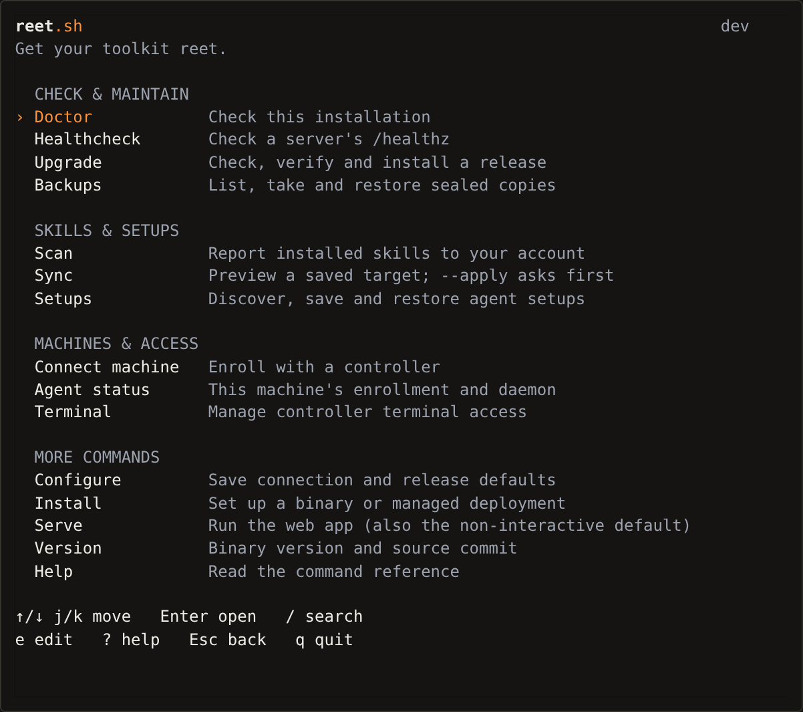
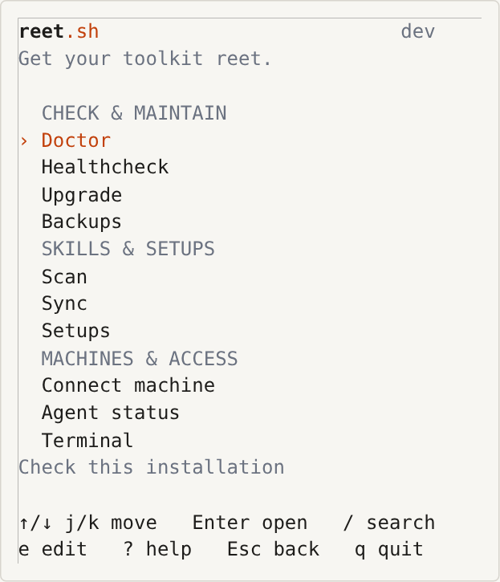
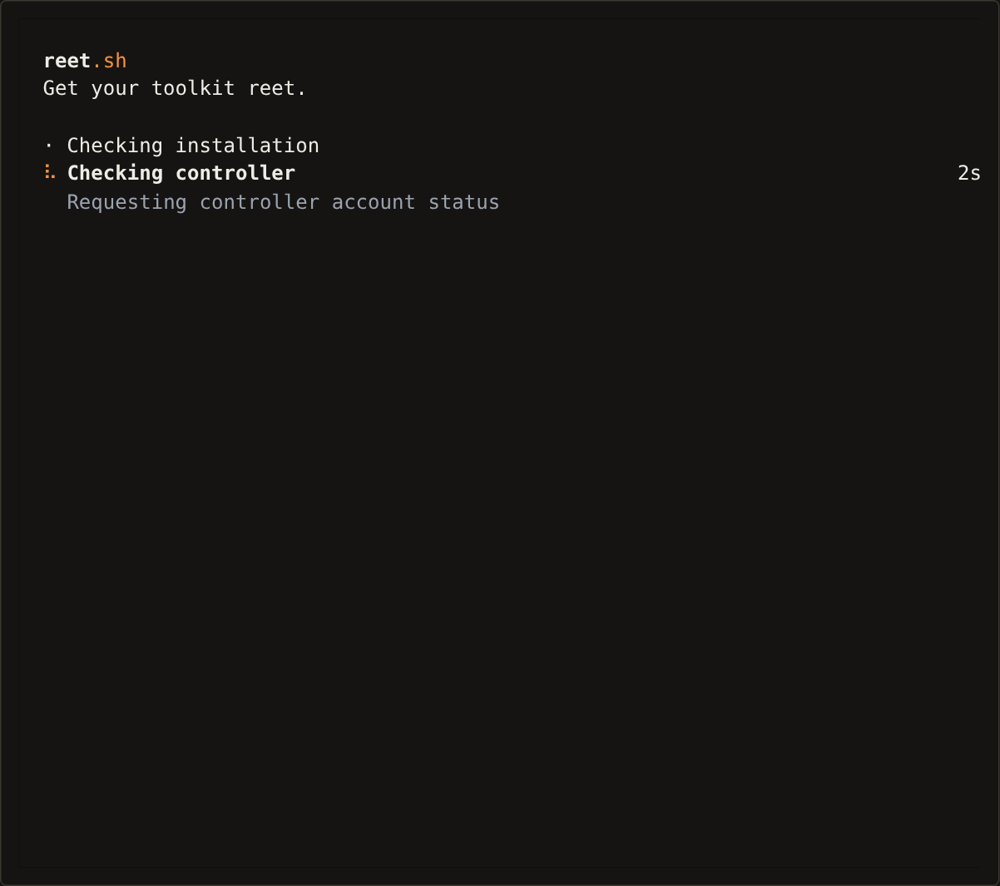

# Interactive CLI home

Run `reet` without arguments in an interactive terminal. The grouped command
list uses the same catalog as `reet help` and the [command reference](cli-reference.md).
It is a launcher for the existing CLI, with Reet's static wordmark, established
tagline and burnt-orange selection. There is no separate dashboard.



## Navigation

- Up/Down or `j`/`k` move; Enter opens the selected task.
- `/` searches command names, descriptions and subcommands. Type normally,
  including `j`, `k` and `q`; use arrows to select a result. Enter opens it and
  Escape clears the search. An empty search cannot run a command.
- `e` edits the selected command's arguments. Quoted words and escaped spaces
  are supported. There is no shell expansion, command substitution or shell execution.
  Prefer environment variables or the existing hidden prompts for tokens.
- `?` reads the selected command's help.
- Escape returns from a submenu, then exits home; `q` or Ctrl+C quits.

Backups, Setups and Terminal open menus of their existing CLI tasks. Other
selections invoke the command directly. Home never adds `--yes`, `--apply` or
authentication flags. Upgrade and installation retain their plans and exact
`yes` confirmation; empty input does not approve a deployment change.

After a command finishes, its original stdout and stderr stay in the terminal's
normal scrollback. Enter or Escape returns home; `q` exits with that command's
status. Returning home does not rerun a failed operation. Use the terminal's
scrollback controls for long output. At narrow widths, descriptions move below
the list and navigation scrolls to keep the selected command visible.



## Progress and terminal ownership

Doctor, healthcheck and upgrade report the current task, elapsed time and a
useful observation while network requests or SQLite checks run. The one-cell
braille spinner comes from Reet's existing presentation. It appears only while
work runs, with no splash delay or estimated percentages. Explicit text reports
finished, failed or cancelled work; the command's full diagnostics remain intact.



The doctor capture uses a delayed local HTTP fixture, not a production controller.
Also see the [completed report](images/cli-doctor-result.png),
[static monochrome progress](images/cli-doctor-static.png) and
[short terminal recording](images/cli-session.cast) (asciicast v2).

Bubble Tea work runs asynchronously and sends results back to the model. A
renderer failure cancels and joins the same operation; it never retries a
download, backup or replacement. Ctrl+C or Escape during rendered work waits
for that operation's cleanup. The launcher also waits for its child rather than
killing it during recovery.

The home renderer stops before starting a command. Progress renderers stop
before approval prompts, password input, child processes and binary replacement.
Those stages use static feedback without taking ownership of terminal input.
Managed upgrades preserve their verified SQLite copy, previous binary and
rollback paths. Recovery uses a separate bounded context so cancellation cannot
prevent it from restoring the previous deployment.

When an upgrade replaces the running launcher's binary, the launcher re-execs
the installed file with the selected command and its flags. `REET_RETURN_HOME`
and `REET_UPGRADE_CONTINUATION` carry the completed command result; the new
process resumes that result without repeating the upgrade. Both markers are
cleared before the result prompt or another menu task. Failed re-exec reports
the failure and never repeats installation work.

## Plain output and preferences

`serve`, agent daemons, containers and redirected bare invocations keep their
existing entry points. Bare `reet` still runs `serve` without an interactive
terminal, with `TERM=dumb`, in CI, or with `REET_NO_TUI=1`.

JSON and piped commands do not receive branding, animation or menu prompts.
Progress goes to stderr only when both the input and command output are terminals.
Existing stdout/stderr streams, parser errors and exit statuses remain in the
command handlers.

| Preference | Behaviour |
| --- | --- |
| `NO_COLOR` (including an empty value) | Remove colours without changing navigation |
| `REET_NO_ANIMATION=1` or leading `--no-animation` | Static progress, no animation |
| `REET_REDUCED_MOTION=1`, `REDUCE_MOTION=1`, `PREFERS_REDUCED_MOTION=reduce` | Static progress |
| `CI` set or `TERM=dumb` | Plain command behaviour; no home or progress renderer |
| Leading `--non-interactive` | Keep the no-command server entry point and suppress prompts |
| `--non-interactive` on doctor/install/upgrade/healthcheck | Suppress prompts and presentation; deployment changes still require `--yes` |
| `REET_TUI_BACKGROUND=light\|dark`, then `COLORFGBG` | Select Reet's existing palette without querying the terminal |

The old `--tui` flag is a compatibility alias: it runs the selected CLI command
and offers a return home. It requires a terminal unless the command requests
structured/non-interactive output. `reet tui` is not a command.

## Development

`internal/cliui` contains the catalog, navigation model and progress presentation.
`cmd/reet/home.go` owns command handoff and upgrade continuation. Business logic
stays in the command packages. Bubble Tea v2, Bubbles v2 and Lip Gloss v2 reuse
the established project versions. The old dashboard and its exclusive Huh
dependency are removed.

Regenerate the command reference after changing the catalog:

```sh
go run ./cmd/command-reference > docs/cli-reference.md
```

Model tests cover navigation, search, editing and sizing. Injected operations
cover renderer failure, cancellation, confirmation defaults and recovery without
installing a real service. PTY checks exercise the built CLI and terminal handoff.
