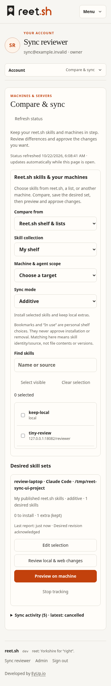
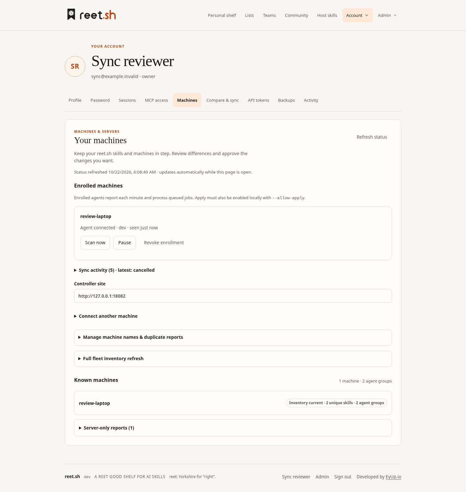

# Controller sync verification

Implemented on `feat/controller-skill-sync`, based on `c3388fe`. All tests used temporary databases and skill directories; no production data or installed fleet binaries were changed.

## Checks

- `go test ./...`: pass.
- `go test -race ./...`: pass; the subsequently changed scan/store/API packages were checked again with `-race` after the final compatibility and recovery changes.
- `go vet ./...`: pass.
- Frontend checks: 8 existing inventory tests pass; Svelte reports zero errors and warnings.
- Frontend production build and embedded Go binary build: pass.
- `git diff --check`: pass.

New regression coverage includes unreadable skill entries and lock files; preserving user shelf choices; hosted publisher provenance; desired selection ownership, freshness and revision checks; private lists and unpublished drafts; three-way deletions and conflicts; enrollment credentials, viewer/cross-account denial and token revocation; preview/approval hashes; paused agents, duplicate claims and expired work; idempotent result acknowledgments; machine rename preservation; backup/restore and copied-enrollment rejection.

The Go agent integration test exercises enrollment → first scan → reet.sh desired set → remote preview → approval → install/removal → backup → rescan/acknowledgment → confirmed restore. Its installer is a controlled fixture so failure and removal behavior can be tested without fetching third-party skills.

## Real installer and browser flow

Chromium drove the built UI against a local accounts-mode server. A test author published a minimal skill on that server. The browser selected it directly from **My published reet.sh skills**, chose an enrolled project scope, saved an additive set, queued a preview, and approved the exact plan. The enrolled Go agent invoked the real `skills@1.7.4` package (including its dependencies, installed outside this repository). It installed the published bundle, preserved an unrelated local-only skill, and reported the correct hosted source and applied revision.

The initial isolated installer harness lacked its `yaml` dependency; its failures appeared as failed jobs and a fresh preview was required. After installing the package's runtime dependencies, the complete real-installer flow passed. No application dependency files were changed for browser/installer tooling.

Additional browser interactions passed:

- Scan now queues work; Pause prevents it from running; Resume allows completion.
- Queued work can be cancelled without execution.
- Machine skills can be selected and adopted into an editable reet.sh list.
- Status updates arrive without reloading the page.
- Completed job history collapses; current work opens for review.

Machines and Compare & sync were checked at 375, 800 and 1440 CSS pixels. The final six combinations had no document overflow or browser runtime errors. These are Chromium fixture checks, not certification for Safari, Firefox, physical touch devices, screen readers or all inventory sizes.

## Deployment boundary

The managed environment blocks access to `https://reet.sh`, and target-machine access was not provided. Live server migration, release installation, native service supervision and actual fleet upgrades have not been performed. Users need a binary containing this change to enroll agents; existing scan reports and legacy snapshots remain readable.

Sync reconciles selected skill identities and sources with explicit approval. It does not claim file-content/version equivalence or silently subscribe all bookmarked/list skills for installation. See [controller sync](controller-sync.md) for setup, supported modes, recovery and operational limits.
