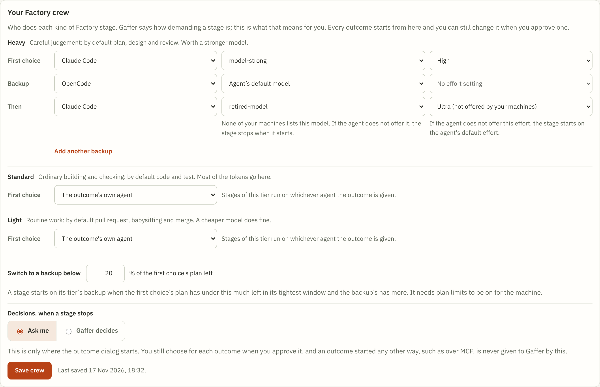
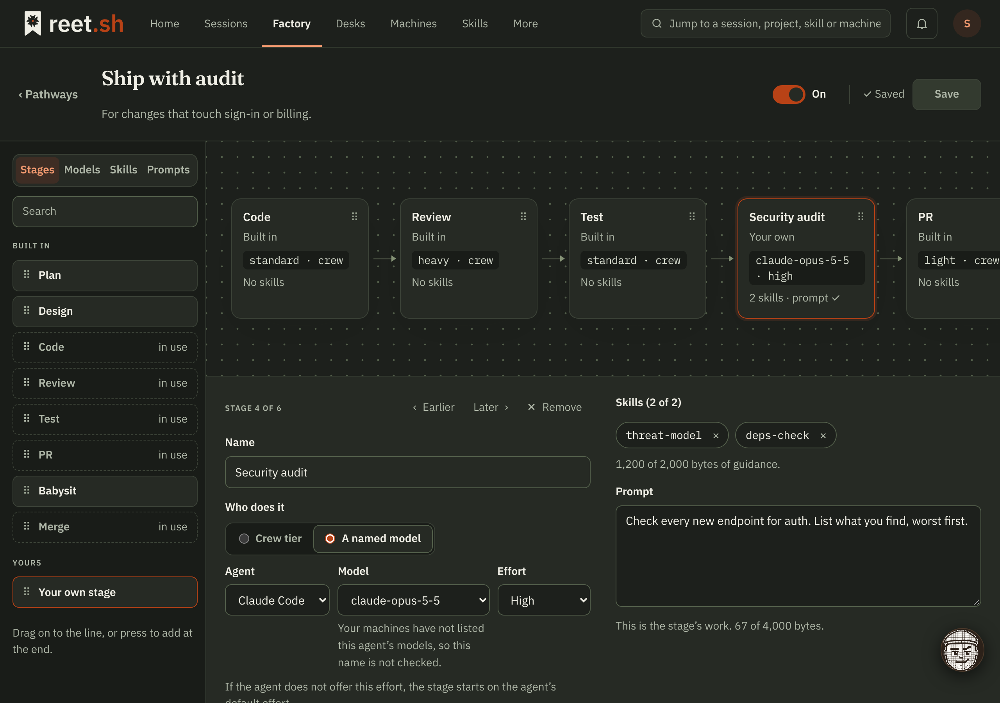
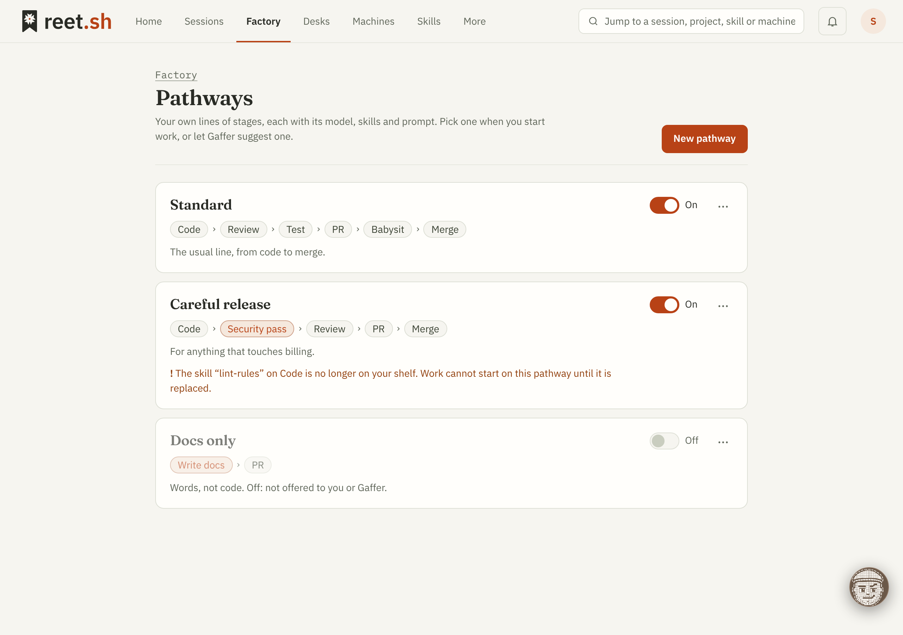

# Factory

The **Factory** is where you track the work you hand over to [Gaffer](gaffer-ai.md). You say what you want
done, Gaffer proposes the work as pipelines, you edit and approve the plan, and the controller runs each pipeline
stage by stage. Factory is a tab beside Home on a controller with accounts sign-in, for any account that can start
sessions; a read-only account does not have it. Before the first outcome you need a connected machine, a project and a
default Gaffer provider, and the page lists whichever is missing under **Three things and you're in business**.

Every stage of a pipeline is an ordinary agent session on the project's machine. The stage in hand is listed in
[Sessions](session-board.md) marked **Factory · stage n of m**, and you can open it and type in it; the stages the
Factory has finished with are left to the pipeline on this page, so they do not clutter Home or Sessions. In a git project
each pipeline works in its own [worktree](terminal-worktrees.md). Gaffer follows each stage as it follows any session
it looks after. It reviews and hands over; it cannot merge, run commands or answer approvals. Opening the Factory page
starts nothing and makes no model request.

## Outcomes and pipelines

An **outcome** is what you asked for, in up to 4,000 bytes of plain text, in one project. A **pipeline** is one piece
of that work, with its own title, brief and stages. Pipelines of an outcome run side by side and cannot see each other.

To start one, choose **New Factory outcome**:

1. Write the outcome and choose the **Project**, or **A repository from GitHub…** to have a connected machine clone
   one as a [temporary project](projects.md#temporary-projects). Choose the **Agent**, and a **Model** and **Effort**
   if you like, and how many pipelines Gaffer may propose under **Sessions** (up to five).
2. Choose **Ask Gaffer for a plan**. Gaffer's default provider is sent what you typed and the project's name, nothing
   else, and proposes the pipelines. **Write the plan myself** skips this.
3. Review the plan. Edit any title or brief, add or remove a pipeline, and tick the stages each runs through.
   **Reply to Gaffer** asks for a revised proposal.
   Under **Acceptance criteria** you can write what must be true for a pipeline to count as delivered, up to ten
   one-line criteria of up to 240 bytes each. A pipeline with criteria stops for a [delivery review](#delivery-review)
   before it merges or finishes; one without them runs as before.
   Each stage also says what it will run on, and **Launch readiness** above **Approve and start** sums that up. See
   [Before you approve](#before-you-approve).
4. Set the limits, **Approvals**, **Decisions** and the merge, described below, then choose **Approve and start**.

Nothing starts until you approve. After that the controller does the starting and the moving on, so you can close the
browser.

### Before you approve

When the plan opens, reet reads the machine again and asks it which agents are signed in and how much of each plan is
left. A machine that cannot answer is a state on the stage, not an error. **Launch readiness on** the machine, at the
head of the pipelines, counts the stages that are ready and how many have something to look at or cannot start. Under
the count each cause is said once, with who it affects: **Every stage** for a machine that is not connected, otherwise
the crews it is on and the stages they do, such as **Heavy and Standard crews, used by Code, Review and Test**. Its word
is **Cannot start**, **Look at** or **Note**. A tier whose agent is not on the machine says only that: its model, effort,
sign-in and backups do not matter until that is fixed. A cause on a tier has **Choose who does what**, which opens the
crew editor and puts you on the first affected tier's agent.

Each stage, and each part of a split stage, is one line: a mark, the agent, model and effort it will run on, and where
the choice came from. **✓** is ready, and says nothing more; **!** (**Look at**), **✕** (**Cannot start**) and **…**
(**Reading**) carry their word. The source is your **Saved crew** for that tier, **Your choice** made in this dialog, or
**Outcome's agent**, which is the outcome's own agent because no crew is saved for the tier or because the saved agent is
not on this machine. A model or effort you left to the agent reads as a choice: **Agent's default model and effort**.
Under the line are the backups, folded until you open them:

- **Backups: …**, in the order tried, with what each will do. It **can take over** when balancing can move a stage
  onto it. Otherwise it **takes over only after a usage limit**, or **balancing will not use it**, and the line says
  why. Balancing moves a stage to a backup only when the first choice's plan figures are less than six hours old and
  low, the backup is signed in, and, if it has figures, has more of its plan left. A backup on the same agent shares
  that agent's plan, so it is not balanced onto. A backup whose own figures are old or absent takes over without a
  comparison, and is not something to look at. After a usage limit the next backup is tried whatever its sign-in, so one
  whose agent is not on the machine or is not signed in is still tried and is likely to be refused there; that is
  something to look at, and the folded line counts it. Backups that fail for the same reason are said together, and a
  backup on the first choice's own agent is not said again when that agent's missing sign-in already is.

Sign-ins are read from the machine's last answer even when the latest read could not be made; only that read is then
said to be old. A machine that does not report an agent's sign-in (Cline, for one) is noted and never counted as a
problem. Things still being read, such as a model list, are shown as being read, not as a problem.

A model that the machine's list does not have, a list read more than a day ago, a model list or effort levels the machine
could not give, a missing sign-in and sign-ins the machine could not read are each worded differently, with when the
list was read. A saved effort that the machine does not offer is shown as the saved crew's, with the note that the stage
starts on the nearest lower level the agent offers, or on its default effort. Where the model or effort was not checked against the machine, a note says so:
an agent that does not offer the model stops the stage when it starts; otherwise the [Applied line](#the-page) on the
running stage says what it is running on.

Warnings never stop you. **Approve and start** waits only when a stage's agent is not on the machine now, or the machine
is not connected, and the reason is beside the button, with the crews to change under **Choose who does what**. When
the reason clears, the same place says **Nothing is holding the plan now.** While a stage cannot start the machine list
is read every ten seconds, so Approve clears when the machine comes back.

## Work orders from another agent

A **work order** is a plan written in reet's own format by an agent outside reet. Use one when you have already worked
out the plan with that agent, in your editor or another chat, and do not want to describe it again to Gaffer. The work
order names the objective, the pipelines, their stages and the acceptance criteria. reet reads it, shows it as the plan
review, and starts nothing until you approve.

### Getting an agent to write one

In **New Factory outcome**, choose **Copy prompt for an outside agent** and paste it to the agent. The prompt holds:

- one line that runs `npx skills use` for this controller's `factory-contract` skill, which tells the agent the format;
- a short **Context** block: the name of the project chosen in the dialog, the names of your [pathways](#pathways) that
  are on, and which tiers have a saved crew.

Nothing else about your account is in it. Names only: no pathway prompts, no model names, no keys.

### Pasting it

Paste the work order the agent gives you into the outcome box. The dialog says **This is a work order**, and
**Read the work order** replaces **Ask Gaffer for a plan**. Reading one makes no model request.

A work order with problems is not started. The problems are listed, each as `Line n: …` with what to change, and you
can fix the text or ask the agent to. A clean one opens the plan review filled in: the pipelines, their stages, tiers
and parts, the acceptance criteria, and the project and pathway if the work order names them and you have them. Then
review and approve as for any plan.

If the work order suggests a crew, the stages show **Suggested by the work order**. It is for this outcome only.
**Use my saved crew** puts yours back. Your saved crew is never changed, and **Launch readiness** still says what the
machine cannot run.

### What stays yours

reet never takes these from a work order. They are set in the dialog, by you:

- YOLO
- folder trust
- a merge that happens by itself
- Gaffer taking the decisions
- the review limits

### Giving the work back to your agent

In an outcome's **⋯** menu, **Copy for your agent** copies a **work report**: the outcome's state, each pipeline stage by
stage, the handover notes the stages left, and the acceptance criteria as last recorded. Give it to your agent so it
knows where things stand. A criterion reads `unverified` when work has started again since it was reviewed. That is not
a failure; the [delivery review](#delivery-review) is the live view.

### Continuing an outcome

Your agent can answer a work report with another work order, one that names the outcome. Paste it into **New Factory
outcome** and reet opens the plan review as **Add to "<objective>"**. **Approve and add** adds the pipelines to the
running outcome. A work order cannot change the outcome's crew or settings.

A connected agent can do the same over MCP; see [Read and steer the Factory](mcp.md#read-and-steer-the-factory).

### The format

The agent reads the full contract from the skill at `/eyupio/factory-contract` on your controller. This is a worked
example:

```markdown
---
reet: work-order/1
objective: Add CSV export to the reports page
project: reports-api
crew: heavy=claude/opus/high, standard=codex
---

## Pipeline: Export endpoint

stages: plan, code, review, test, pr
tiers: code=heavy, review=standard

Add GET /reports/{id}/export.csv … (the brief: self-contained prose, any Markdown,
up to the first ### heading)

### Part: code / Streaming writer
tier: heavy

Write rows as they are read, never the whole file in memory.

### Part: code / Endpoint and auth

Wire the handler and reuse the report's read permission.

### Criteria

- An export of 10,000 rows finishes in under 5 seconds
- A reader of another team's report is refused
```

| Header key | Meaning |
| --- | --- |
| `reet` | Required. `work-order/1`. |
| `objective` | Required, unless `continues` is given. The outcome in plain text. |
| `project` | Optional. A project's name. No match is not an error: you choose the project. |
| `crew` | Optional. A suggested agent, model and effort per tier. |
| `pathway` | Optional. The exact name of one of your pathways. |
| `continues` | Optional. The id of a running outcome, from its work report. |

## The page

What needs you from the Factory is also in [Home](session-board.md)'s **Waiting for you** list, mixed with your
sessions, each with the same buttons; **Details** there opens the pipeline here. The bell counts the same things.

The page is a list of pipelines from every outcome, and the detail of one pipeline. The line under the title counts
what is **waiting for you**, **working** and **finished**. The list has four sections:

- **Waiting for you**: every pipeline that needs you, the longest waiting first.
- **Working**: pipelines that run by themselves or wait their turn.
- **Finished or stopped**: pipelines that finished or were stopped.
- **Other sessions**: sessions you started yourself, the ones Gaffer looks after and the running chats it does not
  yet.

A section opens and closes, and your browser remembers which are open. The first time only **Waiting for you** is
open. **Other sessions** also opens by itself when a session in it needs you, and then stays open for the visit
until you close it, so answering the last one does not close it under you. A closed section still says what is in
it: how long the oldest has waited, or the first titles.

A pipeline's status is **Decision**, **Approval**, **Delivery review**, **Ready to merge**, **Agent stopped** or **Failed** while it waits
for you, **Running** or **Waiting its turn** while it works, and **Finished** or **Stopped** once it ends. Each item in
the list shows its status, its title, the outcome it is for and its stages.

- On a wide screen, 1100 pixels and over, an item is one button with its stages as dots and a caption such as
  "Review · 4 of 8 · next Test". Choosing it shows the pipeline beside the list.
- On a tablet each stage is named. On a phone the stages are circles with a caption such as "Review in hand · Plan,
  Design, Code done · next Test".
- On a tablet or phone an item that waits for you also says why, or what Gaffer recommends and why. It has one filled
  button for what it most likely needs, such as **Have Gaffer look again**, **Approve the merge** or **Try again**, and
  an approval has **Allow once** and **Deny**. **Details** opens the pipeline with its other actions, and **Open the
  session** goes straight to the stage's session to read what its agent did; both are plain underlined links beside the
  filled button. A stage whose agent reports what it is doing says so ("Agent: working · last active 2 min ago"). When
  Gaffer's own review failed, the chip says **Review failed** and the reason sits in a red-tinted panel marked with !.

On a wide screen the first pipeline waiting for you is open beside the list when the page opens, or else the first
one working. The detail has the outcome, the pipeline's title and status, **Open session** and the outcome's menu
(**⋯**). Under them are the pipeline's stages and, when it waits for you, what is waiting. Then come closed rows, each
showing its headline: **Gaffer's report**, **Usage and budget**, **What Gaffer decided**, **History** and **Settings
for this outcome**. One bar at the foot, **What do you want to do?**, holds everything you can do to the pipeline.

Where the machine can read GitHub through its GitHub CLI sign-in, the detail also shows a **GitHub** block for the
pipeline: the pull request's number, state and link, what its CI checks are doing, how long the run has taken, and how
many of Gaffer's decisions put a stage right. **CI stages** opens the list of checks with each state and a link to it.
The figures come from the session in hand, whose folder and branch the pipeline shares, and are silent when GitHub
cannot be read. A finished outcome's bar offers **Archive outcome** and **Delete outcome…**; **Delete** still asks
first, and the outcome's menu keeps both choices.

On a tablet or phone **Details** opens the pipeline as a screen of its own. **‹ Factory** goes back to the list, and so
does the browser's Back button. A pipeline opened from Waiting for you says where it is, such as "2 of 3 waiting for
you", with buttons for the previous and the next. The chosen pipeline is kept in the page's address, so a reload or a
shared link opens it again.

On a wide screen the **Projects** panel is down the left side, and each project says how many of its pipelines are
waiting and working. Choosing a project shows only its pipelines, and a new outcome then starts in that project;
**Show all projects** goes back. On a tablet or phone the **Projects** button opens the same choice.

The detail's rows hold the rest:

- **Gaffer's report**: **Ask Gaffer for a report** is one request to Gaffer's model for a report across the outcome's
  pipelines. A report may suggest pipelines to add; tick the ones you want and choose **Add 1 pipeline** (or **Add 2
  pipelines**, and so on). Nothing is added unless you approve it, and added pipelines never merge by themselves.
- **Usage and budget**: what this pipeline and the whole outcome have used. Reviews and time left in the stage in
  hand, Gaffer tokens, agent tokens, context left, the number of pipelines and the budget per stage. **Review goal**
  (**Goal and limits** while the pipeline waits for you) opens the stage's goal and limits.
- **What Gaffer decided**: the decisions Gaffer took for this outcome, described below.
- **History**: what happened to the outcome's pipelines, newest first, including what was done over MCP. It is read
  again each time you open it.
- **Settings for this outcome**: who decides when a stage stops, **Approvals**, this pipeline's **Merge**, and
  **Reports**.

The outcome's menu holds **Stop starting sessions** while it is starting and **Stop following** while it is
unfinished. A finished outcome has **Archive** and **Delete** there instead, and an archived one only **Restore**.

## Stages and what runs in each

A pipeline runs through the stages you ticked, in this order: **Plan**, **Design**, **Code**, **Review**, **Test**,
**PR**, **Babysit** and **Merge**.

- Every stage runs in an agent session of its own, in the pipeline's folder and branch. It starts from that stage's
  instruction and the handover of the stage before. The earlier stage's session is ended and its history kept.
- When the working agent's reports show the stage's deliverable is done, Gaffer hands it over with a summary and the
  controller starts the next stage you approved. Gaffer does not choose the next stage, its agent or its model.
- Every stage but merge is told not to merge.
- A stage can be **split into parts**, by Gaffer in its plan or by you with **Split into parts**. Each part has a name,
  a brief and a tier of its own, and the parts run one after another, each in its own session. **Do as one stage**
  undoes a split. The pull request, babysitting and merge are never split.
- Each stage has a budget of Gaffer's reviews and hours, set under **Change limits** when you approve: 12 reviews over
  24 hours unless you change it, from 1 to 48 reviews and 1 to 168 hours.

In the detail's stages a tick is a finished stage, a ring is the stage in hand, **!** is waiting for you, **×** has
stopped and **»** is a stage you moved on yourself. Pick a stage to see its facts. The stage in hand shows its agent,
how long it has run, what its agent is doing now, Gaffer's reviews and Gaffer's latest review. A finished stage shows
who did it, with its tier, agent, model and effort, how it ended and its handover. A stage to come says who will do it.

Once a stage's session is running, the controller asks the machine what it is on and shows it on the stage's
**Applied** line: **Confirmed**, **Not as chosen** (naming what differs) or **Not checked**. A finished stage keeps it.
Nothing is stopped by a difference.

An effort the stage's agent does not offer for its model does not stop the stage. Where the machine's report lists the
agent's levels, the stage starts on the nearest lower one (max becomes high when high is the heaviest offered) and its
facts say "high effort (max is not offered)"; with no lower level listed, or when the agent refuses the level at the
start, it starts on the agent's default effort and its facts say "agent's default effort (max is not offered)". Either
way its **Applied** line is **Confirmed** with the reason. A model the agent does not offer still stops it. **Try again** and **Send back** ask for the effort
again, except while an earlier start of that stage is still unanswered; so do Gaffer's own decision to run a stage again
and the restart of a stage on its backup.

## Your Factory crew

The crew says which agent does a stage. It has three tiers, named for how demanding a stage is:

- **Heavy**: careful judgement. By default plan, design and review.
- **Standard**: ordinary building and checking. By default code and test.
- **Light**: routine work. By default the pull request, babysitting and merge.

Under **Choose who does what** in the outcome dialog, give each tier an agent and, if you like, a model and an effort.
Stages start with the agent and model saved for their tier. An unset tier uses the outcome's agent and model. When
Gaffer plans an outcome it says how demanding each stage of this work is;
a stage it moved off its usual tier is marked **Gaffer's assessment** with its reason and a button that puts it back.
A tier you change is marked **Your choice**. Gaffer names no agent and no model: its rating picks a tier, and the
tier's agent is yours.

Each tier can have a **Backup**: a second agent, model and effort.

- A stage starts on its backup when its first choice's plan has under 20% left in its tightest window and the backup's
  has more, or the backup is signed in with no plan figures to go by (a key, or figures over six hours old). The
  figure is **Switch to a backup below**, from 5 to 90.
- A window for one model counts only for a stage on that model. A plan whose windows are all for one kind of use, as
  GitHub Copilot's Premium, Chat and Completions are, is judged by its tightest window.
- A tier can have up to three backups, tried in the order you give them.
- A working agent is never interrupted. If a stage's agent stops, or its session ends, with its plan below your
  figure, the stage is run again on its backup in a new session in the same folder and branch, once for a stage.
- The stage's facts in the detail say **Balanced** with the reason. A finished stage keeps it, and so does History.
- Threshold-based balancing uses the machine's [plan figures](agent-accounts.md) from the past six hours.
- When the working model reports that its usage or credits are exhausted, Factory offers the next configured backup
  and continues the same stage in its existing folder and branch. With **Gaffer decides**, Factory makes that switch
  once automatically. **Choose another model** on the card lets you select a different worker for this stage when you want to use a different model or have no backup.
  See [A worker reached its usage limit](#a-worker-reached-its-usage-limit).

**Save as my crew** keeps the tiers, their backups and the figure for your account. **Your Factory crew** in Gaffer
settings holds the same, and every later outcome starts from it, including one started over MCP.



In Gaffer settings the choices are those of every machine on your account, since no one machine is in view:

- **Agent**: every agent; one none of your machines can run says "(not on your machines)".
- **Model**: every model your machines list for the agent, with **Agent's default model** and **Other…**. A saved
  model none of them lists stays, with a line saying the stage stops if the agent does not offer it.
- **Effort**: every level your machines report for the agent, and **Default effort**. An agent a machine runs that has
  none, such as OpenCode, shows **No effort setting**. An agent none of your machines runs, or any agent when you have
  no machines, offers **Default effort**, low, medium and high. A saved level none of them offers stays, marked "(not
  offered by your machines)": the stage then starts on the nearest lower level the agent offers, or on its default.

Changing a row's agent clears its model and effort. If your machines cannot be read the form says so and still saves.

## Decisions that wait for you

A pipeline that needs you is in **Waiting for you**. Its detail says why in one sentence and asks **What do you want
to do?**, with a button for each choice. The one to take unless you know better comes first, marked **Recommended**.
When Gaffer's review brought the stage back, the detail says **Gaffer recommends** with its reason, and so does the
item on a tablet or phone. Nothing happens until you choose.

- **Have Gaffer look again** has Gaffer review the work that is there now.
- **Tell the agent…** sends your own words to the working agent for its next turn.
- **Move to next stage** (or **Finish this stage**) closes the stage as it stands.
- **Open the session to answer** takes you to the agent while it waits for your answer or approval. When the session
  holds an approval, the pipeline is marked **Approval** and you can answer it on the page with **Allow once** or
  **Deny**: on the item on a tablet or phone, and in the detail at every width. Gaffer carries on by itself once you
  have answered.
- **Try the review again** appears when Gaffer's own review failed.
- **Give it a new budget** appears when the stage used its reviews or its time.
- **Run this stage again in a new session** appears when the stage's session was ended.
- **Restart stage…** is the way out when the stage's agent is stuck in a session that is still open. On the Factory
  page it is a link in the **Waiting for you** card, in the sentence that says what it does; in the session it is one
  of the decision's buttons. It asks first: the session is ended, its history kept, and the stage starts again in a
  new one, in the same folder and branch. It is offered only while the stage waits for you, so a working agent is
  never ended by it.

An instruction from you or from Gaffer reaches the agent after a turn of its that failed too: it is the next attempt,
and is not held in the session's queue for a Retry.

The same decision is shown in the session doing the stage, above the conversation. **Minimise** folds it to one line
and **Show decision** brings it back; a long instruction Gaffer would give starts at three lines with **Read all of
it**. The decision never pushes the composer off the screen: it scrolls within its own share of the height.

### A worker reached its usage limit

The pipeline is marked **Usage limit**. It says which agent and model reached its limit on which stage, and which
agent the backup is. Either button continues the same stage in a new session in the same folder and branch, and the
pipeline keeps its history. If another model had already taken over on the stage after a usage limit, it says so and
which agent the stage started on. It says whether no backup is saved for the stage or none is left. The detail adds
how much of that agent's plan is left and when it resets, when the machine reports it.

The item on Home and in the Factory list has both as buttons, **Continue with the backup** filled and **Choose another
model…** beside it, so you can act without opening the detail. With no backup left only **Choose another model**
remains, as the filled button.

The same decisions are in the pipeline's session, under its header, with Gaffer's latest review to read in place and a
line saying who decides and, when it is not Gaffer, how to hand it the decisions.

### Gaffer decides

Each outcome is set to **You decide** or **Gaffer decides**, under **Who decides when a stage stops** in **Settings for
this outcome**, and under **Decisions** when you approve the plan. It is yours unless you choose otherwise, and you can
switch at any time.

- When a stage stops, Gaffer chooses one of that stage's own choices: review again, tell the agent, move on, a new
  budget or a new session. The controller then does it as your button would.
- Gaffer also answers an agent's multiple-choice question, choosing among the options the agent offered, or leaves it
  to you with its reason.
- It takes at most three decisions on a stage. After that the stage is yours and the detail says so.
- A stop whose answer never came back, because the controller restarted while Gaffer was deciding, is asked again
  after two minutes. That does not spend another of the stage's three.
- For two minutes after the controller starts, a pipeline that was starting or moving to its next stage waits for
  its machine to reconnect before it gives the launch up.
- Approving a plan allows the outcome's Gaffer provider session text and code. If you switch either off afterwards,
  the next stage is started but not followed, and its note says to allow both in Gaffer settings and try again.
- It never decides a merge, never answers an approval, never answers a question that needs your own words and never
  stops an outcome.
- Each decision is one request to Gaffer's model. The detail's **What Gaffer decided** row lists each one with what it
  did and why.
- You can always choose first: the buttons stay.

## YOLO

**Approvals** is **Ask me** unless you choose **YOLO**.

- On **Ask me**, agents ask before running commands or changing files. A pipeline waits for you while one is asking,
  and carries on once you answer, on the page or in the session. Gaffer never answers an approval for you.
- On **YOLO**, every session of the outcome starts without approvals, and the agents also act on what Gaffer asks them
  without waiting for you.
- YOLO is offered only when your account allows it, the machine accepts it and every agent in the crew has a YOLO
  option, and only after a confirmation. It is never remembered, and no plan and no model can ask for it. The
  controller checks again at every start and records each one.
- A started outcome can be switched on the **Approvals** line of **Settings for this outcome**: **Switch to YOLO…**
  after a confirmation, or **Make them ask me**. The session each pipeline has in hand is switched and every later
  stage starts that way.
- An outcome started over MCP never runs on YOLO.

## Delivery review

A pipeline whose criteria you agreed when you approved the plan (or in **Add pipelines**) stops in **Delivery review**
when its last stage before the merge is handed over, or when every stage is handed over and it has no merge stage.
It is in **Waiting for you**, and its button is **Review delivery**. Home's **Waiting for you** shows it as
"Delivery review · 3 criteria", read from the outcome list without asking the machine, and its button opens the Factory
page on that pipeline with the review in view.

The review is a card on the pipeline's page. Opening it asks the pipeline's machine for the folder's current Git commit,
which can take up to about 15 seconds; **Retry** tries again if the read fails. The card shows:

- the **reviewed commit**, with its state: **Verified on the machine**, **Not a Git repository** (a decision is then
  recorded with no commit) or **Could not be verified**, with the reason. Nothing can be decided while the commit
  cannot be verified. It also shows the branch, the repository and the pull request, and says so when the pull request's
  head is not the reviewed commit.
- each criterion with its status, in words and a shape: **Passed**, **Needs work** or **Unverified**, and the evidence
  for it. Evidence is a **Reviewer note** (yours, labelled as such), an **Artefact** link inside the pipeline's
  repository, or a **GitHub check** read from the machine. Evidence added for an earlier commit, or before the
  criterion's words last changed, is shown dimmed as **Earlier commit** or **Earlier criteria** and never counts.
  A criterion with no counting evidence, a check still running or missing, or a pull request on another commit is
  **Unverified**.
- **Add evidence** on each criterion, **Accept delivery** and **Send back** side by side, and **Edit criteria**.

**Accept delivery** asks you to confirm, and the confirmation says how many criteria are not **Passed** when any are.
It records who accepted, when, and which commit. **Accepting the delivery is not approving the merge**: a pipeline that
waits for your approval then stops at **Ready to merge**, where **Approve the merge** is still its own action, and one
set to merge by itself carries on to its merge stage. **Send back** asks for the stage to do again and your notes (the
notes are required when no criterion is marked **Needs work**). That stage and the later ones are done again in a fresh
session in the same folder and branch, and the agent is told which criteria failed or were not verified, and your notes.

If something changed while you were looking (a new commit arrived, someone added evidence or edited the criteria, a
GitHub check changed state, or the delivery was already decided) the decision is refused, the card says what changed, reads the review again and keeps what you typed, so
you can decide again on what is now shown. A decision names the criteria revision, the review revision, the commit and
the statuses you were shown, and an interrupted request that you send again is recorded once. When a delivery was
accepted on a commit that is no longer the current one, the card says so.

After you accept, the pipeline moves on. If, when its merge is about to start, the commit is not the one you accepted,
the criteria were reworded, or the commit cannot be read, the pipeline comes back to **Delivery review**: its note
starts "Delivery review. The work changed after you accepted it", your acceptance and any merge approval are withdrawn,
and nothing merges until you accept what is there now. **Send back** from **Ready to merge** also clears the
acceptance. The merge itself is never a stage you can send back to, so a pipeline with no stage before its merge has no
**Send back** in its review. The plain **Send back…** is not offered while a pipeline is in delivery review; the card's
**Send back** is the way.

Criteria can be edited while a pipeline waits, runs, is in delivery review, has stopped following, or waits at **Ready
to merge** (changing their words there withdraws your acceptance and the merge approval). They cannot be edited while
the pipeline moves between stages, or once it has finished or failed, and a pipeline in delivery review cannot have
every criterion removed.

Gaffer never accepts a delivery for you, and there is no MCP tool for it. A read-only account, an API token and an MCP
connection cannot change a review. Outcomes saved before criteria existed have no review and behave as before.

## Merging

A pipeline with a merge stage either waits for you or merges by itself. The **Merge** line in **Settings for this
outcome** says which.

- **Waits for you** is the default. The pipeline stops at **Ready to merge**. **Approve the merge** asks you to confirm,
  and **Approve merge** then tells its agent to merge the pull request once every check passes, no review thread is open
  and there are no conflicts. If any of those is not true the agent fixes that first or brings it back to you.
- **Merge by itself**, ticked when you approve the plan, lets the agent merge under the same three conditions without
  stopping. The tick starts from **Let new pipelines merge by themselves** in Gaffer settings, which is off by default.
- **Let it merge by itself** and **Make it wait for me** on the Merge line change one pipeline, until it is ready to
  merge.
- On a YOLO outcome, merging by itself takes a separate confirmation for each pipeline. Until you give it the Merge
  line reads **Waits for you (YOLO)** and the pipeline stops at Ready to merge, whatever was ticked at approval.
- Added pipelines and pipelines started over MCP always stop at Ready to merge.
- A pipeline in [delivery review](#delivery-review) reaches Ready to merge only after you accept its delivery, and
  accepting it does not approve the merge.
- A merge cannot be undone from reet.

## Stopping, retrying and sending back

- **Move to next stage** closes the stage in hand as it stands and starts the next, with Gaffer's last review as the
  handover. On the last stage it reads **Finish this stage**.
- **Send back…** has the stage in hand, or an earlier one, done again. You choose the stage and say why; that stage
  and every later one start over in a fresh agent session in the same folder and branch, and the agent is told your
  reason. Nothing already committed is undone.
- **Try again** is offered on a pipeline that did not start or has stopped, in its detail and, for one that did not
  start, on its item on a tablet or phone. A session that did start is followed again; otherwise the stage starts in a
  new session. A pipeline that was waiting at Ready to merge waits there again. Nothing is retried on its own.
- **Stop starting sessions**, in the outcome's menu while it is still starting, leaves what has not started unstarted.
  Sessions already started keep running.
- **Stop following**, in the outcome's menu, ends every unfinished pipeline of an outcome: Gaffer and the controller
  stop looking after them and start nothing more. Sessions that still exist keep running, and nothing is merged or
  closed. A stopped pipeline can be tried again, one at a time.
- Ending a session that a pipeline is working in says so first, and offers to stop following its outcome and delete or
  archive it. If the session is ended and the outcome kept, the pipeline waits for you marked **Agent stopped**, and
  offers to run the stage again in a new session or move on. Stop following is in the outcome's menu.
- A finished outcome's menu has **Archive**, which hides it and keeps its record, report and history, and **Delete**,
  which erases the record for good. Your account's default comes first. **Show archived** at the top of the page lists
  archived outcomes under Finished or stopped, and their menu has **Restore**. Neither touches the sessions or pull
  requests the outcome started. An archived outcome has to be restored before a pipeline in it is tried again, sent back
  or added to.
- The controller ends the sessions a pipeline has finished with and keeps their history. Worktrees are not touched,
  and a worktree a pipeline still works in is kept by every kind of cleaning.

## Templates

A template is a plan you saved from a finished outcome, so the next outcome that needs the same shape does not start
from nothing. Templates are private to your account. They are not shared and have no MCP tool.

**Saving.** On a finished outcome whose every pipeline is done, or had its delivery accepted and did not then fail, choose **Save as template…** in the bar at the foot of the pipeline. Give it a name
and, if you like, a description. It is kept only when every pipeline of the outcome is done or has its delivery
accepted; otherwise reet says which one is not, and nothing is saved. Where you already have templates, **Save as** also offers **A new
version of** one of them, saved on the version you were shown. An outcome started from a template that is still kept
starts on **A new version of** that template, and says which version it started from. If someone, or another tab, saved a newer version
first, reet says which version that was and which one this now saves; what you typed stays, and choosing another template to follow fills only the fields you have not typed in.

**What is kept.** The objective and review limits, and for each pipeline its title, prompt, merge setting, stages
(with their tiers and the reason for them) and criteria, and the skills each stage was approved with, at their
revisions. **What is not kept:** the machine, project or folder, agents, models and sign-ins, YOLO and folder trust,
images, notes, decisions, reports and usage. You choose those when you use it.

**The Templates page.** **Templates** at the top of the Factory page lists them with their description, latest
version, how many pipelines, when they last changed, and when and at which version you last used them. A template whose
latest version is newer than the one you last used says **Changed since you last used it**, with both versions. The
notice after saving one links to it. Open one to read its plan
(read only), its versions, and to compare any two versions. From there you can **Use** a version, **Rename or change
the description** (this saves a new version with the same plan, even when one of its skills is no longer approved), or
**Delete template…**. Deleting removes the template and all its versions; a single version cannot be deleted; outcomes already started from it keep their own inputs and are not touched. To change the plan
itself, start from the template, adjust it, and save the finished outcome as a new version. An account keeps twenty
templates, and twenty versions of each: saving another version drops the oldest.

**Using one.** **Use** opens New Factory outcome on its plan step. You can also reach it from the first step with
**Start from a template**; what you typed there is kept. The plan is shown read only. Everything that belongs to a
start is chosen now: the project (which decides the machine), the agent, model and effort, the crew, YOLO, decisions,
reports, trust and whether to pull the latest code. The crew starts from the one saved in Gaffer settings and **Choose
who does what** changes it for this start, as for any plan; each stage runs on its tier's agent from it. Launch
readiness is shown and holds the start as it does for any plan, and its **Choose who does what** opens the crew on the
tier to change. Starting does not ask Gaffer to plan anything.

**What a start will do.** Each pipeline shows as one line: its title, stages, how many criteria, and whether it merges by itself once checks pass or stops at Ready to merge (the setting it was saved with). Its full card opens from the line, and is open from the start for a pipeline that changed since the version you last used or has a skill that is no longer approved. The review limits are said once above the pipelines. One line beside the start button names the pipelines that merge by themselves; there is none when no pipeline does. On YOLO a pipeline still stops at Ready to merge until you confirm on the Factory page that it may merge by itself. No choice made in a start is remembered for the next one.

**Changes since you last used it.** When the version you are about to use differs from the one you last used, the
plan step shows what changed first, above the plan: pipelines added, removed or changed, a changed prompt, stages
before and after, a stage's tier, brief or part, criteria added, removed or reworded, skills moved to another revision,
and pipelines put in another order. A pipeline that changed in a way none of these describes says so, with a way to
compare the versions. In the plan below, the criteria added or reworded and the skills on another revision are marked
where they are. If the version you last used is no longer kept, the changes start at the oldest version kept and say that older
ones are not shown. A template you have not used yet shows nothing. The **Template version** list lets you start an older version instead.

**Skills.** A template keeps the revision of each skill it was approved with, and never swaps in another. If a skill is
no longer approved at that revision, because a newer revision is approved or because it was archived, removed or
switched off, the stage says so and the start waits until you tick **Start without these skills**, just under the plan. Only those skills
are left out. If the approved skills change while you are looking, the refusal brings the current list and reet asks
again; your other choices stay.

**On the outcome.** An outcome started from a template says **From template {name}, version {n}** under its title, with the
name the template had when the outcome started, and links to the template. If the template has since been deleted, or that
version is no longer kept, it says so and keeps the name. Editing
or deleting a template never changes an outcome that has started.

## Pathways

A pathway is your own ordered line of stages, kept on your account and used instead of the standard stages. It holds up
to 12 stages: the eight built-in ones (once each) and stages of your own, each with a name and a prompt. Every stage
runs on a crew tier or a named model, and can carry up to 2 skills and a prompt of its own.



**Building one.** Choose **Pathways** at the top of the Factory page, then **New pathway**. Drag stages, models, skills
and prompts on to the line, and drag stages to reorder them. Dragging is never the only way: with a stage focused, press
**Alt** and an arrow key (left and right on a wide screen, up and down on a phone) to move it, or **Delete** to remove
it, and every drag has a button too. On a phone, dragging reorders
stages only; adding and applying are done by tapping.

**Rules you will meet.** A built-in stage can appear once. **Merge** must be last. **Babysit** and **Merge** need a
**PR** stage before them. A stage of your own needs a name (up to 40 characters, not a built-in name) and a prompt.
Where a rule would be broken, the drop is not offered, and a button says why in a sentence.



**On and off.** A new pathway is on. Switch it off and it is offered nowhere, but it is kept. Editing or deleting a
pathway never changes work already running: an outcome keeps the stages it started with.

**Starting work on one.** In **New Factory outcome** and **Add pipelines**, **Pathway** lists your pathways that are on.
Pick one and every pipeline follows it, or keep **Standard stages** to choose them yourself. A pathway that cannot
start now, for example because a skill is gone from your shelf, is shown with the reason and cannot be picked.

### With Gaffer and AI clients

**Gaffer's suggestion.** When Gaffer plans an outcome, it may suggest one of your pathways that fits the objective. In
**New Factory outcome** the suggestion is already selected, with Gaffer's reason beside it, when that pathway is on and
can start now (nothing about it, such as a missing skill, would refuse a start). A choice you have made is never changed
by it, and you can pick another pathway or **Standard stages** at any time. If you ask Gaffer to revise its plan and the
revision names no pathway, the earlier suggestion and its selection stay as they were, and your own choice is never
changed.

**What planning reads.** For each pathway that is on, up to 20, Gaffer's planning is given its name, its description and
the names of its stages. It is never given a stage's prompt, model or skills. It can only suggest one of your own pathways
that is on, and a suggestion that does not match one is dropped.

**AI clients.** A connected AI client can list your pathways that are on and start work on one by its name or id; see
[MCP](mcp.md#read-and-steer-the-factory). A pathway that is off is offered to neither Gaffer nor an AI client.

## From an AI client

A connected AI client can read and steer the Factory through [MCP](mcp.md#read-and-steer-the-factory). The six
reads need a writer account; the rest also need a management connection.

- `reet_list_factory` lists the outcomes as short rows, with each pipeline's state and the stage in hand, a page at a time.
- `reet_get_factory_outcome` reads one outcome in full, or one of its pipelines; a management connection also receives handovers and Gaffer's report.
- `reet_list_factory_projects` lists the projects an outcome can run in.
- `reet_list_pathways` lists your pathways that are on, by name, description and stage names, never their prompts.
- `reet_check_work_order` reads a work order and says what it would start, starting nothing.
- `reet_get_work_report` reads an outcome as a work report; a management connection also receives handovers.
- `reet_start_outcome` starts an outcome in a project, with ordinary approvals; it can start every pipeline on a pathway you name, or from a work order.
- `reet_add_pipelines` adds up to five pipelines to an outcome, on a pathway if you name one, or from a work order that continues the outcome.
- `reet_move_pipeline_on` closes the stage in hand, which you name as the outcome lists it, and starts the next.
- `reet_tell_pipeline_agent` queues your instruction for the working agent of the stage in hand.
- `reet_send_pipeline_back` has the stage in hand, or an earlier one, named as the outcome lists it, done again with your reason.
- `reet_retry_pipeline` tries a pipeline that did not start, or stopped, again.
- `reet_set_pipeline_merge` makes a pipeline wait for your approval before merging. It cannot do the opposite.
- `reet_approve_pipeline_merge` records your approval for a pipeline that is Ready to merge. The connection needs your permission to approve merges; see below.
- `reet_report_outcome` asks Gaffer's model for one report.
- `reet_stop_outcome` stops an outcome. Sessions already running keep running.

An outcome that runs on YOLO can only be read, made to wait before merging, asked for a report and stopped over MCP.
No tool answers an approval, turns on YOLO, gives Gaffer an outcome's decisions or merges anything itself.

Approving a merge needs one more permission. A stage's agent can use the same connection as your own client on its
machine, and reet cannot tell the two apart, so a connection that may approve merges lets an agent approve its own
work. Each management connection has a **May approve Factory merges** switch under **Account → MCP access**. It is off
until you turn it on, for existing connections too; turn it on only for a client you trust. Without it
`reet_approve_pipeline_merge` is refused and nothing is approved: approve on the Factory page instead. Making a
connection read-only turns the switch off. Gaffer's own tools and Browser WebMCP act as you in your signed-in browser,
so the switch does not apply to them.

## Limits

- An outcome starts with up to five pipelines and holds at most ten.
- A stage has at most four parts, and a pipeline at most sixteen stages and parts in all.
- A tier has at most three backups.
- Gaffer takes at most three decisions on a stage.
- Gaffer follows at most ten sessions at once, so a plan with more pipelines than it has room for is not approved.
- With **Have Gaffer report across this outcome by itself** ticked, Gaffer reports at most six times for an outcome
  and never within ten minutes of the last.
- An account keeps its thirty newest outcomes. An older one is dropped only when nothing in it is still moving.
- The Factory counts tokens and attaches no price to them.

For how Gaffer reviews a stage, what it is sent, token counts and the activity log, see
[Gaffer](gaffer-ai.md#the-factory).
