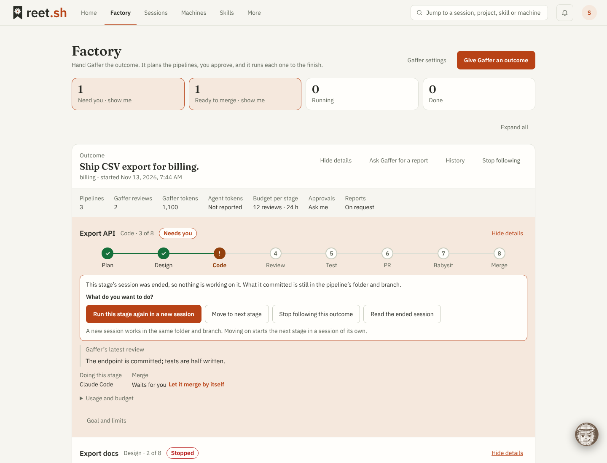
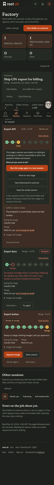

# Gaffer factory floor

9 November 2026. First slice of the user's direction to make Gaffer simpler and
more capable as a controller of an AI agent factory. It resumes from the
[6 November pause checkpoint](gaffer-resume.md). Only reet.sh changes; all
evidence is synthetic.

## Decisions the user made

Asked one at a time with a recommendation, as the checkpoint requires:

1. **Next slice: the factory floor.** One Gaffer view of every running session,
   followed or not. The alternatives offered and not chosen for this slice were
   commanding several sessions from general chat (needs a multi-session grant and
   tool contract), Gaffer launching new workers (crosses the current "no new
   worker launches" boundary) and simplifying per-session setup only.
2. **Start flow: pick several, one review.** Tick any number of running chats,
   review once, confirm once. Not chosen: one pre-filled review per session, and a
   standing consent that skips the review (it needs an account-level permission
   and weakens per-session consent).

## Contract

- **Chat options → Factory floor** is the former Followed sessions job sheet, at
  the same entry points (general chat, session chat and Home's follow-up entry).
  Goal cards, filters, evidence times and nested goal controls are unchanged.
- The floor also reads `GET /api/v2/terminal/sessions` and lists, under **Not
  followed**, each running structured chat that has no saved goal in any state.
  Plain terminals and ended chats are not offered. A session with a goal, even a
  finished one, is managed from its card, which keeps the separate "start a new
  budget" confirmation. A failed session read leaves the followed work in place
  and says so.
- Ticking, **Select all** and opening **Look after these sessions** make no write
  and no provider or worker request. The review names every chosen session, the
  default provider/model, the access that starting grants, one goal and one set of
  limits.
- **Start follow-up** runs the existing reviewed setup once per session, in
  order: read or create that session's conversation with the default provider,
  read its goal pins, then `POST …/goal/setup` with `confirmed: true`,
  `action: "start"` and those exact revisions. Grants, goals and budgets stay per
  conversation. No backend, schema, protocol, MCP or connector change.
- One session failing does not stop the others and is reported with the
  controller's reason. Nothing is retried automatically. A failed session stays
  ticked. An existing session conversation keeps its own provider and model.
- The ten-active-goal limit is counted from the goals read and stated before the
  review; the controller still enforces it at setup.
- The goal and limits last used are kept per account in this browser
  (`reet.gaffer.floorDefaults.<user>`), clamped to 1–48 reviews, 1–168 hours and
  2,000 bytes. The first starting point is the built-in "Ship the pull request"
  prompt, which ends "Do not merge."
- Unchanged boundaries: the working model does the coding, commands and PR work
  under its own approvals; Gaffer has no shell, GitHub-write or merge path, does
  not answer approval cards, enable YOLO or launch sessions.

## Code

- `web/src/lib/gafferFloor.ts`: candidates, room, blockers, result summary and
  saved defaults, with `gafferFloor.test.mjs` in `npm run test`.
- `web/src/lib/GafferFloorReview.svelte`: the combined review and per-session
  start.
- `web/src/lib/GafferFollowedSessions.svelte`: the floor (file name kept).
- `web/tests/gaffer-floor.e2e.mjs`, added to `.github/workflows/gaffer-settings.yml`.

## Validation

`npm --prefix web run check` (unit tests, zero Svelte diagnostics) and the
production build pass. `gaffer-floor` passes four theme/width views plus the two
limit cases; `gaffer-followed`, `home-followups`, `gaffer-goal`,
`gaffer-widget-ux`, `session-end-gaffer` and `stage-follow` pass against the same
build. `gaffer-offline-live.e2e.mjs` was renamed to the new dialog title but needs
the real controller harness and was not run locally; CI runs it. No Go code
changed, so the backend suites were not rerun. Final-head CI and review remain the
publication gate. No real provider, paid call, device or deployment was used.

## Usability pass (10 November 2026)

The user asked for a simpler, more usable UX. Changes, all browser-only:

- **One click to the floor.** General chat's header link under Gaffer's name is
  now **Factory floor** (it was **Follow a session**), and an empty general chat
  offers **Open the factory floor**. Chat options keeps its entry.
- **One way to choose a session.** The separate "Choose a session for Gaffer"
  picker is removed (`GafferSessionPicker.svelte` deleted). Each Not-followed row
  has **Open**, which shows that session with its Gaffer conversation and enables
  nothing, so the general-to-session path is kept on the floor.
- **Less chrome.** The counts line is gone; the filter chips carry the counts
  (shown only when above zero).
- **Home entry without a goal.** Home's Gaffer line also appears when running
  structured chats are not followed ("Gaffer: N running chats not followed"),
  after any review/following/unavailable wording. It reads no extra endpoint:
  Home already holds the sessions and goals. It is an entry, not an attention
  count; the bell, title and Needs you counts are unchanged.

`gaffer-floor.e2e.mjs` covers the header and welcome entries, the Open link, the
counted filters and the Home entry with focus return; `session-end-gaffer`
follows the floor instead of the picker; `gaffer-followed`, `home-followups`,
`gaffer-chat`, `gaffer-goal` and `gaffer-widget-ux` pass against the same build.

## Outcomes: Gaffer plans, the person approves, sessions start (10 November 2026)

The user asked for Gaffer to **own an outcome and start and manage sessions to
meet it**, and chose **plan, approve, then run** over full autonomy within a
budget, grouping only, or deferring. This deliberately crosses the earlier "no new
worker launches" line in [work-orchestration-handoff.md](../work-orchestration-handoff.md),
on the user's instruction, in the narrowest way that does it.

### Contract

- **Planning** is `POST /api/v2/gaffer/providers/{id}/plan` with
  `{revision, objective, project, sessions}` (`internal/gaffer/outcomes.go`,
  `internal/api/gaffer_settings.go`). Writer browser account only, same origin
  and rate/concurrency gates as a connection test. The provider receives the
  typed objective and project name and one tool, `propose_sessions`. No reet
  context is read, so no context grant or provider session permission is needed
  or changed. Nothing is saved: no conversation, goal, grant or session. The
  activity log records `gaffer-outcome-planned` with the provider and count.
- The reply must be exactly one complete `propose_sessions` call with 1 to the
  asked number of sessions (at most 5), unique valid titles, and prompts that pass
  the launch prompt rules (at most 8,000 bytes). Prose, another tool, extra
  fields, too many sessions, a cut-off answer or malformed JSON are refused with a
  message that offers writing the plan by hand. Model text only ever becomes
  editable titles and prompts.
- **Approval** happens in the browser (`GafferOutcome.svelte`). Until **Approve
  and start**, the plan request is the only write. On approval the browser starts
  each session with the ordinary `POST /api/v2/terminal/sessions` (structured
  chat, the chosen project and agent, the edited prompt, no YOLO, a fresh request
  ID each). Ownership, capability, project and worktree isolation checks and the
  launch audit are the existing ones; Gaffer's model chooses no machine, folder,
  agent or flag.
- **Following** reuses the reviewed per-session setup: create the session's
  conversation, wait up to about 30 seconds for the new chat's message channel,
  then `goal/setup` with `confirmed: true`. The goal text is
  `Outcome: <objective on one line>`, `This session's part: <title>`, then a fixed
  instruction ending "Do not merge." (`outcomeGoal` in `gafferOutcome.ts`).
- **Grouping** is derived, not stored: goals whose first line is `Outcome: …`
  group on the floor by that line. There is no outcome record, schema, migration
  or backup change. Editing a goal's first line moves it out of the group.
- Each failure is per session and reported: not started (launch refused), or
  started but not followed (it then sits under Not followed). Nothing is retried.
- Unchanged: Gaffer cannot merge, run commands, answer approvals, enable YOLO or
  message a session outside its own goal. The ten-active-goal limit applies.

### Validation

`internal/gaffer/outcomes_test.go` (fake OpenAI-compatible provider): the plan
from the typed objective only, no conversation or provider change after planning,
six input refusals and a stale or foreign provider all before any provider
request, and ten malformed or partial replies refused.
`internal/api/gaffer_plan_test.go`: foreign origin, signed-out and API-token
refusals, strict body, and a successful plan that saves nothing.
`web/src/lib/gafferOutcome.test.mjs` covers goal text, grouping, blockers and
summaries. `web/tests/gaffer-outcome.e2e.mjs` (in the Gaffer browser workflow)
drives the whole flow on desktop and phone: gates, the exact plan and launch
requests, no write before approval, waiting for a fresh chat, a refused launch, a
started-but-unfollowed session, grouping on the floor, a model that cannot plan
and a hand-written plan. All evidence is synthetic: no real provider, machine,
agent or paid call was used, and a real launch-then-follow has not been run.

### Limits to know before building on this

- The browser is the orchestrator for the start: closing it mid-run leaves later
  sessions unstarted. A controller-owned outcome record would fix that and is the
  natural next slice, together with cross-session awareness.
- Gaffer reviews each session against its own part; it does not see sibling
  sessions, re-plan, or add or retire sessions after approval.
- Agents that need plugin trust at launch are refused with the controller's
  reason. Model and effort are the agent's defaults.
- Outcome identity is the goal's first line, so two outcomes with the same
  objective text merge into one group.

## Controller-owned outcomes, review fixes and floor controls (10 November 2026)

After #713 and #715 merged, the user asked for all three offered follow-ups: an
independent review, controller-owned outcomes, and the smaller floor improvements.
This section supersedes the "browser orchestrates the start" parts of the outcome
contract above.

### Independent review

A fresh-context review of `5f973bf..4d68d6b` found no problem in the plan
endpoint's gates, model-text handling, HTML escaping or the no-YOLO/approval
path. It confirmed these defects in the browser-run start, all fixed here:

1. A create the machine refused (state `lost`/`ended`) was shown as started. The
   controller's launch adapter now reports it as not started.
2. A fractional limit (1.5 reviews) passed the client check, started every
   session, then failed every goal setup. Limits must now be whole numbers in the
   browser (both reviews), and the create body is strictly decoded as integers.
3. A 60-second browser timeout was reported as "Not started" with no idempotent
   retry. The controller now owns the launch and retries only under the saved
   request ID.
4. The browser accepted prompts the launch refuses (leading dash, tabs, control
   characters). Tabs and Windows line ends are normalised; the rest block approval;
   the controller validates the whole plan before anything starts; model plans are
   normalised the same way.
5. A misleading "Review Worker messages and Context sharing" reason was shown for
   a chat that was not ready. Both paths now state the real cause.
6. Closing the dialog mid-run silently abandoned later sessions. The controller
   now carries on.

### Contract

- `POST /api/v2/gaffer/outcomes` saves an approved plan: `{objective, projectId,
  tool, model, trust, sessions:[{title,prompt}], maxReviews, hours, confirmed}`.
  Writer browser account, canonical origin, and remote sessions enabled. The whole
  plan is validated first (project owned, reviewed chat tool, 1–5 unique valid
  titles, launch-valid prompts, whole-number limits, an enabled default provider);
  a refused plan saves and starts nothing. `GET /api/v2/gaffer/outcomes`,
  `GET …/{id}` and `POST …/{id}/stop {revision}` read and stop. Activity log:
  `gaffer-outcome-approved`, `gaffer-outcome-stopped`.
- Record: table `gaffer_outcomes(id, user_id, created_at, data JSON)`
  (`internal/store/store_gaffer_outcomes.go`). Outcome state `starting`, `settled`
  or `stopped`; session state `waiting`, `starting`, `following`, `unfollowed`,
  `failed`, `cancelled`. Changes are revision-checked, so the person's stop and
  the runner never overwrite each other. Thirty kept per account; three may be
  starting at once.
- Runner (`internal/gaffer/outcome_runs.go`): a supervisor beside the goal
  supervisor, under its context and joined by `Close`. It starts nothing while the
  store is fenced, the worker channel is disabled or no launch path is installed.
  Per session it re-reads the account (a person who lost write access starts
  nothing more), launches through `SessionStarter`, creates the session's
  conversation, waits up to 60 seconds for setup to be permitted, then calls the
  existing `SetupGoal` with the person's approval as its confirmation. The goal
  text is built by `OutcomeGoal` and still starts `Outcome: …`.
- Launch (`internal/api/gaffer_outcomes.go`, `outcomeStarter`): the same project
  check, worktree isolation, broker rules and audit as a browser launch, with the
  machine, folder and agent taken from the approved outcome. `Yolo` is never set.
  `Trust` is only the person's own tick. Refusals carry the launch handler's own
  words.
- Shutdown and restart: a launch in flight at shutdown is left `starting` and
  retried under the same request ID, which the broker answers with the session it
  already made. A session that was started but not yet followed is followed, not
  started again.
- Restore: `store_restore.go` marks any `starting` outcome `stopped`, so a restored
  copy starts nothing.
- The floor reads the records (`floorOutcomes`): planned sessions, what is still
  starting, and the goals of the sessions the record started. Goals that only name
  an outcome in their text (made by #715) still group by that line.
- Bulk **Pause all following** / **Stop all goals** act on the sessions shown, one
  goal at a time against a fresh read, with stop confirmed. No bulk resume: resume
  needs the person's per-session check.

### Validation

`internal/gaffer/outcome_runs_test.go`: two approved sessions started and followed
with no browser and no provider call; a refusal reported while the next carries
on; fourteen refused plans and a viewer start nothing; stop leaves the unstarted
unstarted; restart retries the in-flight launch under its own request ID; a
stopped copy starts nothing; the goal fits the limit. `internal/api/
gaffer_outcomes_test.go`: origin, signed-out, API-token, strict-body (fractional
limit, `yolo` at either level) and remote-sessions-off refusals.
`gaffer-outcome.e2e.mjs` and `gaffer-floor.e2e.mjs` cover the browser side,
including closing while it starts, stopping, trust, model, and bulk pause/stop
with a partial failure. Go race runs for `internal/gaffer`, and the Gaffer and
restore selections of `internal/api` and `internal/store`, pass locally.

Still synthetic: the launch adapter itself (`outcomeStarter`) has no test against
a real broker and machine here, so a real start-and-follow remains the first thing
to try after deploying.

## Alignment and polish pass (10 November 2026)

The user asked for the widget, the floor and the automation to be checked for
alignment and brought to a professional standard, as reet's main selling point.
An audit of every screen (desktop, phone, dark) found, and this pass fixes:

- **Cards were walls of text.** Every outcome session repeated the seven-line
  standing instruction, plus three separate evidence lines. A card now shows the
  title, state, an **Outcome** chip with the objective (or the goal clamped to
  three lines), a highlighted line when something waits on the person, the latest
  report clamped, and one budget line. The full goal and evidence times moved into
  **Review & evidence**. Nothing was removed from the record.
- **The floor was a 580 px column on a desktop.** `WorkspaceDialog` gained `wide`
  (820 px); the floor uses it. Phones are unchanged.
- **Loose structure.** The floor now has a hero action, then **Outcomes**,
  **Sessions** (filters on one scrolling row; bulk actions and Refresh in the
  heading row) and **Not followed**, each under a heading. An outcome's plan opens
  inside its own row instead of pushing the filters down.
- **The headline action was buried.** An empty general chat now leads with **Give
  Gaffer an outcome** (opens the floor with the dialog up, `startWithOutcome`) and
  keeps **Open the factory floor** beside it. Home's Gaffer line is a pill button
  with his face rather than an underlined sentence.
- **Red error before any input.** The outcome dialog showed "Write the outcome you
  want." in the error colour on opening. Missing input is now muted guidance;
  the error colour is kept for real failures. The dialog also shows its three
  steps (Outcome, Plan, Start).

Accessible names used by the suites are unchanged. `gaffer-outcome.e2e.mjs` adds
the direct widget entry, the steps, guidance styling and the compact card (the
standing instruction hidden until expanded). All Gaffer, Home and attention suites
pass against this build.

Not changed, and worth a decision: the vocabulary still mixes "look after",
"follow", "follow-up" and "goal" across the widget, floor and Home. Unifying it
touches many strings and tests, so it was left for an explicit choice of terms.

## The Factory page and staged pipelines (10 November 2026)

The user asked for the factory to be a first-class use case, a page rather than a
modal, showing work as production pipelines; for Gaffer's enablement to be a
global setting, on by default, with per-session overrides and setup guidance; and
named the typical flow: plan, design, code, review, test, PR, babysit, merge, with
the plan able to say which agent and model does which part.

### Decisions the user made

1. **Staged handoffs.** Each pipeline moves through stages, each with its own agent
   and model, and the controller starts the next stage on a hand-over. Not chosen:
   one session per pipeline with stages only displayed, or page first and engine
   later.
2. **Merge.** Auto-merge is a setting per pipeline, with a global default. (Asked
   as "who merges"; the user answered in their own words.) The global default ships
   **off**: that value is this agent's choice, not the user's stated one.
3. **Pre-approved, one click.** With the global setting on, asking Gaffer to look
   after a session starts at once with the usual goal and limits. Nothing is sent
   to the provider until the person asks. Not chosen: following every session
   automatically, or covering factory pipelines only.

### Contract

- **Stages** (`internal/gaffer/outcome_runs.go`): `StageKinds` is the fixed order
  plan, design, code, review, test, pr, babysit, merge. A planned session with
  `stages` is a pipeline; each stage carries the agent and model the person
  approved. Stages may be left out, never reordered or repeated. A session without
  stages behaves exactly as before.
- **Hand-over.** A review of a pipeline stage's goal is also offered `hand_over`
  (`worker_tools.go`). It takes a summary and nothing else. After the review is
  saved, `stageHandedOver` marks the stage done, closes that stage's goal as
  **stopped** ("handed over", never the person's "completed") and asks the
  controller to advance. An ordinary goal is never offered the tool.
- **Advance** (`advancePipeline`). The next stage keeps the session when the same
  agent and model do it, under a fresh goal and budget; otherwise the controller
  starts a new session in the first stage's working folder (`WorkDir`, the
  worktree in a git project) with the brief, the last handover and the stage's
  instruction. Later stages name no project, so they get no second worktree.
  Every launch still goes through `outcomeStarter`: no YOLO, audited.
- **Merge gate.** The merge stage starts only if the pipeline has `autoMerge` or
  `mergeApproved`. Otherwise the pipeline is `ready_to_merge` and nothing starts.
  `POST /api/v2/gaffer/outcomes/{id}/sessions/{key}/merge {revision, confirmed}`
  is the approval (writer browser, canonical origin; activity
  `gaffer-pipeline-merge-approved`). The merge goal says to merge only when every
  check passes, no review thread is open and there are no conflicts; every other
  stage's goal ends "Do not merge." The working agent merges under its own
  approvals: Gaffer still has no GitHub path.
- **Plans.** `propose_sessions` may list `stages` (kinds only). The parsed plan has
  no field for an agent, model or auto-merge, so the provider cannot set them; the
  crew and the merge tick come from the browser, from the person.
- **Profile.** `gaffer_standing` (default 1) and `gaffer_auto_merge` (default 0)
  on `user_profiles`. `gafferStanding` only changes whether the browser shows the
  review before starting; the controller enforces nothing new from it. Per-session
  override is the existing review, pause and stop on that session.
- **Page.** `/factory` (`web/src/lib/factory/Factory.svelte`), a tab after Home.
  It reads outcomes and goals every five seconds and starts nothing. The floor's
  session sections render inline there (`GafferFollowedSessions inline`); the
  dialog form remains only behind **Chat options → Factory floor**. Home's Gaffer
  line and the chat's entries are links to the page; `?outcome=1` opens the
  outcome dialog.

### Validation

`outcome_runs_test.go`: a pipeline through code (new model → new session in the
worktree, handover in the prompt), review to test (same model → same session,
fresh goal), the merge gate with stale and foreign approvals refused, merge goal
wording, done; auto-merge per outcome and overridden per pipeline; stage order and
agent validation; and a real goal review whose provider calls `hand_over`.
`gaffer_outcomes_test.go` adds the merge route's refusals. Browser:
`gaffer-factory.e2e.mjs` (tab, tiles, tracks, merge approval, setup guidance,
settings), `gaffer-outcome.e2e.mjs` (crew, stages, auto-merge, exact approved
body), `gaffer-floor.e2e.mjs` and `home-followups.e2e.mjs` moved to the page,
`navigation` and `shell-fidelity` updated for the fifth tab.

### Not done, and known limits

- **No real run.** Everything is synthetic. The hand-over depends on Gaffer's
  model judging a stage done from the worker's reports; how well that works with
  real models is untested. A model that never hands over leaves a pipeline at its
  stage until its review budget runs out.
- **The session chat is not one-click yet.** "Look after this session" inside a
  session's Gaffer chat still opens the review; only the Factory list starts at
  once. The user chose one-click for ordinary sessions, so this is owed.
- **Later-stage sessions are not tied to the project** in the session list,
  because they launch in the worktree folder without a project ID.
- A stage that fails to start leaves the pipeline stopped; there is no retry or
  re-plan, and Gaffer does not see sibling pipelines.
- Per-stage budgets are the outcome's one budget, renewed for each stage.
- No token prices: the crew is the person's choice of agent and model; reet does
  not know or compare prices.
- The floor dialog and the page list duplicate some wording; the vocabulary
  ("look after", "follow", "goal") is still mixed.

## Owed items, smarter outcomes, usage and wording (10 November 2026)

After #719 merged the user chose, one question at a time: finish what was owed,
make pipelines smarter, and show cost; **tokens only, no money**, including
remaining budgets; and unify the wording to **look after / goal / following /
needs you**. Auto-merge stays off by default.

### What changed

- **One-click in a session's chat.** With looking-after pre-approved, the
  composer's **Look after** control starts a session that has no goal at once
  with the usual goal and limits (`GafferGoal quick`). **Chat options → Look
  after this session** still opens the review.
- **Later stages listed under the project.** `LinkTerminalSessionProjectFor`
  sets a later stage's session's project when its folder is the project's folder
  or one of its `.reet/worktrees`, on the project's machine. Best effort, after
  the launch; it is not a project launch and makes no worktree.
- **Try again.** `POST …/outcomes/{id}/sessions/{key}/retry {revision}` for a
  pipeline that is failed, unfollowed or cancelled. A step that never started is
  asked for under a new request ID; a session that did start is kept and followed.
- **Usage.** At hand-over a stage keeps Gaffer's reviews and tokens for it
  (`Reviews`, `InputTokens`, `OutputTokens`, `UsageReported`). The page sums
  finished stages, the goal in hand and any report (`pipelineUsage`,
  `outcomeUsage`), shows "not reported" where a count is missing, and shows
  reviews and time left for the stage in hand. No prices and no spend budget.
  **Agent tokens are not known to reet at all**; only Gaffer's.
- **Report across an outcome.** `POST …/outcomes/{id}/review {revision}`
  (`ReviewOutcome`): one request to the outcome's own provider, refused unless
  that provider is enabled and still allowed session text. The evidence is the
  objective, each pipeline's state, handovers and Gaffer's saved reviews, capped
  at 16 KiB; no session is read. Tool `report_outcome{summary, proposals}`;
  proposals have a title, brief, reason and stage kinds only, at most three, and
  one that repeats an existing pipeline is dropped. The report is saved on the
  outcome.
- **Adding pipelines.** `POST …/outcomes/{id}/sessions {revision, confirmed,
  sessions}` (`AddPipelines`): 1 to 5 at a time, ten per outcome, same validation
  as a new outcome. Added pipelines take the outcome's agent where a stage names
  none and never auto-merge. Approving clears the report's proposals.
- **Wording.** State and filter "Needs review" → "Needs you"; "Not followed" →
  "Not looked after"; "Start follow-up" → "Start looking after"; "Pause/Resume
  follow-up" → "Pause/Resume goal"; Home's line reads "Gaffer: N goal(s) need(s)
  you". Internal names (`followups`, file names) are unchanged.

### Validation

Go: retry (new request, stale and non-stopped refused), added pipelines
(unapproved, repeated title and over-limit refused; outcome's agent inherited),
the review (evidence content, saved report, dropped duplicate proposal, nothing
started, refused with session text revoked and no request sent), stage usage at
hand-over, the project link, and the three routes' refusals. Browser:
`gaffer-factory.e2e.mjs` covers usage figures, Try again, the report, proposals
and approval; `gaffer-goal.e2e.mjs` the one-click start; every suite carrying the
old wording was updated. All evidence is synthetic.

### Still not done

- No real run; the hand-over and the report both depend on model judgement.
- Gaffer does not review an outcome on its own schedule: the report is on request.
- Added pipelines cannot choose a different crew in the approval dialog.
- No agent-token figures and no prices, by the user's choice of tokens only.

## A stuck pipeline, YOLO, real models and the Home marker (10 November 2026, after #720)

The owner ran a real outcome on dev.reet.sh and reported four things.

### The pipeline stopped after its first stage (bug)

Evidence from the instance's audit log: the plan session asked for approvals and
was switched to YOLO by hand; the goal showed Needs you with zero reviews. Cause:
`reviewGoal` found `Controls.Waiting`, set the goal to `needs_user`, and nothing
ever looked at it again, so answering the approval did not resume it. With
ordinary approvals almost every pipeline would hit this.

Fix: such a goal is **held**. `GafferGoal.WaitingOnWorker` is set with
`needs_user` (`HoldGafferGoalForWorker`); `DueGafferGoals` also returns held
goals; `reviewHeldGoal` probes the worker without any model request and, once it
is no longer waiting, `ReleaseGafferGoalHold` makes the goal active again within
the ten-active limit, **without moving `LastSeq`**, so the finished work is
reviewed. An expired goal or an ended session ends the hold
(`EndGafferGoalHold`); a pause, stop or resume by the person clears it. Access is
checked by the normal review after the release. The goal's revision does not
change. Also: resuming a **pipeline stage** goal by hand sets `LastSeq` one
behind the worker's progress so Gaffer reviews what is there (ordinary goals
still wait for new progress), and the Factory page now shows the goal's own note
when a pipeline needs you.

The owner's already-stuck pipeline predates the flag: after updating, use
**Review goal → Resume goal** on it.

### YOLO for an outcome (the owner's decision; reverses "never YOLO")

`OutcomeInput.Yolo` → `GafferOutcome.Yolo` → `OutcomeLaunch.Yolo` →
`terminalproto.Create.Yolo`. It is a field of the outcome only: a session or
stage carrying `yolo` is still an unknown field, and neither the plan tool nor
the report tool can set it. The create route refuses it without the account
setting; the broker checks the account, the agent and the machine at every
start and audits each. Added pipelines inherit it. The dialog offers it on the
plan step behind the existing `YoloDialog` with three gates (account, machine,
every crew agent). **Gaffer's instructions to a YOLO agent are acted on without
an approval**; the dialog and the guide say so. Gaffer still has no shell, GitHub
or merge path and never answers approvals.

### Real models, and the Home marker

`GafferModelSelect.svelte`: favourites, the machine's own list
(`GET /api/v2/machines/{id}/models`), reet's suggestions and Other…, for the main
agent and each crew role. The main model applies to roles on the main agent until
a role is given its own. `factoryMembers`/`factoryBadge` in `gafferOutcome.ts`
mark a pipeline's sessions on Home's Continue working rows and planning-board
cards ("Factory · Plan 1 of 8", linking to `/factory`); a failed outcomes read
only omits the marker.

### Validation

Go: a held goal stays held while the worker waits, makes no model request,
resumes and is reviewed once the wait ends, and a pause ends the hold; YOLO off
by default and present on every stage launch when chosen; the route refuses YOLO
without the account setting. Browser: `gaffer-outcome.e2e.mjs` (model lists,
Other…, the YOLO confirmation and what is sent), `gaffer-factory.e2e.mjs`
(Approvals fact), `home-followups.e2e.mjs` (the marker), plus the unit test for
membership. Synthetic only; the hold was not re-run against the owner's
instance.

### A report is no longer lost when a pipeline moves

CI kept failing `TestOutcomeReviewReportsAcrossPipelinesAndOnlyProposes` with
"That outcome changed". The cause was in the product: `ReviewOutcome` refused an
older revision and saved the report against the revision it started from, so any
supervisor step during the model request (tens of seconds on a real provider)
threw the report away after its tokens were spent. A report changes nothing the
person decides on, so it is no longer revision-gated: it reads the record as it
is and is saved onto the record as it stands, retrying on a concurrent step.
Adding pipelines, retry, stop and merge approval stay revision-checked.

### Not done

- The Sessions page carries the marker too (added in the same PR): its list rows and the
  session header, from the same `factoryMembers` read in `TerminalWorkspace`.
- A Gaffer chat in a pipeline's session is now told about the pipeline (added in
  the same PR): `ContextSnapshot.Pipeline` (`contextPipeline`) carries the stage
  in hand, every stage's state and agent, the merge decision, the stage goal's
  state and a fixed sentence on how a pipeline moves on. Stage names and states
  go with status sharing; the outcome's words, the pipeline title and the
  handover notes only with text sharing, clipped and credential-scrubbed like the
  rest of the snapshot. It is evidence only: the chat still has no tools and
  cannot move a pipeline. The system prompt tells it not to suggest a new goal
  for a session whose pipeline already has one.
- Effort per crew role was added in the same PR at the owner's request:
  `OutcomeStageInput.Effort` → `GafferOutcomeStage.Effort` → `OutcomeLaunch.Effort`
  → `terminalproto.Create.Effort`, validated with `ValidEffort` and
  `ToolTakesEffort`; a stage keeps the previous stage's session only when agent,
  model **and effort** match. The dialog offers it for the main agent and each
  role, from the web catalogue's effort flag, so OpenCode (no launch effort in
  `agentOptions`) shows none even though its live chat has an effort control.

## Added pipelines choose their own agent, model and effort (10 November 2026, after #722)

Asked for by the owner. `factory/AddPipelines.svelte` replaces the plain
confirmation: each ticked proposal has an Agent, Model (`GafferModelSelect`) and
Effort, starting from the outcome's. Left unchanged, a pipeline's stages are sent
as `{kind}` and the controller fills in the outcome's agent and model as before;
changed, every stage carries `tool`, `model` and `effort`. No controller change
was needed: `AddPipelines` already validates stages like a new outcome's
(`outcomePieces`), and a YOLO outcome still refuses an agent without a YOLO
option. One agent runs the whole added pipeline; per-role crews are not offered
here. An outcome approved without folder trust shows a warning when OpenCode or
Antigravity is picked, because their launch is refused in a folder with plugins.
Tests: `TestAnAddedPipelineCanRunOnItsOwnAgentModelAndEffort`, and
`gaffer-factory.e2e.mjs` (agent list, model, effort, what is sent).

## Four follow-ups (10 November 2026, after #726)

The owner asked for all four of the remaining items.

1. **Adding pipelines is not refused when the record moved.** `AddPipelines`
   applies the approval to the outcome as it stands (`addPipelinesOnce`, retried
   on `ErrGafferOutcomeBusy`); the limit, titles and YOLO rule are checked
   against that record. Its `revision` is no longer compared. Retry, stop and
   merge approval stay revision-checked.
2. **Effort is the agent's own level, for every chat agent.** Every outcome
   session is a structured chat, whose effort is one of the thinking levels the
   machine reports for that agent (`launchEfforts(tool, caps, true)`), not reet's
   low/medium/high terminal presets. The dialogs now offer those, so OpenCode
   gets an effort wherever its machine reports levels, and the controller
   accepts any effort that is a valid name (`ValidModel`) instead of
   `ValidEffort` + `ToolTakesEffort`. The agent confirms the level for the model
   before any prompt is sent; a level it does not confirm fails the launch with
   the agent's own message. **This corrects the effort shipped in #722**, which
   offered the terminal presets for chats.
3. **Gaffer reports by itself.** `GafferOutcome.AutoReport` (the person's choice
   at approval, on by default in the dialog) has the outcome supervisor ask for
   a report when the set of pipelines that are done, ready to merge, not started
   or unfollowed changes (`autoReportEvent`). It is bounded: one report per
   event (`AutoReportedFor`, recorded before the request), at most six per
   outcome, not within ten minutes of the last report, never for a stopped
   outcome. It is the same request as a report on demand, to the outcome's own
   provider under the same gates, marked `report.auto`; it starts nothing, and
   proposals arrive unticked.
4. **A crew for an added pipeline.** `AddPipelines.svelte` gives each pipeline
   an agent, model and effort and, under "Choose who does what", one per role;
   it sends `stagePlan` for anything changed.

Tests: `TestGafferReportsByItselfOncePerPipelineEventWhenAsked`, the added
pipeline test (now with a stale revision), the effort tests, and the two Factory
browser suites. Synthetic only.

## The person runs the line (10 November 2026, after #727)

The owner pasted a real session where a pipeline could not be moved past its
plan stage. What that transcript showed, and what changed:

1. **The plan stage did the whole job.** `stagePrompt` gave the first stage the
   whole brief ("Work in two phases… raise a pull request") and named its stage
   in a last line, so the agent coded, raised a PR and ran checks during *plan*.
   Every stage now opens with its stage and that stage's work, gives the whole
   brief as context only, says what the stage must leave behind
   (`stageDeliverable`), names the later stages as done separately, and ends
   with the stop.
2. **Gaffer treated the merge setting as a conflict in every review.** The
   stage goal said "Do not merge." beside a pipeline set to merge by itself. A
   stage goal now says "Nothing is merged in this stage.", and the stage review
   is told the setting applies only at the merge stage.
3. **Reviews looped.** Three reviews asked for the plan or asked the person a
   scope question. The stage review is now told: work done early is not by
   itself a reason to stop; ask the agent once for the deliverable; hand over
   when it is there and say what was done early; do not ask twice in a row,
   ask the person once instead.
4. **"Continue to next stage" could not be done.** The person's own chat had no
   tools, so Gaffer explained the plumbing and contradicted its own reviews
   ("sent" / "I can't send"). Now:
   - **Move to next stage** on the Factory pipeline card:
     `POST …/outcomes/{id}/sessions/{key}/advance {confirmed}` →
     `MovePipelineOn`. The person's decision, with no model judgement: the
     stage's goal is closed whatever state it is in (not while a review is
     running), the stage is marked done with "The person moved this pipeline
     on…" plus Gaffer's last review as the handover, and the controller starts
     the next stage as after any hand-over.
   - **Gaffer's chat in a pipeline session can act** (`chatJob.pipelineChat`):
     it is given `move_on` (the same move, on the person's current message) and,
     where the session's messaging grant is on, `message_worker` without the
     per-request switch. The result of the tool is what the reply reports.
     Model text still cannot trigger either: only the person's turn has them.
   - **Merge setting per pipeline**:
     `POST …/sessions/{key}/automerge {on}` → `SetPipelineAutoMerge`, a switch
     on the card.

Boundaries unchanged: Gaffer has no shell, GitHub or merge path and never
answers approvals; `move_on` and the button only move a stage on.

Tests: the first-stage instruction, move-on from a stuck goal, the merge
setting, a chat turn that moves the pipeline on and is offered both tools, and
the Factory browser suite for the button and the switch. **None of the prompt
changes can be proven without a real model and agent.**

## The Factory over MCP (10 November 2026, with #731)

Asked for by the owner: the reet MCP must be able to read Factory data and
control it. Eight tools, defined in `mcp/src/server.ts` (the stdio package,
which forwards to the hosted server) and exported to
`internal/api/mcp_tools.json`; handled in `internal/api/gaffer_factory_mcp.go`.

- Reads (`reet_list_factory`, `reet_get_factory_outcome`): any connection on a
  writer account; hidden from and refused for a viewer. Handover notes and the
  report's text are session-derived, so they are returned only to a management
  (write-scope) connection.
- Controls (move on, retry, merge setting, approve merge, stop, report):
  management scope on a writer account. Move on, approve merge, stop and
  switching a merge to by-itself need `confirm: true`. Revision-checked calls
  are applied to the record as it stands and retried if a pipeline stepped in
  between. Each is audited as `mcp-factory-control`.
- **Not offered:** creating an outcome or approving a plan, adding pipelines,
  answering approvals. Starting agents on a machine stays a browser action.
- **Judgement call to revisit:** approving a merge and switching a pipeline to
  merge by itself are now possible for a management MCP client with
  `confirm: true`. The agent still merges only on green checks, but this is the
  first path where something other than the person in the browser can give that
  approval.

Counts: 43 definitions; a read-only writer connection sees 15, a viewer 11.

## Tell the agent, send back, and start over MCP (11 November 2026, after #731)

The owner asked for all three.

- **Tell the agent.** `POST …/sessions/{key}/tell {requestId, text}` →
  `TellPipelineAgent`: the person's text, unchanged, queued through
  `WorkerMessage` for the pipeline's working session under the grant given at
  approval. A button and dialog on the pipeline card.
- **Send back.** `POST …/sessions/{key}/back {stage, reason, confirmed}` →
  `SendPipelineBack`. The stage in hand or an earlier one; allowed from
  following, ready to merge, done and unfollowed. The current goal is stopped
  (not during a review). The target stage and every later one are reset to
  pending under **new request IDs**, so each gets a session of its own rather
  than the old launch being answered again; the piece's session and
  conversation are cleared so the same-agent shortcut cannot reuse the wrong
  session; merge approval is cleared. `GafferOutcomeStage.SentBack` carries the
  reason into `stagePrompt`. A stage is now always launched in the pipeline's
  work folder once it has one (was: only for stages after the first), so
  sending back to the first stage does not make a second worktree.
- **MCP.** Five more tools (48 in all; a read-only writer connection sees 16):
  `reet_list_factory_projects` (read), `reet_start_outcome`,
  `reet_add_pipelines`, `reet_tell_pipeline_agent`, `reet_send_pipeline_back`.
  Starting, adding and sending back need `confirm: true`. An outcome started
  over MCP cannot ask for YOLO, folder trust, a crew, a model or a merge by
  itself: one agent, ordinary approvals, 12 reviews over 24 hours.
  **This reverses the earlier line that starting agents stays a browser
  action**, at the owner's request.

Tests: sending back (refusals, a new request and session in the same folder,
the reason in the prompt, later stages reset, goals), the MCP scope and
confirmation rules for the new tools, the tool contract in the stdio package,
and the Factory browser suite for both dialogs. Synthetic only.

## Three defaults decided (11 November 2026)

Asked one at a time; the owner chose:

- **MCP and merges: approve only.** `reet_approve_pipeline_merge` stays (one
  pipeline that is Ready to merge, `confirm: true`). `reet_set_pipeline_merge`
  can only make a pipeline wait; "by_itself" is refused and is no longer in its
  schema. Letting a pipeline merge by itself is set on the Factory page only.
- **Automatic reports: off by default.** The dialog's box starts unticked.
- **Auto-merge: stays off by default.**

## Agent tokens and context left (11 November 2026)

Asked for by the owner, who chose **context left** as the meaning of "remaining
usage" (not a token budget, not plan quota).

Path, end to end:

- **Agent → machine** (`internal/acpagent`): `usage.go` reads two optional ACP
  signals. `turnUsage` reads `usage` on a `session/prompt` result
  (`inputTokens`, `outputTokens`, `cachedReadTokens`, `cachedWriteTokens`, and
  their snake_case forms); `contextUsage` reads a `usage_update` session update
  (`used`, `size`). Each becomes an `Event{Kind: "usage"}`. Zero, negative,
  oversized or malformed figures report nothing.
- **Machine → controller**: new feature `acp-usage-v1`
  (`terminalproto/acp_usage.go`), advertised by the controller. The machine
  sends a usage event only on a link that has it, because an older controller
  refuses an unknown event kind; it is sent directly, never queued or replayed,
  and never for a quiet chat. `ACPEvent.Usage` is valid only on kind `usage`,
  which may carry nothing else (no text).
- **Controller**: the broker keeps it beside the session, not in the
  conversation: table `terminal_session_usage` (tokens added up, the last
  context report kept), only for a session the account owns.
- **Factory**: a stage's figures are the session's total less what earlier
  done stages in the same session already account for (`stageAgentUsage`),
  kept on the stage at hand-over and read live for the stage in hand
  (`withAgentUsage`). The page shows Agent tokens per pipeline and per outcome
  (split by agent) and Context left for the stage in hand. The MCP outcome read
  carries `agent_tokens`, `agent_cached_tokens`, `context_used`, `context_size`.

**What is not known.** I could not check which agents send either signal, or
that they use exactly these field names: the parsing follows the ACP usage
fields as I understand them and was tested with synthetic frames only. An agent
that sends neither shows "Not reported". Sending a stage back resets that
stage's kept figures. No prices; no plan or rate-limit quota. Machines need
updating as well as the controller.

Tests: parsing (`acpagent/usage_test.go`), event validity
(`terminalproto/acp_test.go`), the store, stage attribution across a shared
session, the unit helpers and the Factory browser suite.

## Removing a goal whose session is gone (11 November 2026)

Reported by the owner with a screenshot: an old goal for an archived session
sat under Other sessions as "Needs you" and could not be cleared. Its card's
only action, **Conversation history**, was passed an empty handler by the
Factory page (`onhistory={() => {}}`), so it did nothing. The card now has
**Remove**, which, after a confirmation, deletes Gaffer's saved conversation for
that session (`DELETE /api/v2/gaffer/conversations/{id}`); the goal goes with
it by the table's cascade. The floor's own dialog keeps Conversation history
beside it; the Factory page shows Remove only. The controller's reason text
now says "use Remove". Covered in `gaffer-followed.e2e.mjs` for both places.

## Gaffer's own actions in the activity log, and YOLO approvals rolled up (11 November 2026, after #733)

Asked for by the owner after reading the live instance's audit log through
MCP: nothing recorded why a pipeline moved or stopped unless the person pressed
a button, and every YOLO approval wrote its own row (about 340 rows in 29
minutes from two sessions).

### What the live read showed (dev.reet.sh, read only)

- Three outcomes, one pipeline each, all on PROD_Snicket with OpenCode. The
  first (`358303b0…`, ordinary approvals) was moved on by the person at plan,
  design and code; the agent had been idle for hours with three questions
  open, and Gaffer's reviews kept asking for the plan rather than handing
  over. The two later ones (YOLO, after the stage-instruction rewrite) were
  handed over by Gaffer itself: plan and design inside four minutes, code in
  under half an hour.
- **A move made from the chat was not audited.** Three stages were moved on by
  the person, two `gaffer-pipeline-moved-on` rows existed: the route records
  the button, `move_on` in the chat recorded nothing. Fixed here.
- No stage carried `agent_tokens`, `context_used` or `context_size`.

### Contract

- **Hook.** `gaffer.AuditFunc` and `Service.SetAudit` (`internal/gaffer/audit.go`),
  held in an `atomic.Pointer` so it is safe to call with or without the
  service lock. The API installs `s.event(uid, "gaffer", action, "", detail)`.
  The gaffer package still has no dependency on the API. It only records; it
  gives Gaffer no new ability.
- **Events**, all source `gaffer`:
  - `gaffer-stage-handed-over {outcome, pipeline, stage, by, session, reviews,
    reason}` from `stageHandedOver`, which now takes `by`: `gaffer` (a review
    called `hand_over`), `person` (`MovePipelineOn`: the button and MCP) or
    `chat` (`move_on` in the session's chat). The route's own
    `gaffer-pipeline-moved-on` (source `ui`/`mcp`) is unchanged, so a button
    press writes both.
  - `gaffer-stage-started`, `gaffer-pipeline-waiting-merge`,
    `gaffer-pipeline-done`, `gaffer-pipeline-stopped` `{outcome, pipeline,
    stage, state, reason, session}` from `auditPipeline`, called wherever
    `advancePipeline` and `runOutcomeSession` leave a pipeline `following`,
    `ready_to_merge`, `done`, `unfollowed` or `failed`. `starting` and
    `advancing` are not recorded. `reason` is the pipeline's note.
  - `gaffer-goal-needs-you`, `gaffer-goal-limit` `{conversation, session, goal,
    reason}` plus `{outcome, pipeline, stage}` when the goal is a pipeline
    stage's (`pipelineOf`): from `reviewGoal`'s `observe`, from the end of a
    hold, and after a review turn when `FinishGafferGoal` leaves the goal in
    either state. `gaffer-goal-held` once when a hold begins (not at the
    15-second rechecks) and `gaffer-goal-released` when it ends by itself.
  - Every event is written only after the store accepted the change.
- **Reasons are the controller's own words.** Handover summaries and review
  text are session-derived and are returned over MCP only to a management
  connection; `reet_list_events` is open to a read connection, so none of that
  text goes into an event. A test asserts it.
- **YOLO roll-up** (`internal/terminalbroker/yolo_audit.go`). `publishChat`
  calls `auditYoloAllow`; the first approval of a turn inserts the
  `yolo-allow` row (`AddEventIDFor`) and each later one updates its detail
  (`UpdateEventDetailFor`): `{machine, tool, session, count, permission,
  lastPermission, from, to}`. Nothing is buffered, so a crash loses no
  approval. The row closes on the chat's next `user` event or `idle` status,
  after ten minutes (`yoloRollupWindow`), or when the chat closes. If the
  update fails the approval is written as a row of its own. Rows written
  before this have no `count` and read as one.
- **MCP.** `reet_list_events` `source` accepts `gaffer` and `machine`
  (the controller already filtered on any source). No new tool: 48 definitions.
- **Browser.** `events.ts` has sentences for all of the above and for
  `gaffer-pipeline-moved-on`, which fell through to "… a skill"; they file
  under Agents.

### Validation

`internal/gaffer/audit_test.go`: a pipeline's whole history in order through a
Gaffer hand-over, a person's move and the merge wait, with outcome, pipeline
and reason on every row and no handover text; a stage that cannot start; a hold
recorded once across three looks, its release, and a needs-you with its reason,
with no model request. The chat move-on test asserts `by: chat`.
`internal/terminalbroker/yolo_audit_test.go`: seven approvals across two YOLO
chats, a refusal and a non-YOLO chat become four rows whose counts add to
seven; a new turn and the window each start a row; a closed chat keeps nothing.
`events.test.mjs` covers the sentences. Synthetic only.

### Limits

- **Not run against a real agent or the owner's instance.** Whether OpenCode's
  chat emits `idle` between turns as the fake does decides whether rows are
  per turn or per ten minutes; either way the count is right.
- A goal left needing the person by `FinishGafferGoal` is covered by code but
  has no test of its own.
- The controller's reason says a stage was handed over, not why Gaffer judged
  it done. That judgement is the handover note on the stage.
- Roll-up state is in memory: after a controller restart the next approval
  starts a new row even mid-turn.
- `scan` still writes two rows a minute; not touched.

## Goals that cannot move say so (11 November 2026, with #734)

The owner chose this as the next improvement from the live read: pipeline
`358303b0…` showed an `active` goal for hours while the agent sat idle on three
questions, then "Waiting for the existing instruction's delivery" for a queued
instruction that never arrived. `reviewGoal` rechecked both every 10 to 15
seconds with no limit.

- **Undelivered instruction** (`instructionDeliveryWait`, 10 minutes from the
  receipt's `CreatedAt`). Past it, the worker is probed: waiting on the person
  → the ordinary hold; working, configuring or compacting → keep waiting; idle
  → `needs_user` "…without reaching the working model, which is not busy";
  probe failed → `needs_user` "…the working session could not be reached".
  Not applied while the controller's worker channel is off. The queued
  instruction is left alone; a resume clears the goal's pending receipt as it
  always did.
- **Idle worker** (`idleWorkerWait`, 30 minutes). Only where there is no
  unreviewed progress, Gaffer has reviewed at least once, and 30 minutes have
  passed since the later of `LastReviewedAt` and the new `ResumedAt`
  (`GafferGoal`, set by a resume; JSON field, no migration). The worker is
  probed: waiting → hold; busy or unreachable → keep waiting; idle →
  `needs_user` "The working model has been idle for N minutes since Gaffer
  last looked, and nothing is queued for it…".
- No model request is made by either. Both write `gaffer-goal-needs-you`.
- The two waits are package variables so tests can shorten them; there is no
  setting. **The values are this agent's choice, not the owner's.**

Tests (`goal_stuck_test.go`): within the wait and with a busy worker the goal
stays active; an idle worker with a queued instruction, and an idle worker
after a delivered one, each go to Needs you with the note and the audit row
and no further review; a resume restarts the idle clock. Synthetic only: what
a real OpenCode chat reports as busy or idle between turns is not verified, and
a long silent turn that the agent does not report as working would be called
idle.

## Deliverable in view, card clarity, YOLO merge guard, quieter log (11 November 2026, after #734)

The owner asked what needed improving after a second live read and chose all
four groups offered. One PR, a commit each.

- **Latest reply at length.** `ContextSnapshot.LatestReply` (`latestReply`,
  `store.ContextLatestReplyFor`): every `agent` event after the last `user`
  event, joined, scrubbed by `contextText`, capped at `MaxLatestReplyBytes`
  (9 KiB; the end is kept and `startOmitted` set). Needs history and text
  sharing. History events are unchanged (2 KiB each), and the snapshot still
  fits `MaxContextBytes` because older events are dropped first. The stage
  review's instruction points at it. **Reason:** on the live instance Gaffer
  could not see a plan's body and never handed over. Also returned by
  `reet_get_context` under the same grant.
- **Who closed a stage.** `GafferOutcomeStage.ClosedBy` from
  `stageHandedOver`'s `by`; a send-back resets the stage and so clears it.
- **Agent activity.** `AgentState`/`AgentActiveAt` on the stage in hand, read
  live in `withAgentUsage` from the session row (`ChatStatus`, `ActivityAt`);
  never saved.
- **Failed review.** `FinishGafferGoal` sets `GafferGoal.ReviewFailed` and
  puts the turn's error (300 bytes) in the note; any control action clears the
  flag. The page's button reads the goal view and resumes it.
- **History.** `GET /api/v2/gaffer/outcomes/{id}/history` →
  `store.OutcomeEventsFor`: the account's `gaffer-%` events whose detail names
  the outcome, newest 200. Same access as the outcome read.
- **YOLO merge guard.** `GafferOutcomeSession.YoloMergeOK`; `MergesByItself`
  is `AutoMerge && (!Yolo || YoloMergeOK)` and gates the merge stage, the MCP
  `merge` value and the chat's pipeline context. `SetPipelineAutoMerge` takes
  `yoloOK` and refuses to turn it on for a YOLO outcome without it; the route
  takes `yoloConfirmed`. MCP still cannot turn it on at all. **Existing YOLO
  pipelines set to merge by themselves now stop at Ready to merge** (the owner
  had left one running that way before choosing this guard).
- **Scan rows.** `AddEventUnlessRepeatedFor`: an unchanged scan (nothing
  created or pruned, no error) is skipped when the same detail was recorded
  in the last six hours.
- **Events read.** `EventQuery.Exclude`, `?exclude=a,b`, MCP `exclude`.
- **Builds.** `reet_list_factory` adds `controller{version,commit}` and
  `machines[{id,name,version,commit,last_seen}]`; an outcome carries
  `machine_id`.

Tests: `context_test.go` (latest reply: span, scrubbing, text grant, bound),
`audit_test.go` (closed-by, the YOLO merge guard), `goal_stuck_test.go` (a
failed review's note and retry), the store tests for outcome events, repeated
events and exclusion, `gafferOutcome.test.mjs`, and `gaffer-factory.e2e.mjs`
(stage marks, time in stage, agent line, history). Not covered in a browser:
the YOLO confirmation dialog and Try the review again. Synthetic only.

**Decided by the owner for the next slice:** Gaffer is to be given every reet
MCP tool, controllable in Gaffer settings with a per-tool selection. That
removes the "only the person approves a merge or starts an outcome" boundary
wherever the person switches those tools on. Not built yet.

## Gaffer uses reet's own tools, per tool (11 November 2026, after #736)

**The owner's decision, reversing earlier lines:** Gaffer is given every reet
MCP tool, "controllable in the Gaffer settings, including granular MCP tool
selection", with three states per tool (Off / Ask me / Allow), chosen over
plain switches. Where the person sets a tool to Allow, Gaffer can now start an
outcome or approve a merge on their word in a chat. "Only the person in the
browser approves a merge" therefore holds only while that tool is Off or Ask
me. Unchanged: no shell, no GitHub path, never answers an approval card, and
only the person marks work complete.

### Contract

- **Choice.** Table `gaffer_tool_modes(user_id, tool, mode)`; a tool not
  listed is off. `GET/PUT /api/v2/gaffer/tools` (writer browser account,
  canonical origin; `PUT` replaces the whole choice and refuses unknown tools
  and modes). Activity: `gaffer-tools-changed {ask, allow, allowed[]}`.
- **Host.** `gaffer.ToolHost` (`internal/gaffer/host_tools.go`), installed by
  the API as `gafferToolHost` (`internal/api/gaffer_tools.go`). Tools are the
  embedded MCP definitions; a call applies schema defaults, validates, and
  runs `executeMCP` in-process as the account with a synthetic connection
  `{Name:"Gaffer", Scope:"write", Kind:"gaffer"}`. So every rule a management
  MCP client is under applies (fence, viewer, Factory confirmations, no YOLO
  or merge-by-itself from a tool). Not offered: the worker and context tools,
  which need a per-connection grant.
- **When.** Only the person's own chat turn (`chatJob.goalID == ""`), in any
  conversation. Goal reviews get none. `hostTools` downgrades every
  non-read-only tool to `ask` when the conversation belongs to a session,
  because that turn's context contains the working model's text.
- **Loop.** In `answerRounds` a call to a host tool is handled before the
  worker-tool rules and does not use up the single worker-instruction round.
  One call per model round, at most six per turn (`maxHostToolRounds`). Allow:
  run, feed the result back (12 KiB), keep it on the turn (6 KiB). Ask: record
  it `pending`, tell the model it was not run, offer no more tools.
- **Record.** `GafferTurn.Tools` (`gaffer_turns.tools_json`): id, name, exact
  canonical args, mode, state (`ran`, `failed`, `pending`, `approved`,
  `declined`), result. Later turns' history carries a short summary of them.
- **Approval.** `POST …/conversations/{id}/turns/{turnId}/tools/{toolId}
  {approve}` → `AnswerTool`. The call is taken from `pending` to `approved` in
  one transaction before it runs, so two approvals cannot run it twice; the
  saved args are what runs; the tool must still be switched on. There is no
  expiry on a pending call.
- **Audit.** `gaffer-tool-call {tool, mode, ok}`, `gaffer-tool-proposed`,
  `gaffer-tool-declined`, source `gaffer`; the tool's own events carry source
  `mcp` and client "Gaffer".

### Validation

`host_tools_test.go` (fake host and provider): an allowed tool runs with the
model's exact args, the result reaches the model, off tools are not offered,
history carries it; an asking tool is not run, approve runs the saved call
once, a second approval, an unknown id and a tool since switched off are
refused, decline runs nothing; a failed tool is reported and a turn stops at
six; the session-chat downgrade and no tools for a goal review.
`gaffer_tools_test.go` (real API): refusals, all tools start off, the groups,
strict save, a Factory read and a shelf write actually run as the account, a
tool left out of a new choice stops running, schema checked.
`gaffer-tools.e2e.mjs` (added to the Gaffer browser workflow): the settings
choice and the approve and decline card, desktop light and phone dark.
Synthetic only: no real provider has driven these tools.

### Limits

- A model can be talked into a call by text it reads. In general chat the
  only untrusted text is tool results; that is why session chats force Ask for
  changes and why the guidance tells the model results are data. It is a
  mitigation, not a guarantee: Allow on a destructive tool is the person
  accepting that risk.
- After an approval the model is not asked again; the result shows in the
  chat and is in the next turn's history.
- Six tools per turn, one per model round, no parallel calls.
- No per-conversation or per-project override: the choice is per account.

## What a stuck card asks of you, and three controller fixes (11 November 2026, after #737)

The owner sent a live card: raw markdown in Gaffer's review, "Needs you" with
no way to tell what to do, an agent idle at the PR stage, and asked for simple
clickable options, a better Factory page, and Factory context on Home with a
link to the item.

- **Bug: a same-session stage was never told its work.** `advancePipeline`
  started the next stage's goal in the same session and left the stage's
  instruction to Gaffer's first review. On the live pipeline that review wrote
  prose, so the agent sat idle at PR with "No worker instruction was queued".
  The controller now sends `stagePrompt` itself through `WorkerMessage` (no
  turn) and says in the pipeline's note if that failed. The stage review is
  told not to resend it.
- **Bug: Tell the agent… never worked.** `AdmitWorkerMessageFor` required every
  `gaffer` message to belong to a running turn (`ID == TurnID`), so
  `TellPipelineAgent` (turn "") always got `ErrGafferConflict`, shown as "this
  Gaffer provider changed". A message with no turn is now accepted as the
  person's or the controller's, under the session's grant. It had no Go test;
  it has one now.
- **No-step reviews.** A goal review that answers in prose with no tool sets
  `GoalNeedsUser`, which read "Gaffer needs your decision". `chatJob.noStep` →
  `MarkGafferGoalNoStep` → `GafferGoal.NoStep` and `goalNoStepNote`.
- **Card.** `needsYou(goal, reason, last)` in `gafferOutcome.ts` gives one
  sentence and the choices (`answer`, `retry`, `again`, `tell`, `move`,
  `budget`, `open`); `Factory.svelte` draws them in a `decide` region with
  the review inside it, rendered by `GafferProse` and clamped. "Have Gaffer
  look again" resumes the goal. Usage and budget facts sit in a closed
  `
`. Tiles that want the person jump to the first such card. Each
  card has the id `pipelineAnchor(outcome, key)`; a `#pipeline-…` hash brings
  it into view.
- **Home.** `factoryRows` and `home/FactoryStatus.svelte`: a "Factory
  pipelines" section, needs-you first, each line a link to
  `/factory#pipeline-<outcome>-<key>`. It reuses the outcomes and goals Home
  already reads.

Tests: `audit_test.go` (the stage instruction queued by the controller; the
person's instruction queued), `goal_stuck_test.go` (no-step note, cleared by
resume), `gafferOutcome.test.mjs` (rows and choices),
`gaffer-factory.e2e.mjs` (tile jump, the decide region and its buttons),
`home-followups.e2e.mjs` (the Home line and its link). Synthetic only.

**Asked what bothered them most about the Factory page, the owner chose "too
much on each card"**, and then asked for professional polish: animation and
better status colours (a pulsing green circle for running, a green tick for
complete). In the same PR:

- **Compact rows.** `shown(id, tone)`: a pipeline's card body is rendered only
  when open. Default open for tone `you` or `bad` and for a card reached by a
  `#pipeline-…` link; the person's per-card toggle (`folds`) wins, then
  **Expand/Collapse all pipelines** (`allOpen`). The head always shows the
  title, "Stage · n of m", the badge and the toggle; a closed row adds one or
  two lines of why. State is per page visit, not saved.
- **Colours and motion.** Done stages and their rail use `--good` with a
  tick; the running stage has a `--good` ring with a pulsing halo
  (`factory-pulse`); a stage whose pipeline needs the person is drawn as
  waiting (`--warn`, "!") rather than running; failed stays `--bad`. The
  Running badge is green with a blinking dot and Done is green with a tick,
  on the Factory page and in Home's list. `prefers-reduced-motion` stops both
  animations. Needs you keeps the brand accent. Screen-reader text for the
  stage in hand changed from "in hand" to "running now".

Not done: the outcome header, totals and report layout are unchanged; the
open/closed choice is not remembered between visits.

## Tools list: set all, and one control per tool (11 November 2026, after #738)

The owner asked for a select-all "like Claude does" and attached Claude's
connector permissions. `GafferTools.svelte` only: an **All tools** select
(`Set every tool`), a select per group (`Set all tools in <group>`), both
reading "Custom" when mixed; each tool is a `radiogroup` of three buttons
(Allow, Ask me, Off) named "<title>: what Gaffer may do"; the description sits
behind the tool's name; a group folds. The save is unchanged: the whole choice
is sent on every change, and "Off" for all sends `{modes:{}}`. No controller
change. `gaffer-tools.e2e.mjs` covers one tool, a group, every tool, Custom,
the description, folding, the merge warning and a failed save.

## Review of the Factory, and sessions that end under a pipeline (13 November 2026)

The owner asked for a detailed review of the Factory: code, UI and UX polish,
alignment with sessions (including closing a session that belongs to a
pipeline), Gaffer with every agent, and edge cases. Four reads were made in
parallel (the controller engine and session paths; the API, MCP and store; the
browser code; every agent's path through an outcome) and the page was captured
at 1440 and 390 px. Every defect fixed here was reproduced by a failing test
first.

### Decisions the owner made

Asked one at a time with a recommendation:

1. **Ending a pipeline's session: warn, then the person decides.** Not chosen:
   the controller restarting the stage by itself, or marking the pipeline
   stopped at once.
2. **Sessions a pipeline has finished with are ended, history kept.** Not
   chosen: leaving them running, or ending them only when the pipeline is done.
3. **MCP and Gaffer's tools are refused on YOLO outcomes** for telling the
   agent, adding pipelines and sending back; tell also needs `confirm: true`.

### Contract changes

- **Session state on the read.** `GafferOutcomeSession.SessionState`
  (`running`, `ended`, `gone`; live only, set in `withAgentUsage`). A pipeline
  that is `following` with an ended or gone session is drawn as Needs you
  (`sessionLost`, `sessionEndedChoices` in `gafferOutcome.ts`), on the page,
  the tiles and Home.
- **Retry** (`RetryPipeline`): a session that is not running (ended, lost,
  removed) is not followed again; the step is asked for under a new request in
  the pipeline's `WorkDir` (now used for unstaged pieces too). A pipeline still
  `following` may be retried only when its session is not running; its old goal
  is closed. A stage already `done` is advanced instead of followed again. A
  running session whose goal was closed (Stop following) is followed again:
  `runOutcomeSession` replaces a `stopped` or `completed` goal and still
  refuses one that is in hand.
- **Ending finished sessions.** `gaffer.SessionEnder`, implemented by the API's
  `outcomeStarter.EndOutcomeSession` (the broker's `End`, history kept, so
  `onSessionClosed` leaves the worktree). Called by `endFinishedSession` when a
  stage starts in a session of its own, after a send-back, and when the
  pipeline is done. Never for a session some pipeline still has in hand.
  Activity: `gaffer-session-ended {outcome, pipeline, session, reason}`.
- **Stopped outcomes.** `settleStoppedOutcome` writes the states the person is
  shown (`cancelled`, `unfollowed`) into the record before a retry, an added
  pipeline, an approved merge or a send-back sets the outcome going, so only
  what was asked for starts. A send-back, or the person's own move-on, restarts
  a stopped outcome; Gaffer's hand-over still does not.
- **Move on** takes the stage seen: `POST …/advance {confirmed, stage}` and
  `MovePipelineOn(uid, id, key, stage)`; `reet_move_pipeline_on` has an
  optional `stage`. A mismatch changes nothing.
- **Trust.** `CreateOutcome` and `AddPipelines` refuse Google Antigravity
  without the outcome's folder trust (`antigravityTrust` always asks for it).
  Both dialogs block instead of warning.
- **Retention.** `CreateGafferOutcomeFor` drops only outcomes with nothing
  moving; the list read takes sixty rows so kept live ones still show.
- **MCP.** `executeMCPFactory` checks the fence for every write, names a
  missing outcome, and refuses with its own sentence instead of the context
  one. 48 definitions still; `mcp_tools.json` regenerated.
- **Stop.** The browser's `/stop` answers 409 when nothing was being started.
  `reet_stop_outcome` calls `StopFollowingOutcome`.

### Validation

Go: `outcome_retry_test.go` (retry after a removed, an ended and a stopped
session; one pipeline of a stopped outcome; the Cline source on send-back; an
ended session retried from following; finished sessions ended; move-on from the
wrong stage; Antigravity without trust), the retention test in
`internal/store`, and the MCP test for the fence, YOLO, confirm and the missing
outcome. `internal/gaffer`, `internal/api` and `internal/store` pass. Browser:
`gaffer-factory-session.e2e.mjs` (added to the Gaffer workflow) and the
existing Factory, outcome, floor, followed, goal, Home, sessions and board
suites against this build. `npm run check` and the stdio MCP package's tests
pass. Synthetic only: no real machine, agent or provider was used.

### Found and not fixed

Each was confirmed by reading the code unless it says otherwise.

- **An approval nobody answers for five minutes ends the agent's turn.** The
  held goal is released, the next review finds the worker halted and the goal
  needs the person again; resuming alone loops. Only the release note's wording
  ("You answered…", which was untrue) was changed. The dialog's promise that
  Gaffer carries on once the person answers does not hold past five minutes.
- **One supervisor starts every account's sessions in turn.** A slow launch (up
  to 90 s) or follow wait (60 s) for one outcome delays every other outcome on
  the controller.
- **Removing a first-stage session from history can remove the pipeline's
  worktree** when nothing is uncommitted. The End dialog now warns; a retry
  into a folder that is gone fails with the machine's own message.
- Agents: effort for OpenCode and Cline falls back to low/medium/high with no
  evidence either accepts one at launch; model names can be checked against the
  machine only for OpenCode; Stop during a tool call ends the whole chat for
  Codex and Antigravity; Add pipelines has no Cline source choice (it now keeps
  the outcome's) and inherits no effort; a model chosen for one agent survives
  the dialog switching agent by itself; Home's backlog refuses folder trust for
  Antigravity (`session_backlog.go`).
- MCP and tools: actions taken over MCP are missing from an outcome's History;
  Gaffer's in-process tools return handover text whatever the chat provider's
  session permission; a pending Ask-me tool call never expires; an outcome
  started over MCP cannot choose a model, and its agent is not checked against
  the machine until launch.
- Browser: stage details (agent, handover) live only in a hover title; goals of
  stages replaced by a send-back show under Other sessions; the inline floor
  overstates room for new goals; the outcome dialog still says "Session 1";
  `GafferFollowedSessions`' dialog branch is unreachable and polls beside the
  page; Gaffer's launcher can sit over a card's text on a phone.
- Store: `terminal_session_usage` rows are never removed; an outcome's History
  scans the account's whole Gaffer log.
- Tests owed: the `back`, `automerge`, `tell` and `stop-following` routes, a
  viewer and a foreign ID on the browser routes, and the restore of outcomes.

## Not done, for the next slice

- No bulk resume (deliberate), and no per-session goal text in one review.
- The review uses the default provider's own model; a per-session override is
  still made in that session's chat.
- General chat still cannot instruct workers.
- Gaffer still reviews each session on its own: no cross-session report, and no
  re-planning (proposing an added or replacement session for approval).
- No per-session model or effort; one model applies to the whole outcome.
- A failed or unfollowed session of an outcome cannot be retried from the outcome;
  start it again or look after it from the floor.
