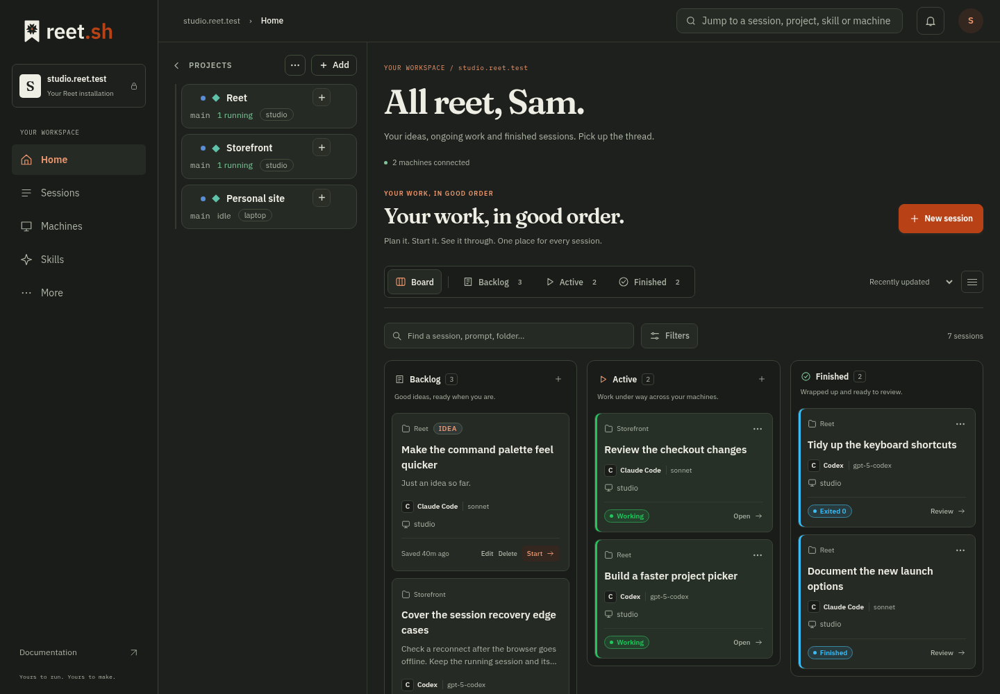
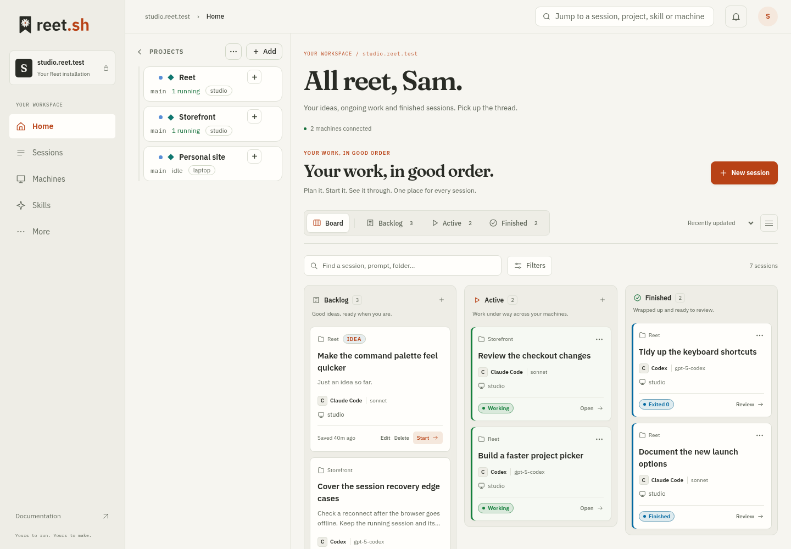
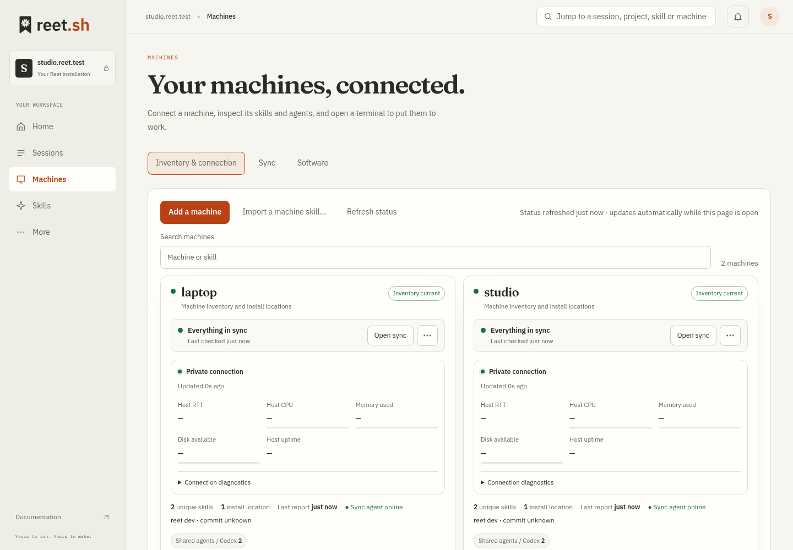
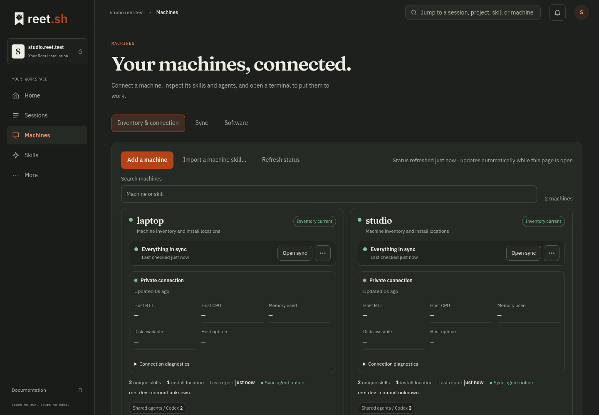
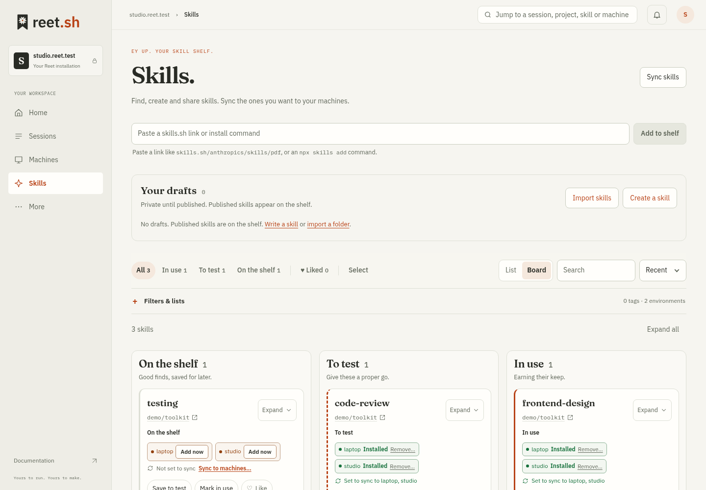
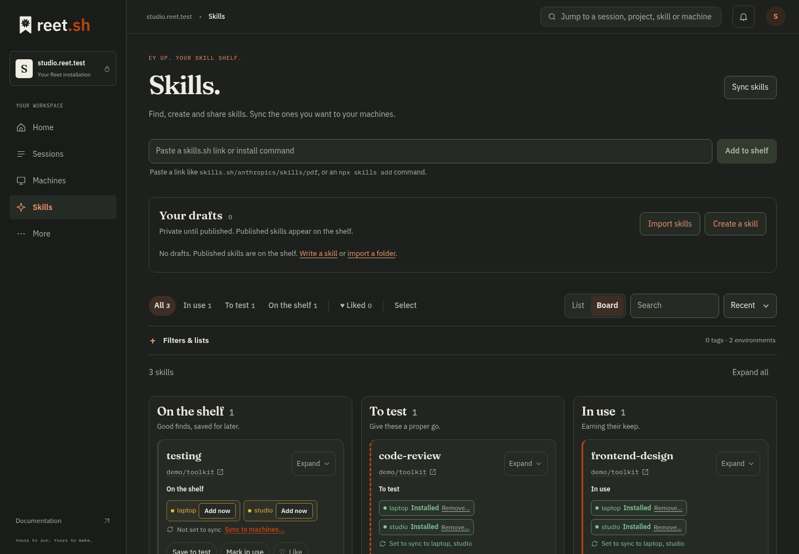
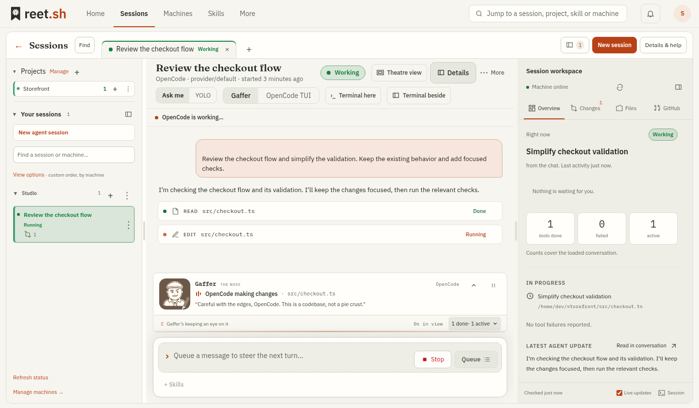
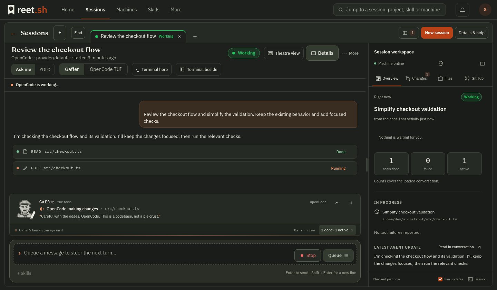

<section class="hero wrap">

 YOUR MACHINES. YOUR RULES.
<h1>Your agents. Your machines. <em>All reet.</em></h1>
The self-hosted control room for your AI work. Run agents, pick up sessions, and keep skills in order. Across every machine you call yours.

<a class="button" href="quick-start/">Make yourself at home <svg class="icon " viewBox="0 0 24 24" fill="none" stroke="currentColor" stroke-width="1.6" stroke-linecap="round" stroke-linejoin="round" aria-hidden="true"><path d="M4 12h16m-6-6 6 6-6 6"/></svg></a><a class="text-link" href="#product">Take the tour ↓</a>

One Go binary · SQLite · No telemetry

ONE WORKSPACE. YOUR WHOLE FLEET.↙

<i></i><i></i><i></i><svg class="icon " viewBox="0 0 24 24" fill="none" stroke="currentColor" stroke-width="1.6" stroke-linecap="round" stroke-linejoin="round" aria-hidden="true"><path d="m12 2 9 4v6c0 6-9 10-9 10S3 18 3 12V6l9-4Z"/><path d="m8 12 3 3 5-6"/></svg> your-reet / home<i class="status-dot"></i> Self-hosted

<svg class="icon " viewBox="0 0 24 24" fill="none" stroke="currentColor" stroke-width="1.6" stroke-linecap="round" stroke-linejoin="round" aria-hidden="true"><rect x="3" y="4" width="18" height="13" rx="2"/><path d="M8 21h8m-4-4v4"/></svg>
<strong>Laptop. VPS. Home lab.</strong>Pick up the work, wherever it lives.
<svg class="icon" viewBox="0 0 24 24" fill="none" stroke="currentColor" stroke-width="1.4"><path d="m12 2 2.5 7.5L22 12l-7.5 2.5L12 22l-2.5-7.5L2 12l7.5-2.5L12 2Z"/></svg>

</section>

BRING THE TOOLS YOU ALREADY USE
✳ Claude Code

&gt;_ Codex

▣ OpenCode

✦ Gemini CLI
<a href="https://github.com/eyupio/reet.sh" class="open-source"><svg class="icon " viewBox="0 0 24 24" fill="none" stroke="currentColor" stroke-width="1.6" stroke-linecap="round" stroke-linejoin="round" aria-hidden="true"><path d="M9 19c-4 1-4-2-6-2m12 5v-4c0-1-.3-2-1-2 4-.5 7-2 7-6a5 5 0 0 0-1-3c.3-1 0-3 0-3s-2-.4-4 1a14 14 0 0 0-8 0C6 3.6 4 4 4 4s-.3 2 0 3a5 5 0 0 0-1 3c0 4 3 5.5 7 6-.7 0-1 1-1 2v4"/></svg> Open source <svg class="icon " viewBox="0 0 24 24" fill="none" stroke="currentColor" stroke-width="1.6" stroke-linecap="round" stroke-linejoin="round" aria-hidden="true"><path d="M5 19 19 5M5 5h14v14"/></svg></a>

<section class="section wrap" id="product">

01 / A LOOK AROUND
<h2>A proper place for work in flight.</h2>

Your projects, sessions, machines and skills. A clear view of what’s running, what’s waiting, and where to go next.

<a href="#tour-sessions" class="tour-tab" data-tour="sessions">01 Sessions</a><a href="#tour-machines" class="tour-tab" data-tour="machines">02 Machines</a><a href="#tour-skills" class="tour-tab" data-tour="skills">03 Skills & sync</a><a href="#tour-gaffer" class="tour-tab" data-tour="gaffer">04 Gaffer</a>

<section class="tour-panel" id="tour-sessions">
<h3>Plan it. Start it. See it through.</h3>
Save a prompt for later, return to a running session, and review finished work. One board across your projects and machines.
<a class="text-link" href="session-board/">Explore the session board <svg class="icon " viewBox="0 0 24 24" fill="none" stroke="currentColor" stroke-width="1.6" stroke-linecap="round" stroke-linejoin="round" aria-hidden="true"><path d="M4 12h16m-6-6 6 6-6 6"/></svg></a>

<a class="screen-expand screen-light" href="images/workspace/home-desktop-light-992a1261390c.png" target="_blank" rel="noopener" aria-label="Open the session board screenshot full size">Full screen ↗</a><a class="screen-expand screen-dark" href="images/workspace/home-desktop-dark-f6a68f6000dd.png" target="_blank" rel="noopener" aria-label="Open the session board screenshot full size">Full screen ↗</a><picture class=""></picture>
</section>
<section class="tour-panel" id="tour-machines">
<h3>All your machines. Within reach.</h3>
See which machines are reporting, find their installed tools, and open a browser terminal. Each machine connects out to your controller.
<a class="text-link" href="add-machine-in-context/">Connect your first machine <svg class="icon " viewBox="0 0 24 24" fill="none" stroke="currentColor" stroke-width="1.6" stroke-linecap="round" stroke-linejoin="round" aria-hidden="true"><path d="M4 12h16m-6-6 6 6-6 6"/></svg></a>

<a class="screen-expand screen-light" href="images/workspace/machines-desktop-light-811518861955.png" target="_blank" rel="noopener" aria-label="Open the machines screenshot full size">Full screen ↗</a><a class="screen-expand screen-dark" href="images/workspace/machines-desktop-dark-4eb0c3f8a037.png" target="_blank" rel="noopener" aria-label="Open the machines screenshot full size">Full screen ↗</a><picture></picture>
</section>
<section class="tour-panel" id="tour-skills">
<h3>A library with a plan.</h3>
Collect the skills you use, choose where they belong, and review the exact sync plan before approving a change.
<a class="text-link" href="sync-skills-between-machines/">Get your skills in order <svg class="icon " viewBox="0 0 24 24" fill="none" stroke="currentColor" stroke-width="1.6" stroke-linecap="round" stroke-linejoin="round" aria-hidden="true"><path d="M4 12h16m-6-6 6 6-6 6"/></svg></a>

<a class="screen-expand screen-light" href="images/workspace/skills-desktop-light-0d1e2f170410.png" target="_blank" rel="noopener" aria-label="Open the skill library screenshot full size">Full screen ↗</a><a class="screen-expand screen-dark" href="images/workspace/skills-desktop-dark-0f289a8cc13e.png" target="_blank" rel="noopener" aria-label="Open the skill library screenshot full size">Full screen ↗</a><picture class=""></picture>
</section>
<section class="tour-panel" id="tour-gaffer">
<h3>Meet Gaffer. Keep a hand on the work.</h3>
Use OpenCode in a conversation view with approval prompts, or switch a supported session to its terminal UI when the agent is idle.
<a class="text-link" href="start-agent-session/">Inside an agent session <svg class="icon " viewBox="0 0 24 24" fill="none" stroke="currentColor" stroke-width="1.6" stroke-linecap="round" stroke-linejoin="round" aria-hidden="true"><path d="M4 12h16m-6-6 6 6-6 6"/></svg></a>

<a class="screen-expand screen-light" href="images/workspace/gaffer-desktop-light-4a58471fa2f8.png" target="_blank" rel="noopener" aria-label="Open the Gaffer screenshot full size">Full screen ↗</a><a class="screen-expand screen-dark" href="images/workspace/gaffer-desktop-dark-334d43cc33e1.png" target="_blank" rel="noopener" aria-label="Open the Gaffer screenshot full size">Full screen ↗</a><picture class=""></picture>
</section>

Product screens shown with example data. Features depend on your machine and agent capabilities.
</section>
<section class="principles wrap">

<svg class="icon " viewBox="0 0 24 24" fill="none" stroke="currentColor" stroke-width="1.6" stroke-linecap="round" stroke-linejoin="round" aria-hidden="true"><rect x="3" y="4" width="18" height="13" rx="2"/><path d="M8 21h8m-4-4v4"/></svg>
<h3>The work stays on your machines.</h3>
Keep the tools and environment you already use. Reet connects the pieces, from your laptop to a remote server.
<a href="run-claude-code-on-a-vps/">Work from your browser <svg class="icon " viewBox="0 0 24 24" fill="none" stroke="currentColor" stroke-width="1.6" stroke-linecap="round" stroke-linejoin="round" aria-hidden="true"><path d="M4 12h16m-6-6 6 6-6 6"/></svg></a>

<svg class="icon " viewBox="0 0 24 24" fill="none" stroke="currentColor" stroke-width="1.6" stroke-linecap="round" stroke-linejoin="round" aria-hidden="true"><circle cx="6" cy="4" r="2"/><circle cx="18" cy="6" r="2"/><circle cx="6" cy="20" r="2"/><path d="M6 6v12m0-4c0-5 12 0 12-6"/></svg>
<h3>Review first. Then make a change.</h3>
Use Advanced sync to inspect a plan before applying it. Choose what belongs on each machine, with local consent.
<a href="sync-skills-between-machines/">Understand skill sync <svg class="icon " viewBox="0 0 24 24" fill="none" stroke="currentColor" stroke-width="1.6" stroke-linecap="round" stroke-linejoin="round" aria-hidden="true"><path d="M4 12h16m-6-6 6 6-6 6"/></svg></a>

<svg class="icon " viewBox="0 0 24 24" fill="none" stroke="currentColor" stroke-width="1.6" stroke-linecap="round" stroke-linejoin="round" aria-hidden="true"><path d="m12 2 9 4v6c0 6-9 10-9 10S3 18 3 12V6l9-4Z"/><path d="m8 12 3 3 5-6"/></svg>
<h3>Your control room. Your call.</h3>
Host it yourself. Keep your data in a SQLite database you own. Read the source. Back it up. Make it yours.
<a href="quick-start/">Start self-hosting <svg class="icon " viewBox="0 0 24 24" fill="none" stroke="currentColor" stroke-width="1.6" stroke-linecap="round" stroke-linejoin="round" aria-hidden="true"><path d="M4 12h16m-6-6 6 6-6 6"/></svg></a>
</section>
<section class="architecture">

02 / SMALL FOOTPRINT. WIDE VIEW.
<h2>One little binary. A lot less juggling.</h2>
A controller on a machine you trust. An outbound connector on the machines where you work. No inbound port needed on those machines.
<a class="text-link" href="remote-agents-without-a-vpn/">How the pieces fit <svg class="icon " viewBox="0 0 24 24" fill="none" stroke="currentColor" stroke-width="1.6" stroke-linecap="round" stroke-linejoin="round" aria-hidden="true"><path d="M4 12h16m-6-6 6 6-6 6"/></svg></a>
$<code>reet serve</code><button class="icon-button" data-copy="reet serve" aria-label="Copy reet serve command"><svg class="icon " viewBox="0 0 24 24" fill="none" stroke="currentColor" stroke-width="1.6" stroke-linecap="round" stroke-linejoin="round" aria-hidden="true"><rect x="8" y="8" width="12" height="13" rx="2"/><path d="M15 8V3H3v13h5"/></svg></button>
Install the binary, then start your control room.

<svg class="icon " viewBox="0 0 24 24" fill="none" stroke="currentColor" stroke-width="1.6" stroke-linecap="round" stroke-linejoin="round" aria-hidden="true"><rect x="3" y="4" width="18" height="13" rx="2"/><path d="M8 21h8m-4-4v4"/></svg> Your browser

<strong>reet.sh</strong>Your control room
Go + SQLite

<svg class="icon " viewBox="0 0 24 24" fill="none" stroke="currentColor" stroke-width="1.6" stroke-linecap="round" stroke-linejoin="round" aria-hidden="true"><rect x="3" y="4" width="18" height="13" rx="2"/><path d="M8 21h8m-4-4v4"/></svg><strong>Laptop</strong>Your daily driver

<svg class="icon " viewBox="0 0 24 24" fill="none" stroke="currentColor" stroke-width="1.6" stroke-linecap="round" stroke-linejoin="round" aria-hidden="true"><rect x="4" y="3" width="16" height="7" rx="2"/><rect x="4" y="14" width="16" height="7" rx="2"/><path d="M8 6.5h.01M8 17.5h.01m3-11h5m-5 11h5"/></svg><strong>VPS</strong>Room to run

<svg class="icon " viewBox="0 0 24 24" fill="none" stroke="currentColor" stroke-width="1.6" stroke-linecap="round" stroke-linejoin="round" aria-hidden="true"><rect x="4" y="3" width="16" height="7" rx="2"/><rect x="4" y="14" width="16" height="7" rx="2"/><path d="M8 6.5h.01M8 17.5h.01m3-11h5m-5 11h5"/></svg><strong>Home lab</strong>Put it to work

↑ OUTBOUND CONNECTIONS TO YOUR CONTROLLER

</section>
<section class="section wrap">

03 / FIND YOUR WAY IN
<h2>What brings you here?</h2>
<a class="text-link" href="documentation/">All documentation <svg class="icon " viewBox="0 0 24 24" fill="none" stroke="currentColor" stroke-width="1.6" stroke-linecap="round" stroke-linejoin="round" aria-hidden="true"><path d="M4 12h16m-6-6 6 6-6 6"/></svg></a>

<a href="quick-start/">01<h3>I’m starting fresh.</h3>
Install Reet, create your account and connect your first machine.
Get up and running <svg class="icon " viewBox="0 0 24 24" fill="none" stroke="currentColor" stroke-width="1.6" stroke-linecap="round" stroke-linejoin="round" aria-hidden="true"><path d="M4 12h16m-6-6 6 6-6 6"/></svg></a><a href="run-claude-code-on-a-vps/">02<h3>I want to work remotely.</h3>
Run Claude Code on a VPS and reach the session from your browser.
Take your agents with you <svg class="icon " viewBox="0 0 24 24" fill="none" stroke="currentColor" stroke-width="1.6" stroke-linecap="round" stroke-linejoin="round" aria-hidden="true"><path d="M4 12h16m-6-6 6 6-6 6"/></svg></a><a href="sync-skills-between-machines/">03<h3>My skills are all over.</h3>
Build a private library and send a reviewed set to the right machines.
Bring a little order <svg class="icon " viewBox="0 0 24 24" fill="none" stroke="currentColor" stroke-width="1.6" stroke-linecap="round" stroke-linejoin="round" aria-hidden="true"><path d="M4 12h16m-6-6 6 6-6 6"/></svg></a>
</section>
<section class="field-section">

04 / THE FIELD GUIDE
<h2>Good tools. Proper know-how.</h2>

Practical guides for the work you actually do. From the first install to a well-kept fleet.
<a class="text-link" href="guides/">Explore all guides <svg class="icon " viewBox="0 0 24 24" fill="none" stroke="currentColor" stroke-width="1.6" stroke-linecap="round" stroke-linejoin="round" aria-hidden="true"><path d="M4 12h16m-6-6 6 6-6 6"/></svg></a>

<a class="article-card" href="run-claude-code-on-a-vps/">
<svg class="icon " viewBox="0 0 24 24" fill="none" stroke="currentColor" stroke-width="1.6" stroke-linecap="round" stroke-linejoin="round" aria-hidden="true"><rect x="3" y="4" width="18" height="13" rx="2"/><path d="M8 21h8m-4-4v4"/></svg>FROM ANYWHERE

REMOTE WORK<h3>Claude Code on a VPS. Your browser, anywhere.</h3>
Keep the agent on your server and bring the session to you.

Practical guide<svg class="icon " viewBox="0 0 24 24" fill="none" stroke="currentColor" stroke-width="1.6" stroke-linecap="round" stroke-linejoin="round" aria-hidden="true"><path d="M4 12h16m-6-6 6 6-6 6"/></svg>

</a><a class="article-card" href="sync-skills-between-machines/">
<svg class="icon " viewBox="0 0 24 24" fill="none" stroke="currentColor" stroke-width="1.6" stroke-linecap="round" stroke-linejoin="round" aria-hidden="true"><circle cx="6" cy="4" r="2"/><circle cx="18" cy="6" r="2"/><circle cx="6" cy="20" r="2"/><path d="M6 6v12m0-4c0-5 12 0 12-6"/></svg>IN GOOD ORDER

SKILLS & SYNC<h3>Same skills. Every machine. A plan you can trust.</h3>
Collect, compare and sync your agent skills with a plan you can inspect in Advanced sync.

Practical guide<svg class="icon " viewBox="0 0 24 24" fill="none" stroke="currentColor" stroke-width="1.6" stroke-linecap="round" stroke-linejoin="round" aria-hidden="true"><path d="M4 12h16m-6-6 6 6-6 6"/></svg>

</a><a class="article-card" href="self-host-mcp-server/">
<svg class="icon " viewBox="0 0 24 24" fill="none" stroke="currentColor" stroke-width="1.6" stroke-linecap="round" stroke-linejoin="round" aria-hidden="true"><path d="m8 7-5 5 5 5m8-10 5 5-5 5m-3-14-2 18"/></svg>STAY CONNECTED

INTEGRATIONS<h3>Your skill library, one MCP connection away.</h3>
Connect your AI client to a private shelf you control.

Practical guide<svg class="icon " viewBox="0 0 24 24" fill="none" stroke="currentColor" stroke-width="1.6" stroke-linecap="round" stroke-linejoin="round" aria-hidden="true"><path d="M4 12h16m-6-6 6 6-6 6"/></svg>

</a>

</section>
<section class="faq-section wrap">

A FEW GOOD QUESTIONS
<h2>Before you put the kettle on.</h2><a class="text-link" href="https://github.com/eyupio/reet.sh/issues">Ask us on GitHub <svg class="icon " viewBox="0 0 24 24" fill="none" stroke="currentColor" stroke-width="1.6" stroke-linecap="round" stroke-linejoin="round" aria-hidden="true"><path d="M5 19 19 5M5 5h14v14"/></svg></a>

What exactly is Reet?

A self-hosted control room for AI coding agents, terminals, skills and setups across your machines. It starts the tools installed on those machines and gives you one place to return to the work.

Does it replace Claude Code or Codex?

Reet starts your installed agent tools. It can also manage its own OpenCode copy on supported Linux machines. Install and authenticate Claude Code, Codex, OpenCode or Gemini CLI on the machine where you want to run it. Your agent’s own provider access and permissions still apply.

Do I need a VPN?

Each enrolled machine makes an outbound connection to your Reet controller. Reet does not need an inbound port on that machine or a VPN for its own protocol. You may still want a VPN for SSH or other private services.

Is it free and open source?

Reet is AGPL-3.0 licensed. You supply hosting and any model subscriptions or API usage your agents need. There is no Reet platform subscription to run the binary.

</section>
<section class="closing wrap">
YOUR WORK, IN GOOD ORDER
<h2>A reet good day’s work.</h2>
Less hopping between machines. More getting on with it.
<a class="button" href="quick-start/">Get started with Reet <svg class="icon " viewBox="0 0 24 24" fill="none" stroke="currentColor" stroke-width="1.6" stroke-linecap="round" stroke-linejoin="round" aria-hidden="true"><path d="M4 12h16m-6-6 6 6-6 6"/></svg></a><a class="text-link" href="https://github.com/eyupio/reet.sh">Have a look at the source <svg class="icon " viewBox="0 0 24 24" fill="none" stroke="currentColor" stroke-width="1.6" stroke-linecap="round" stroke-linejoin="round" aria-hidden="true"><path d="M9 19c-4 1-4-2-6-2m12 5v-4c0-1-.3-2-1-2 4-.5 7-2 7-6a5 5 0 0 0-1-3c.3-1 0-3 0-3s-2-.4-4 1a14 14 0 0 0-8 0C6 3.6 4 4 4 4s-.3 2 0 3a5 5 0 0 0-1 3c0 4 3 5.5 7 6-.7 0-1 1-1 2v4"/></svg></a>
<svg viewBox="0 0 100 100" fill="none" stroke="currentColor" stroke-width="1"><path d="M50 4v92M4 50h92M17.5 17.5l65 65m-65 0 65-65"/><circle cx="50" cy="50" r="33"/><circle cx="50" cy="50" r="11"/></svg>
</section>
