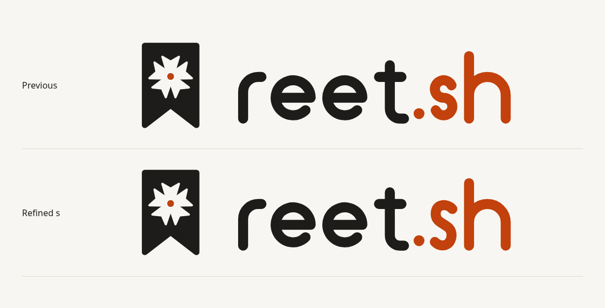

# Library implementation and binary releases

Library is now the application design, across signed-out account flows, the shelf, shared lists, account settings, admin, and bookmarklet feedback. Workbench and Focus remain reference concepts.

## Interface

The main header is a separate banner with the generated brand SVG and role-aware navigation. Each page has its own primary heading. Shelf, list, account and admin headings share `PageHeader`; account entry flows use `AuthCard`.

Library's paper palette, serif headings, spacing, and bordered panels carry through the app. Shelf cards retain the existing flags and actions, with a solid accent edge for In use and a dashed edge for To test. Import, bookmarklets, backup, tags, and ignored skills are grouped in responsive tool panels. Search's empty state includes a working Clear filters action. Connection and permission errors use the same heading treatment.

All existing APIs, roles, list visibility, personal notes, scanner behaviour, exports, and confirmation flows remain in place. No production JavaScript dependency was added.

## Logo

The previous `s` used two large circular arcs whose thick caps pinched the middle. It now uses three continuous cubic curves with open bowls. The brand generator updates every wordmark variant and writes the themeable `web/src/lib/logo.svg` imported by the application. The app no longer keeps a handwritten copy of that geometry.

The contact sheet, social image, concept wordmarks, and application screenshots have been refreshed.

## Binary installation

The new [installer and release workflow](binary-installation.md) provide Linux and macOS binaries for amd64 and arm64. A binary includes the full web UI and scanner. The installer selects the platform, downloads the requested stable or pinned release, verifies its SHA-256 archive digest, and atomically replaces the binary in a writable directory. It defaults to `~/.local/bin` and never invokes sudo.

`reet version`, `reet --version`, and `reet --help` report the build or show commands without starting the server. Tag builds embed the release tag and source commit. The release workflow checks the UI and Go tests before packaging all four targets and publishing archives with checksums.

Downloads require a version tag to run the workflow after this PR is merged. No binary release or new version tag was published during implementation.

## Screenshots

- [Shelf, light](images/ui/library-shelf-light.png)
- [Shelf, dark](images/ui/library-shelf-dark.png)
- [Shelf on a phone](images/ui/library-shelf-phone.png)
- [Grouped tools](images/ui/library-tools-light.png)
- [Admin, dark](images/ui/library-admin-dark.png)
- [Account sign-in](images/ui/app-sign-in-light.png)
- [Phone sign-in, dark](images/ui/app-sign-in-mobile-dark.png)

## Validation

- `npm run check`: zero errors and warnings; `npm run build` passes.
- `go vet ./...` and `go test -race ./...`: all packages pass, including ten installer integration cases.
- `sh -n scripts/install.sh` and `actionlint .github/workflows/release.yml`: pass.
- Cross-built the complete, UI-embedded binary for Linux/amd64, Linux/arm64, macOS/amd64, and macOS/arm64 with `CGO_ENABLED=0`.
- Packaged and checksummed local test archives, installed the actual Linux binary through the installer using a fixture download transport, and started its embedded server. Version, help, and a dry-run scan worked.
- The Library UI passed 102 Chromium/axe layout/accessibility checks across 17 rendered states, light and dark themes, and widths of 375, 768, and 1440 pixels. No document overflow, axe WCAG A/AA violations, or JavaScript runtime errors were reported.
- The installed release binary passed 96 additional browser checks, including owner setup, first-run and populated shelves, list creation dialog, bulk selection, account, list settings/people, public lists, and invitation states. Real-server interactions covered password mismatch, show/hide, search, token creation and one-time display, invitation acceptance, member access restrictions, and keyboard file selection.
- Another 18 checks covered connection failure, disabled accounts, and member access to admin after the final heading changes, in both themes at the three widths.
- Installer fixtures cover Linux and macOS architectures, latest and pinned versions, paths with spaces, damaged downloads, duplicate checksum records, missing binaries, unsupported platforms, and invalid version paths. Failure cases assert that an existing installation is preserved. These tests run under `go test ./...` without external network access.

Playwright MCP remains unavailable; browser validation used the installed Chromium browser with local Playwright and axe-core. Automated scans are not a WCAG certification. Native macOS execution, Safari/Firefox, physical touch devices, and manual screen-reader testing remain unverified. Installer downloads were tested with local release fixtures because the first binary release is published only after tagging.
