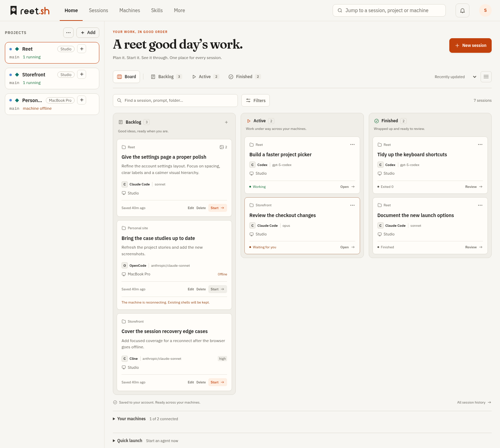
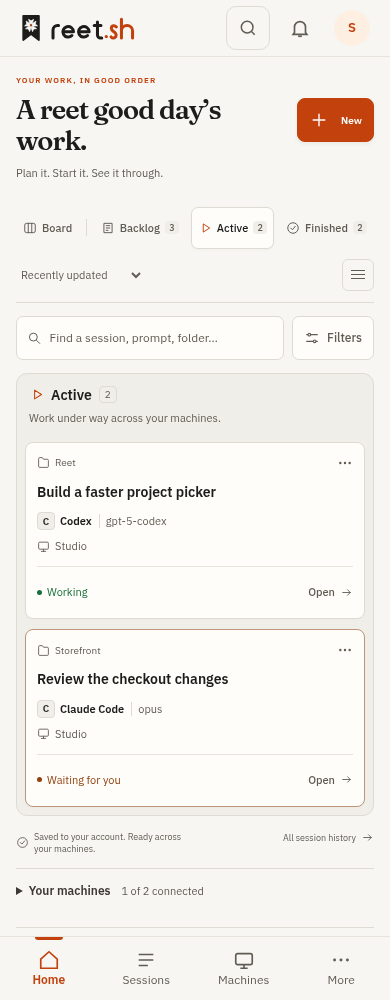

# Session board

<picture>
  <source media="(prefers-color-scheme: dark)" srcset="images/session-board-dark.png">
  
</picture>

<details>
<summary>Phone view</summary>



</details>

Home organises session work into **Backlog**, **Active**, and **Finished**. Use
Board to see all three columns, or choose a stage to focus on that stage alone.
View, sort order, and compact cards are remembered in this browser per account.

- **Backlog** contains account-saved prompts that have not reserved a terminal
  session. Create, edit, or delete an item without connecting to its machine.
  Choose a folder project, or a machine and an absolute folder path (empty means
  its home folder), plus an agent, model, and supported effort setting.
- **Active** contains creating, running, and ending sessions. A quiet terminal
  or a completed chat turn remains Active while its session is running.
- **Finished** contains ended, exited, and lost sessions. Their original status
  remains visible: Finished does not imply success. Review opens the existing
  session screen and history. Session actions retain the existing stop, rename,
  and archive behavior.

Search matches title, saved prompt, folder, machine, project, agent, model, and
effort. Filters accept several machines, projects, agents, or models: choices
within a group combine with OR; groups combine with AND. Additional filters show
sessions needing attention and backlog items with reference images. Filter chips
remove individual choices, and Clear all resets the search and filters. Counts
reflect the filtered set in every stage.

Backlog items accept up to four PNG, JPEG, GIF, or WebP images, at most 5 MB each
and 10 MB together. Images are saved privately in SQLite; list responses omit
their bodies. An account can hold 100 unlaunched items and 32 MB of saved JSON
content, including base64 image encoding. Saved images are sent through the
existing machine upload route when Start is pressed, and their machine paths
are appended to the prompt. The complete launch prompt must fit the existing
2,000-byte limit. Model and effort use the same shared picker as the launch bar:
the machine's list, favourites, suggestions, `Other…`, and an honest status line,
with effort offered only for an agent whose catalogue row takes it. The prompt
also has **Use a skill**, which searches the account's shelf and inserts that
skill's ready-to-run prompt at the caret. The inserted text is ordinary prompt
text, so the person can edit it, add around it, or delete it.

Start checks machine readiness, installed agents, image-upload capability, and
project identity. The server freezes the launch parameters before dispatch and
uses the backlog item's stable ID as the terminal create request ID. Concurrent
starts and retries reuse that frozen request, including its uploaded image
paths. A definitive refusal before any broker operation is recorded makes the
item editable again. A recorded request is represented by its actual terminal
session, without a duplicate backlog card. After successful dispatch, saved
image bodies are removed; the small launch record remains for retries and is
pruned after 30 days during a subsequent backlog save.

All `/api/v2/session-backlog` routes require a writer's browser account. Writes
require the canonical origin and share the existing folder-project write rate
limit. Updates and deletes require the version that was read; concurrent edits
are refused instead of overwritten. Starting additionally uses the existing
terminal feature, authorization, capability, and audit gates. No prompt or image
body is added to Activity or browser storage. Ordinary agent approvals apply.

Quick launch remains available in an expandable section. New session links from
Sessions and project handoffs open it automatically; launch links focus the prompt.
Machine health and Needs you remain accessible below the board and through the
existing bell.
Home refreshes visible data every 15 seconds and keeps the last successful read
when a refresh fails.

Verification:

```sh
cd web
REET_THEME_BASE=HEAD npm run check
npm run build
node tests/session-board.e2e.mjs # local Vite on :5173, Chromium installed
```

Backend tests are `TestSessionBacklog*` in `internal/store` and `internal/api`.
The browser checks use synthetic machines and sessions, and never launch a real
agent. They cover stage views, remembered view, combined filters, image capture,
offline planning, edit/delete/start, light/dark themes, and responsive layouts.
