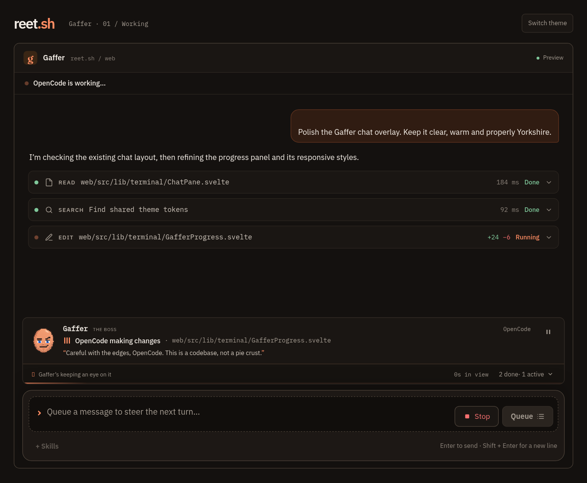
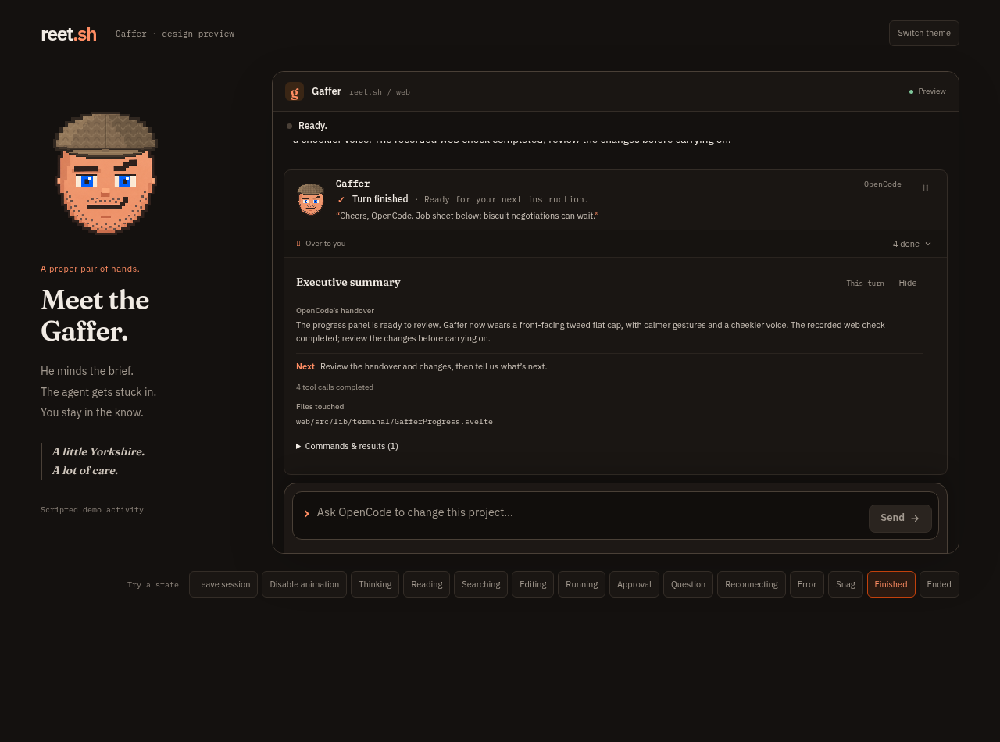
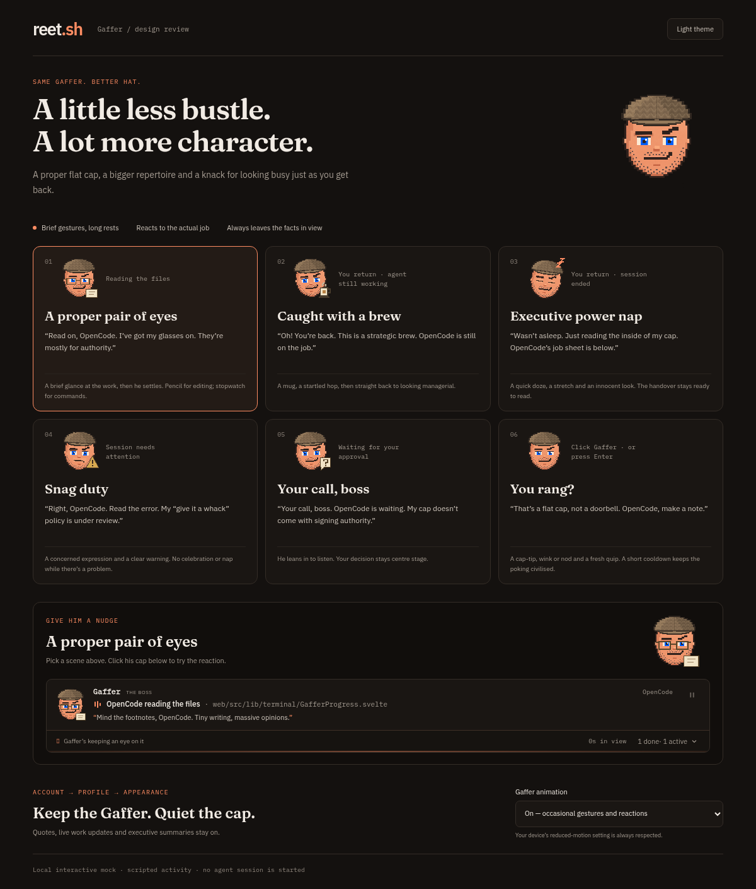

# OpenCode in Gaffer

**Gaffer** is reet's native agent control interface. **Eli AI Chat** is the underlying technology intended for reuse from Zoomies; **OpenCode TUI** is the agent's original terminal interface. The reet CLI TUI is separate. A bounded Eli provider compatibility probe is documented in [the reuse review](research/eli-reuse.md); the coordinator is not enabled and live worker chat still uses ACP. Existing ACP, session ownership, permissions, streaming and lifecycle paths stay in place.

A structured session is **OpenCode in Gaffer**, a conversation over the Agent Client Protocol (ACP). It is not a
terminal: OpenCode streams messages and tool calls, and reet shows an approval card before an edit or command runs.
Terminal sessions are unchanged.

Slice 1 is deliberately narrow: OpenCode only, trusted folders only, and **Allow once** or **Deny** only. Always allow is
not offered; later slices add a per-session command/file allowance and a live Ask me ↔ YOLO switch, both described below. The probe is [OpenCode `opencode acp` hands-on probe](research/probe-report.md); the plan is
[Program 2, slice 1](superpowers/plans/2026-10-29-program-2-slice-1.md).

## Per-agent availability

A connector that negotiates `acp-agents-v1` reports an `acpAgents` list alongside
its older `acp` flags. Each entry names the tool, adapter command, minimum
version, installation version when readable, state and supported chat features
(history, embedded images, live model and approval changes). It refreshes with
the connection's capabilities rather than querying a package registry.

- `available`: reet has a reviewed integration and resolves its executable.
  An unknown installation version can still be available: starting the chat
  checks `--version` and ACP's reported identity/version before sending a prompt.
- `missing`: the executable needed for that integration is absent.
- `unverified`: an adapter is present but reet has not verified its integration.
- `incompatible`: readable installation evidence does not meet the reviewed floor.

OpenCode is the only available integration in this stage. Claude Code, Codex
and Gemini entries describe missing or unverified support; installing an adapter
alone does not enable its chat. No CLI is executed to build these descriptors,
and availability does not establish a successful model turn or authentication.

An explicit list is authoritative: a missing tool or an empty list does not fall
back to machine-wide flags. Older peers omit the list and retain the OpenCode-only
behaviour. New descriptors are never sent to an older controller. Launches and
history continuation both enforce the per-agent result; stored history must also
belong to the same account, machine, tool and folder, from a closed reet session.
No transcript, database migration or new execution control is introduced.

The live chat's **Model**, **Change model** and **Make default** controls appear only when that agent's available descriptor offers model switching.
An explicit descriptor overrides machine-wide flags; an older OpenCode peer must report `acpModel`. Without that capability, the pane does not request
model options or favourites, and provider-error guidance does not direct the person to a missing model control. A capability update applies to an open
pane: removing support hides the control, clears its option list and retires pending lookups. A delayed reply cannot repopulate a later control.
A live model change is reported as applied only after the adapter confirms it. OpenCode keeps its legacy acknowledgement when the option list is
omitted; an explicit list must contain one valid model value. Claude requires that read-back. Incomplete or ambiguous replies clear the confirmed
model and retained status detail, and show a notice. The controller also clears its stored model if an acknowledgement is lost after sending; busy or pre-send failures leave it
unchanged. The person can choose a model again; the conversation and approvals are preserved.
On connectors that negotiate `acp-live-controls-v1`, Gaffer reads the active session's configuration selectors.
**Model** can change during a turn when the agent advertises a model selector, and **Effort** appears only for the
session's advertised `thought_level` choices. Changes use `session/set_config_option` and show success only after a matching
read-back. A model can change the available effort values, so the whole selector snapshot is refreshed. An ambiguous reply
shows the value as unconfirmed. Permission and approval modes remain separate controls. Confirmed model and effort values
are saved for connector restart and in-place reconnect; a saved effort must be accepted before a reopened chat is ready.
Older connectors keep the existing idle-only model control and do not show an effort selector.

The runtime controls endpoint is `GET /api/v2/terminal/sessions/{id}/chat/controls`; `POST` accepts
`{"action":"set","configId":"effort","value":"high"}` using an ID and value reported by that exact session.
Only model and thought-level selectors are accepted. Static installation descriptors do not authorise a runtime switch.

## Starting one

Both **Start an agent** dialogs and the backlog composer include **Model** and **Effort**. Models use the machine catalogue,
your favourites or a configured model ID. In Gaffer, effort suggestions come from the selected agent's advertised
thought-level options on a connector that negotiated `acp-start-options-v1` (`acpStartOptions`). Older live-controls
connectors must be upgraded before they can accept effort in a new chat. When no options are advertised, **Agent default** is
shown with an explanation. A chosen effort is confirmed against the actual selected model before the chat becomes ready
or receives the opening prompt; an unsupported choice refuses startup rather than silently falling back. The terminal
interface keeps its existing effort mappings. Backlog save, edit, reload and Start retain both selected values.

In **Start an agent**, choose OpenCode on a machine that advertises `acp`. The **Session** choice is **Gaffer** by
default; choose **OpenCode TUI** for the terminal UI. The **Model** control chooses the model for the chat; leave it at
**Agent default** to use the model configured in OpenCode. Effort stays at Agent default unless this connector advertises a choice and you select one. The opening prompt becomes the
first message. The dialog states that the folder's `.opencode` plugins run when it starts, and that a chat can be
restored after reet restarts on the machine.

The session appears in the usual list with its title and state. Its screen opens on **Gaffer**. The header's **OpenCode
TUI** button switches the same live session to OpenCode's own terminal UI, and back, on a machine that negotiated
`session-mode-v1` ([below](#switching-between-gaffer-and-the-opencode-tui)); otherwise it is disabled with the reason.
Closing the tab or **End session** ends the reet session and its process. Losing the
control connection detaches it without killing the agent; the next connection adopts the running session. If the agent
closes its protocol output or sends an oversized frame, reet ends that process
so the chat can be recovered instead of waiting on an unusable connection. When an agent exits, reet retires its descendants
and allows up to two seconds for final protocol messages to reach the event sender. A sender blocked beyond that bound can
still lose those messages; it cannot keep the exited process appearing live indefinitely. A provider failure found in the agent's local
log also ends the process if it ignores cancellation, while keeping the provider error visible. The next connection drains events
queued while it was away. Recovery puts the retained pending approvals and current status after that buffered output, so a full queue
cannot immediately evict the recovered card during replay preparation. If output continues during a stalled replay, the queue discards old output
before current pending approvals and the latest status. It retains the original approval token and command, keeps resolved approvals
resolved, and uses the existing 1,000-event / 256 KiB queue limits, including after a failed send. Where typed questions are negotiated,
recovery also restores already delivered pending questions with their original tokens and complete schemas. Their schemas count against the same
queue limit. Resolutions while detached settle the retained waiting state; a replacement controller without question support receives no question
frames and the connector cancels pending questions. Questions first asked without a live recipient are still cancelled. This recovery does not enable
typed questions: form capability remains off pending the device checks. Restarting the agent process, or rebooting the
machine, is followed by the connector reopening the chats it was running from OpenCode's own store
([below](#recovery-after-a-connector-restart-or-reboot)).

## The transcript

Every tool call is one row: a state dot, its kind (**Bash**, **Read**, **Edit**, **Search**…), the command or the file path
relative to the session's folder, and the line count, duration and status. Where the connector can read them it also shows
the added and removed line counts; opening the row reveals the full command, output or unified diff and any reported paths.
A failed row opens on its error; the rest stay folded so a long turn reads as a list rather than a wall of output.

The connector sends those tool details only to a controller that negotiated **`acp-tool-details-v1`**; an older controller
receives the plain tool event and the row falls back to its title and location. Thinking is a quiet, foldable aside that
stops running when the turn waits, finishes or stops. An agent message keeps its headings, lists and quotes, and its fenced code is rendered in its own block; an approval
remains the one card that asks for an answer.

## Gaffer’s work update

Above the message box, Gaffer is a compact block portrait with a front-facing tweed flat cap, blue eyes and short stubble.
Brief, smooth gestures follow the agent’s activity: a thoughtful tilt while planning, a glance and glasses for reading,
a magnifying glass for searches, a pencil for edits and a stopwatch for commands. Gestures settle after a second or two,
with irregular 18–32 second rests during active work. Only an occasional blink loops. Contextual Yorkshire quips rotate
every 30 seconds during active work without immediately repeating; status changes get a relevant quip immediately.
They are presentation copy, not extra instructions sent to the agent or evidence of work completing.

Click Gaffer (or focus him and press Enter or Space) for a cap-tip, wink or nod and a contextual quip. A two-second
cooldown prevents repeated clicks from continually restarting him. After at least 15 seconds away from a session,
returning catches him with a brew during active work or asleep after a finished turn or session, before he startles or
stretches awake. This works when switching sessions as well as leaving the tab; short focus changes do not trigger it.
An error, failed session, lost connection or pending decision always takes priority over a tea break or nap.

The update uses the chat stream to show the current tool and target. A disclosure lists the five latest tool calls
in this turn with their reported states, alongside counts of completed, active (pending or running) and failed tools.
Thinking is excluded from those counts. Truncated history is labelled as recent activity. There is no estimated
completion percentage. The timer is labelled **in view**: it starts when this view first sees the agent active,
includes waits and reconnects, and freezes when the turn finishes or stops. It is not the full duration of a turn
that began before the chat opened.

Approvals, questions, errors, stopped turns and reconnects override working messages. Reconnecting labels the tool
counts as last seen, and finishes as a compact handover without claiming checks passed. Working, waiting and finished
states have distinct decorative expressions. **Pause Gaffer animation** keeps him still for this view while quotes and
factual updates keep arriving. **Account → Profile → Appearance → Gaffer animation** saves the animation preference
with your account across browsers. Turning it off never hides Gaffer, quirky quotes, live updates, activity or the
handover and job sheet. The device’s reduced-motion preference also disables all Gaffer motion without silencing quotes.
The avatar is decorative, changing facts are announced politely, and timers and quips do not repeatedly interrupt
screen readers. Hidden tabs pause the decorative work.

When a turn finishes, stops or reports an error, Gaffer gives the handover himself, in his own card: his speech line
quotes a bounded plain-text excerpt of the agent’s final handover (three lines, with **Read more**), and a row of chips
shows completed, failed and unfinished tool calls and files changed. **Job sheet** in the footer opens the rest: snags,
a next step, reported file operations and recorded command statuses. It is closed by default so the conversation keeps
its height. A completed tool call alone does not establish that tests passed. An opening plan or an earlier turn’s
answer is never presented as the handover for unfinished work. Missing handovers and truncated history are called out.

The live summary covers the latest prompt. When the session ends, **Whole session** covers all activity still held in
the conversation, with the latest handover and a reminder to start a new session to continue. Earlier activity beyond
the bounded history is unavailable. The summary waits for replay to settle, disappears when new work starts, and
can be hidden to give the conversation more room. It uses the existing stream without a model call or stored report.

Approved appearance and placement, with illustrative session content. All poses use the same front-facing cap with its peak centred above the brow:

The activity, tea-break, sleeping, error, approval and click mocks share the same avatar:

For the interactive scripted preview, run `node tests/serve-fixture.mjs gaffer-review` from `web/`.

The review fixture at `web/tests/fixtures/gaffer-progress.html` uses the real chat pane with a scripted stream. It has
controls for work, approval, question, reconnect, failure, finished and ended states and both themes. It never contacts a
provider or changes a project. Run it with `node tests/serve-fixture.mjs gaffer-progress` from `web/`.

## The seven conditions

The controller never runs OpenCode. The connector starts `opencode acp` as its own process, one per reet session, in the session's
folder, as the connector's user. All seven conditions are mandatory:

1. **reet owns the permission config.** `OPENCODE_CONFIG_CONTENT` asks for edit, bash and external-directory permission at
   top level and for `build`, `plan`, `general` and `explore`; `task` and `webfetch` are denied; `default_agent` is `build`.
   `OPENCODE_DISABLE_PROJECT_CONFIG=1` ignores the repository's config. The inherited environment is scrubbed of every
   `OPENCODE_*`, so `OPENCODE_PERMISSION`, `OPENCODE_CONFIG` and `OPENCODE_CONFIG_DIR` cannot override it. After
   `session/new`, the connector refuses to continue unless the mode is `build`. OpenCode's own agent-mode switching is not
   offered; approval mode (Ask me or YOLO) is separate and can switch while a chat runs.
2. **A random server password.** Each process gets a fresh `OPENCODE_SERVER_PASSWORD`, so another local process cannot
   approve permissions through OpenCode's local HTTP API. A tool the person approves runs as the same user and can read its
   own environment, including that password; this is accepted for slice 1.
3. **No subagents.** `task: deny` removes the `task` tool. OpenCode does not forward a subagent's permission request over
   ACP, so allowing subagents would hang the turn and hide an approval.
4. **Deadlines.** One card waits at most five minutes; a turn is cancelled after ten minutes and says "still working" after
   twenty seconds of silence. If OpenCode logged a provider error during that silence but did not send it over ACP, reet
   shows the error and stops the turn instead of waiting for the ten-minute deadline. On cancel or timeout reet closes its
   own cards and sends `session/cancel`, because OpenCode never withdraws an outstanding `request_permission`.
5. **An allowlist environment and opt-outs.** Only PATH, HOME, XDG directories, TMPDIR/TEMP/TMP, locale, timezone and the
   connector's own OpenCode settings reach the process. `SSH_AUTH_SOCK`, `DISPLAY`, DBus, GitHub/cloud tokens and shell
   settings do not. The model fetch, autoupdate, default plugins, LSP download, Claude Code compatibility and external
   skills are off. OpenCode may still install `@opencode-ai/plugin` from npm in the background; the probe saw that with the
   opt-outs set. OpenCode reads credentials from its own auth store or from the verified provider keys reet forwards
   (`ANTHROPIC_API_KEY`, `OPENAI_API_KEY`, the Google/Gemini keys, `OPENROUTER_API_KEY`, `OPENCODE_API_KEY`); no other
   inherited variable reaches it.
6. **Trusted folders.** If `.opencode/plugin*` or `.opencode/package.json` exists, the machine refuses Gaffer unless the
   start carries the person's trust confirmation. The Start dialog always shows the warning and sends the confirmation
   when Gaffer is chosen. An unreadable `.opencode` refuses Gaffer rather than hiding a plugin.
7. **The version floor.** The connector runs `opencode --version` and requires at least `1.19.5` before it starts a process.
   ACP's `initialize` must also report protocol 1, the agent name `OpenCode`, and a version at or above the floor; a newer
   release is accepted, but lowering the floor needs a fresh probe.

## Reopening a reet session and history

A structured session row keeps OpenCode's own session id (`ses_…`) once the machine reports it. The controller also keeps a
bounded transcript of the conversation it has shown, restored with the session after a controller restart. What happens when
a chat closes depends on how it closed and on what the machine supports.

**A lost or crashed chat reconnects in place.** On a machine that negotiated `chat-reattach-v1` (it requires `acp-v1` and
`acp-history-v1`; the capability is `chatReattach`), a chat that is `lost`, or `exited` without a person ending it (the
OpenCode process died), with a saved id comes back by itself,
in the same reet session: same row, same URL, same transcript. The browser makes one automatic attempt per session per page
load. The pane shows **Reconnecting to your conversation…** with the composer disabled and the Gaffer card reconnecting,
and the conversation stays visible. The controller sends the machine a `chat_reattach` message that carries the row's launch
data (folder, model, YOLO, saved id, trust), and the machine runs `session/load` on the saved OpenCode conversation. The
replayed conversation is dropped because the controller already holds the transcript; the chat's idle status and any tool
that was left running (shown as interrupted) are forwarded. A reply that was running is stopped, so the chat needs a new
prompt. If the machine still has a live process for the conversation, it adopts that process instead of restarting it.
A different reet session that already owns the same conversation is refused: "This conversation is open in another session."

If the attempt fails, the pane shows the reason (announced as an alert) with **Start a new chat**, and **Try again** where a
retry can help. Nothing is created or changed by a failed attempt: the row stays as it was. The ended-chat notice also offers a manual **Reconnect** button, and the
session header menu no longer offers the new-row **Continue in Gaffer with history…** for a chat that can reconnect.

The controller runs one reattach per session and trust at a time (concurrent callers with the same trust, such as two
tabs or a double click, join the same machine call). Two calls with different trust can be in flight at once (an
automatic attempt and the click in another tab, say); the machine serialises them: the second adopts the chat if the
first already has it running, or is refused as still starting. The controller bounds it at 75 seconds ("Reconnecting took too long. Try again."), never creates a row, and allows the
`lost`/`exited` to `running` change for structured chats only (the exit code is cleared). The route
`POST /api/v2/terminal/sessions/{id}/reattach` takes an optional JSON body: none, `null` or `{}` reconnect without folder
trust, and `{"trust": true}` confirms the person trusts the chat's folder for this request (the audit event
`chat-reattach` records `trust`). Any other body (malformed, an unknown field, a non-boolean `trust`) is
refused with 400 before the machine is asked. A trusting and a non-trusting call never join each other's machine call.
The controller never stores the confirmation: each click is one request. The machine keeps the folder trust a chat
was started with in its restart record, as it does for any chat started with trust (a new chat in a trusted folder, or
Continue with history), so after its own restart it reopens that chat with that trust, with no click; the record is kept
up to 7 days or 3 failed reopens. A later in-place reconnect from the controller asks again.
The route answers 204, or an error with one of these codes:

| Code | Status | Sentence | Try again |
| --- | --- | --- | --- |
| `chat_reattach_unsupported` | 409 | "Update reet on this machine to reconnect this chat." (machine without the feature or history), or "This chat cannot be reconnected in place." (not an OpenCode chat) | no |
| `chat_reattach_ended` | 409 | "You ended this chat. Continue it with history as a new session." | no (quiet when automatic, see below) |
| `chat_reattach_not_closed` | 409 | "This chat is still running." | yes (quiet when automatic) |
| `chat_reattach_no_conversation` | 409 | "This chat has no saved conversation to reconnect." | no |
| `chat_reattach_archived` | 409 | "This chat was archived, so its history is gone." | no; nothing to continue |
| `chat_reattach_starting` | 409 | "Still reconnecting. Try again in a moment." (the machine is still starting this chat) | yes |
| `chat_reattach_conflict` | 409 | "This conversation is open in another session." | yes |
| `chat_reattach_yolo_not_allowed` | 409 | "An owner or admin can allow YOLO for this account in Settings." | no |
| `chat_reattach_yolo_refused` | 409 | "YOLO is turned off on this machine, so this YOLO chat cannot be reconnected." | no |
| `chat_reattach_capacity` | 409 | "This machine has reached its session limit." | no |
| `chat_reattach_trust` | 409 | "This folder has OpenCode plugins, which run as code on this machine, so reet did not reconnect automatically. Reconnect only if you trust it." with a `detail` naming the plugin files | no; **Trust this folder and reconnect** and Continue with history are offered |
| `chat_reattach_failed` | 502 | "The machine did not bring this chat back. Try again, or start a new chat." | yes |

A wait that times out or finds the machine offline answers 503 "Reconnecting took too long. Try again.". A YOLO chat is a
YOLO launch: the controller checks the account's **Allow YOLO** setting before it asks the machine. The machine marks a
"still starting" conflict with the result detail `starting` (the only detail a `conflict` result may carry) only for a
controller that advertised **`chat-reattach-detail-v1`**; any other controller gets a plain `conflict`. A plain
`conflict` means another session owns the conversation. Because the marker is negotiated, the controller and the machine
can be updated in either order; an older controller shows its old "open in another session" wording for that rare
moment.

**A chat a person ended is never reconnected in place.** The machine answers a person's **End** of a Gaffer chat with
`exited` (code 0); the controller records that close of an `end_requested` structured row as `ended` (no exit code). Rows
ended before this was recorded are stored `exited` (or `lost`, when the machine went away before it answered); the
controller refuses a reattach of any row that has an end operation with `chat_reattach_ended`. When an automatic attempt
gets that answer, the pane falls back quietly to the ended note with **Continue with history** (no failure card), and the
header menu offers **Continue in Gaffer with history…** again. A manual **Reconnect** or **Try again** refused this way shows the failure card with the server's message, **Continue with history** and **Start a new chat**, and no **Try again**.

**An ended chat starts a new session.** A chat that a person ended (`ended`, or refused as ended) keeps **Continue in Gaffer with history…**. That
creates a **new** reet session row with `resumeAcp` set to the old id; the old row stays in history. The machine runs
`session/load` with the same folder, checks mode `build`, and replays OpenCode's stored conversation before the new Gaffer
is ready; the replay is read from OpenCode, so a machine whose OpenCode store is gone cannot be continued with history.
A continuation row whose create operation failed cannot itself be continued, so repeated clicks no longer pile up rows.

**Older connectors keep the manual path.** A connector that did not negotiate `chat-reattach-v1` is never sent
`chat_reattach`. For lost, exited and ended chats with a saved id and history support, the ended-chat notice offers
**Continue with history**, which uses the same new-row continuation as the actions menu, keeps the original folder and
model, and sends no prompt automatically. The browser runs one continuation per saved conversation at a time, never
alongside an in-place reconnect of the same chat. The old row's pane shows "Starting a new session…" until the create
returns, then the browser switches to the new row; a failure is shown in that pane. If the reply is uncertain, clicking again checks the same operation id. A reload refusal
leaves the old transcript and both recovery and fresh-chat choices visible. Without a saved id or verified history support,
the notice offers a new chat.
The machine refuses a second load while that conversation already has a live or starting process. A successful manual
continuation replaces its older restart record so the next connector start restores one copy.

**Limits of reconnecting.**

- Automatic reconnect never sends a folder-trust confirmation. A folder with OpenCode plugins is refused with the trust
  message; the pane shows the plugin files and offers **Trust this folder and reconnect** (in place: the same row, URL and
  transcript, with the same "Reconnecting to your conversation…" state), the explicit **Continue with history** (a new
  row that confirms trust, as the manual path always did) and **Start a new chat**, without **Try again**. Only a click on
  **Trust this folder and reconnect** sends `{"trust": true}`, as one request; the controller does not keep it, so a later in-place reconnect asks
  again (the machine's own restart restores a trusted chat as it does any chat started with trust, see above). The card
  shows only the plugin files from the machine's detail. A trusted attempt refused for another reason shows that reason as usual. The header menu offers **Continue in
  Gaffer with history…** again for that chat.
- A YOLO chat is refused, not downgraded, if the account no longer allows YOLO or the machine's local YOLO consent is off.
- While the machine is offline the pane shows the idle ended note, not a waiting state, and a failure uses up the one
  automatic attempt (**Try again** or **Reconnect** still works).
- Claude and Codex chats are not covered.
- Recovery depends on OpenCode's saved history being present on the machine.

Replayed tools left `pending` or `in_progress` are shown as interrupted, not as still working. Pending approvals are not restored; a new prompt starts cleanly. The controller will only load an id that belongs to one of the account's own closed
structured sessions on that machine, so a crafted `resumeAcp` cannot read another project's OpenCode history.

A connector that predates `acp-history-v1` can still run a new Gaffer, but it does not report or accept an OpenCode session
id, so its reet sessions have no Continue action. The `acpHistory` and `chatReattach` capabilities are sent only to a controller
that negotiated the feature, and the older controller's strict decoder never sees the new fields.

## Images

In Gaffer, **Attach image** (or paste/drop) uploads the file to the machine over the launch-upload route, then sends
the image with the prompt: the connector reads its own uploaded file and embeds the bytes as an ACP image
content block. The agent sees the image itself, not a path it has to open with a tool, so no extra read approval is needed.
The prompt can be images alone. Limits are PNG, JPEG, GIF or WebP, 5 MiB each and at most eight in one prompt. Uploads live
under the machine's private `launch-uploads/` folder and are removed by the existing 24-hour sweep.

A connector that predates `acp-image-v1` keeps the old behaviour: the prompt carries the absolute path as text, and an
agent that needs the image opens it with its own read tool. The controller never sends the image fields to such a machine.

## Approvals

The card names the tool, the folder and, for a command, the full command text; for an edit it shows the whole-file diff
from the permission request. The machine cuts a diff or command that is too large for one control frame and marks the card
truncated; **Allow** actions are disabled then, and only **Deny** is available. The browser never sends the agent's own
`allow_always` option. An unknown answer is treated as Deny.

A card offers **Allow once**, **Deny**, and, when the card names a command or a path, **Allow this command/file for this
session**. The last choice is remembered by the controller for that chat only, by exact command or path and tool kind:
a repeat is answered automatically, every automatic answer is audited as `session-allow`, and the approval is forgotten
when the chat ends, is archived or the controller restarts. It never widens to other commands or files, and it is never
sent to the agent as `allow_always`.

A card is for one tool call. Answering it closes it; a later call asks again unless the person allowed that exact
command or file for the session. The agent's completion update and the person's answer both appear in Gaffer.

## Switching Ask me and YOLO while it runs

A structured session's header shows **Ask me** and **YOLO** for a live chat on a machine that negotiated
`acp-approval-v1`. Switching to YOLO asks for the same per-session confirmation as a launch and passes the same gates:
the account's Allow YOLO setting, the machine's `yolo` capability and the agent's reviewed YOLO option. The controller
then sends `acp_mode`; the connector sets its own auto-answer for this chat and answers any card already waiting. The
store's `yolo` flag, the YOLO badge and the audit (`yolo-mode`, then `yolo-allow` for each answer) follow. Switching back
to Ask me stops the auto-answer immediately. A connector older than `acp-approval-v1` reports no `acpApproval` capability,
so the switch is not offered; terminal sessions keep the mode they launched with. A refusal is sentence-shaped and leaves
the mode as it was.

## Switching between Gaffer and the OpenCode TUI

A running OpenCode session can move between Gaffer and the OpenCode TUI under the same session row. The session
header's **Gaffer** | **OpenCode TUI** pair shows the one in use; the other one switches (on a phone, the session's
actions menu has **Switch to Gaffer…** or **Switch to the OpenCode TUI…**). A confirmation says what happens: the
machine stops one process and starts the other on the same OpenCode conversation in the same folder, terminal scrollback
is not kept, and the switch can take a few minutes. Until the machine answers, both buttons wait and the status line says
**Switching to the …**; the browser sets no deadline of its own. Then the pane changes to the chat or the terminal, and
the status pill, the **Approvals** line and the context panel's decisions follow the new mode.

- **Only reet-started sessions return to Gaffer.** Going to Gaffer needs OpenCode's session id, which reet
  records only for a session that started (or has been) in Gaffer. A session started in the OpenCode TUI keeps the
  **Gaffer** button disabled: "This session started in the OpenCode TUI, so Gaffer cannot pick up its
  conversation." Going the other way needs the same id: a Gaffer session whose OpenCode id was never recorded keeps
  the **OpenCode TUI** button disabled, and the controller refuses it too: "This session has no saved OpenCode
  conversation yet, so it cannot move to the OpenCode TUI."
- **Idle only.** A chat with a running turn, an approval card or a question waiting does not switch: "Wait for the agent
  to finish or answer what it is asking." The controller refuses it too.
- **`session-mode-v1` machines only.** A connector that did not negotiate it, has no chat history for OpenCode, or
  cannot launch OpenCode in a terminal (OpenCode is not among its launch tools) is not asked: "Update reet on this
  machine to switch between Gaffer and the OpenCode TUI." Only a running session can switch. Asking for the mode
  the session is already in changes nothing.
- **YOLO stays YOLO, and is checked again.** A YOLO session moving to the OpenCode TUI starts it with `--auto`, so the
  switch is refused if the account no longer allows YOLO ("An owner or admin can allow YOLO for this account in
  Settings."), before anything is stopped. The switch is audited (`session-mode`, with `yolo`), and a YOLO switch to the
  OpenCode TUI also records a `yolo-launch` event like a launch when the switch request is answered (a switch settled
  later by a reconnect is not audited).
- **Terminal scrollback is not carried over.** Gaffer rebuilds the conversation from OpenCode's own store with
  `session/load`, as **Continue in Gaffer with history…** does; the OpenCode TUI opens that conversation on a fresh
  screen.
- **The OpenCode TUI is stopped before the chat opens.** The machine waits up to five seconds for the TUI to exit after its
  tmux session closes. A TUI that has not exited by then is sent SIGTERM and, if it is still there, SIGKILL; the chat
  opens only once its process group is gone, so two OpenCode processes never share one conversation. If a TUI survives
  even that, no chat is opened and the session ends.
- **A failed switch says whether the session survived.** When the other mode cannot start, the machine restores the
  previous one and the switch reports "The session could not be switched. Try again, or end it and start a new
  session." When neither mode could be left running, the machine ends the session and the switch reports "The session
  could not be switched and has ended. Start a new session or continue it with history."
- **Gaffer is as durable as any chat.** A session in the OpenCode TUI runs in tmux and survives an agent restart;
  once switched to Gaffer it ends if the agent process restarts (its OpenCode id can still be continued).
- **Folder trust when returning to Gaffer.** OpenCode project plugins run when Gaffer opens the session. If
  the folder has `.opencode` plugins and the request does not carry the person's trust, the machine refuses it before
  stopping anything: the OpenCode TUI keeps running untouched. The dialog then shows the plugin warning and an **I trust
  this folder** confirmation, and sends the switch again with the person's trust.

## Recovery after a connector restart or reboot

A machine upgrade restarts the connector, and a reboot does both. Chats used to end there. Now the connector keeps a
private record of the structured chats it was running, beside its terminal state, and the next connector process reopens
each one with `session/load` under the same reet session id. The controller then adopts the row instead of marking it
lost, so a session survives an upgrade or a reboot rather than asking for a new chat.

- **OpenCode keeps the conversation.** The record holds only which `ses_…` belongs to which reet session, its folder,
  model, approval mode and folder trust. The conversation itself is read from OpenCode's own store.
  A live model switch updates that record from the agent's confirmed model, even when it applies a different model than
  requested. An unconfirmed switch clears the recorded model so a restart cannot force an old choice back onto the chat.
- **Only chats that were live are reopened.** Ending a chat, archiving it, or switching it to the OpenCode TUI removes its
  record. A record left by a crash is retried on the next start.
- **The replay is not shown twice.** The controller already holds the transcript (live, or restored from its own store),
  so the connector drops OpenCode's `session/load` replay and adds a notice that the chat was restored. A reply that was
  running when the connector stopped was stopped; the chat starts idle and can be prompted again.
- **The gates still apply.** The folder trust recorded at launch is re-checked, so a folder that gained `.opencode`
  plugins is not reopened without a confirmation. YOLO is re-checked against the account and the machine's local switch,
  and a chat whose YOLO is no longer allowed reopens asking. A missing or broken OpenCode installation, an unresolvable
  folder, or a disabled machine environment drops the record.
- **Bounded and forgetful.** Records older than seven days are dropped, and a record that fails to reopen is retried at
  most three connector starts. A failed restore retains its conversation id so the person can explicitly try
  **Continue with history** (or **Reconnect**, on a machine with `chat-reattach-v1`) without restarting the connector. A connector that stops does not leave its chats in the controller's quota: the controller marks a
  chat lost only if the next connector does not report it running.

## Limits

- **History is kept, bounded.** The controller keeps at most 1,000 events / 256 KiB per reet session in its SQLite database,
  and the live ring uses the same bounds. The live ring evicts ordinary output before waiting approvals, questions and the
  latest status, so a browser reconnect can still show a pending card after a long stream. If pending state alone fills
  the ring, the hard limits still apply. A controller restart or a reboot restores the stored transcript with the session; archiving
  a session drops it. A lost or crashed Gaffer session reconnects in place from OpenCode's own store, and a closed one can be
  reopened as a new session with Continue in Gaffer with history…
- **The browser's log is bounded too.** Gaffer keeps at most 400 items / 256 KiB of the conversation, drops the
  oldest history first and says when earlier messages are no longer shown. Waiting approvals and questions are retained
  separately from evictable history: a card never pins the output after it, and tool commands, paths and diffs count towards
  the text budget. If waiting cards alone exceed the budget they stay answerable. A continued chat replaying a long history stays responsive instead of building an
  unbounded page.
- **Messages typed while it works are queued.** On upgraded connectors, the queue holds at most ten messages per session
  in the controller database and is shared by all tabs. Images are uploaded before enqueueing. Closing a browser or restarting
  the controller preserves queued messages; sending normally waits for the actual turn to finish, including cancellation,
  approvals and compaction. **Edit**, **Remove** and **Retry** use revisions so another tab cannot overwrite a delivery in progress.
  **Send now** appears when the active agent explicitly supports mid-turn steering. It injects the selected message into that
  turn. Only an explicit `promptRequired` response permits submitting it as a new turn. **Stop and send** cancels first, then
  waits for the actual turn to end. If cancellation ends the session, the message stays available for recovery.
  A lost acknowledgement or controller restart during delivery leaves the message **uncertain** and pauses ordinary queue
  processing. It is never resent automatically. A failed agent turn also pauses ordinary delivery until an explicit edit or retry. Check the conversation and acknowledge the possible duplicate before retrying.
  The queue API is `GET`/`POST`/`PATCH /api/v2/terminal/sessions/{id}/chat/queue`. Enqueues carry a stable client ID; completed
  IDs retain only a receipt until session deletion. Archiving erases queued content. Uploaded images still follow the machine's
  24-hour expiry; an expired image needs to be attached again. Older connectors retain their browser-only queue, which is lost
  when the pane closes.
- **A control connection loss does not end a reet session.** The connector owns one process per reet session for the life of
  the agent process. A reconnect adopts the running sessions, includes them in reconciliation, and drains the bounded event
  queue produced while detached. A connector restart or machine reboot reopens the recorded chats from OpenCode's store;
  see [Recovery after a connector restart or reboot](#recovery-after-a-connector-restart-or-reboot).
- **Only OpenCode, at least 1.19.5.** No other agent has an ACP adapter in this slice. A machine with an older OpenCode
  shows the version refusal; a newer release passes the name and semver checks.
- **The model is chosen at launch.** **Agent default** uses OpenCode's configured model. A chosen model is passed in
  `OPENCODE_CONFIG_CONTENT`. New and loaded chats must report exactly one valid model matching that choice; missing, empty, ambiguous or mismatched read-back refuses startup before the opening prompt. A definite failed chat create clears its unconfirmed model metadata while keeping the refusal receipt for replay. Agent-default launches keep their existing behaviour.
  Thinking remains OpenCode's own. Continuing a chat keeps the model recorded on the closed session.
- **Switching TUI is for a running, idle OpenCode session** on a `session-mode-v1` machine, and only a session reet
  started in Gaffer can return to it. Terminal scrollback is not carried over, a switch can take a few minutes, and
  a session in Gaffer is lost if the agent process restarts.
- **Approval mode can change while a structured chat runs**, on a connector that negotiated `acp-approval-v1`. The
  per-session approval card and the Ask me/YOLO switch are described above. A terminal session cannot change the flags
  it was launched with.
- **Dropped provider errors are recovered.** When OpenCode ends a turn without streaming any progress, the connector reads
  the newest matching error from OpenCode's local store and shows it instead of leaving a silently empty turn. A provider
  error OpenCode writes to its log during a silent turn is read the same way; the connector shows it and stops that turn
  rather than leaving "still working" until the deadline.
- **Images are embedded when the machine supports it.** An `acp-image-v1` machine embeds the uploaded image in the ACP prompt
  (at most eight per prompt); an older machine names the path as text. OpenCode's agent modes, MCP servers, resume of a live turn and other
  agents are not in this slice.
- **No physical phone, Safari or live provider run** was part of the checks. The fake ACP child covers the protocol; the
  real 1.19.5 binary opened and then loaded a session in a throwaway HOME, but no model turn was sent.
