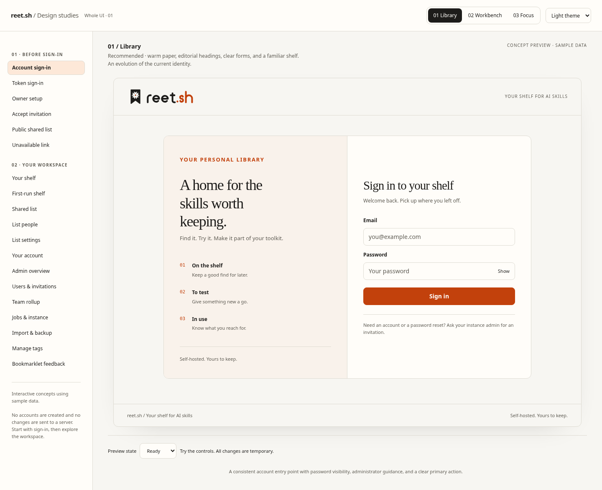
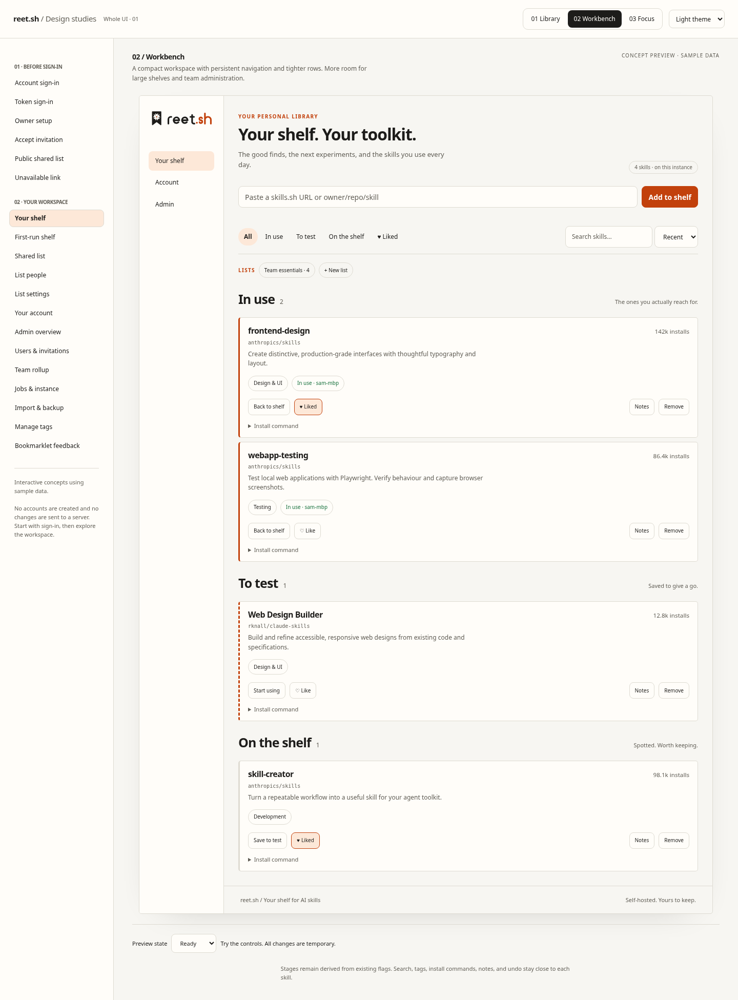
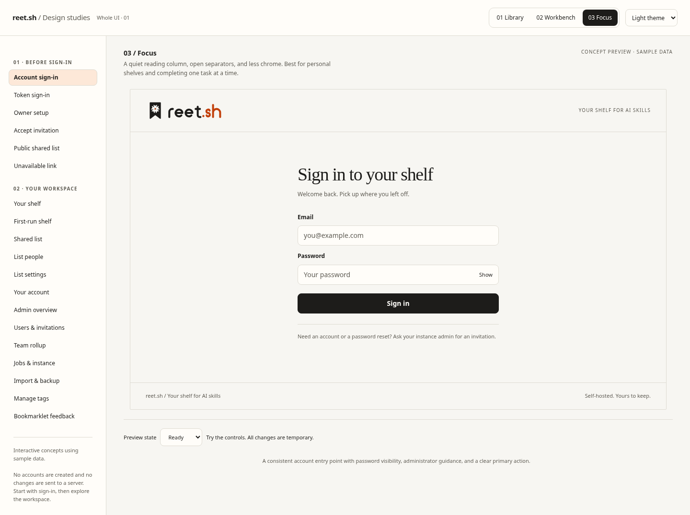

# Whole UI design studies

The explorer in `web/concepts/controller.html` covers the signed-out pages first, then the signed-in workspace. It is one self-contained HTML file with the existing brand wordmark, sample data, and no runtime dependencies or network calls. Open it directly in a browser, or run `npm run dev` in `web/` and visit `/concepts/controller.html`.

## Three directions

| Direction | Approach | Best suited to |
| --- | --- | --- |
| Library — recommended | Warm paper, serif headings, a two-column account form, and familiar shelf stages | An evolution of the current reet.sh identity |
| Workbench | Persistent desktop navigation, compact rows, sans-serif headings | Larger shelves and instance administration |
| Focus | One reading column, open separators, restrained controls | Personal use and focused tasks |

Switch directions without changing the selected page. Use the theme selector for light or dark, and Preview state for ready, loading, error, and empty examples. At narrow widths a screen selector replaces the navigation index. URL fragments select pages; for example, `controller.html?direction=workbench&theme=dark#admin`.

The prototype supports password visibility, password confirmation checks, navigation, search, stage filters, likes, moving skills, sample notes, removal with confirmation and undo, and sample exports. Changes last for the current page session. These are design demonstrations: no credentials are submitted, no accounts are created, and no server data is changed. Use placeholder credentials in the prototype.

## Screenshots

| Library | Workbench | Focus |
| --- | --- | --- |
|  |  |  |

[Implemented sign-in](images/ui/app-sign-in-light.png) · [Implemented phone layout in dark mode](images/ui/app-sign-in-mobile-dark.png)

## Coverage

| Before sign-in | Signed-in workspace |
| --- | --- |
| Account sign-in | Populated and first-run shelf |
| Token sign-in | Shared list |
| Owner setup | List people and list settings |
| Invitation acceptance | Account and personal API tokens |
| Public shared list | Admin overview and environments |
| Unavailable public link | Users and invitations |
| Loading and failure examples | Team adoption, drift, and privacy controls |
| | Jobs and instance settings |
| | Import, backup, restore, and tags |
| | Bookmarklet feedback |

The explorer has 19 named views. Some are panels in the existing app, not separate routes. Role-dependent controls are shown as an owner concept; the real app continues to enforce its existing permissions.

## Changes in the Svelte app

The implementation applies the shared Library foundation while leaving the three full design directions available for review:

- Account sign-in, setup, invitations, and legacy token sign-in share `AuthCard`.
- Account password fields share `PasswordInput`, with a labelled show/hide control, correct password-manager autocomplete, and preserved Svelte bindings.
- Forms declare required credentials, password length constraints for new passwords, busy state, and error descriptions.
- The header offers Shelf, Account, and Admin navigation when the authenticated role can use them. All routes have a skip link; non-public routes have descriptive document titles.
- Shared spacing and type tokens, a wider reading column, and a wider admin layout improve use of available space. Account and admin sections use consistent panels.
- Admin section links shorten navigation; wide tables can be focused and scrolled by keyboard. User-role selectors have accessible names.
- Restore from JSON uses a keyboard-operable button and file input.
- Public-list primary buttons keep the correct foreground colour. Active navigation, list-owner labels, and adoption badges have stronger contrast.
- The Go-rendered bookmarklet response now has a complete document, language, themed styling, readable feedback, and a link back to the shelf.
- The SVG wordmark geometry and core brand palette remain intact. The older shelf-only studies remain available from `web/concepts/index.html`.

No production dependency was added. The concept explorer is outside the shipped Vite entry graph and does not increase the embedded app bundle. The app still uses its existing APIs, authentication modes, permissions, shelf flags, and data contracts.

## Components and customisation

`AuthCard` accepts `title`, `lede`, an optional `eyebrow`, and its child form. Its supporting explanation collapses to a compact introduction on phones. `PasswordInput` accepts `id`, a bindable `value`, `autocomplete`, `placeholder`, `required`, optional `minlength`, and optional `describedby`; pair it with a `<label for>` in the parent form.

Global colours, fonts, content width, and shadow live in `web/src/app.css`. The explorer has its own inline tokens and overrides under `data-direction` and `data-theme`. Keep both palettes in sync when carrying a concept into production.

Build the production UI with `cd web && npm ci && npm run check && npm run build`, then run the existing Go server. No deployment or public hosting was performed. The explorer is a review artifact, rather than a user-facing theme switch in the production app.

## Verification

See `ui-verification.md` for the final checks and limits. The requested Web Design Builder skill was retrieved with `npx skills use "https://github.com/rknall/claude-skills" --skill "Web Design Builder"`; its complete output was read. Supporting files were resolved from the directory returned by the command.

Playwright MCP is not installed in this session. Its MCP verification phase was skipped. Separate local Chromium, Playwright, and axe-core checks were run as an alternative. No automated scan is a WCAG certification: manual screen-reader checks and testing on Safari, Firefox, and physical touch devices are still needed.

For an MCP-capable client, configure the official Playwright MCP server with `{"mcpServers":{"playwright":{"command":"npx","args":["@playwright/mcp@latest"]}}}` and restart that client. This configuration is not required to run reet.sh.
