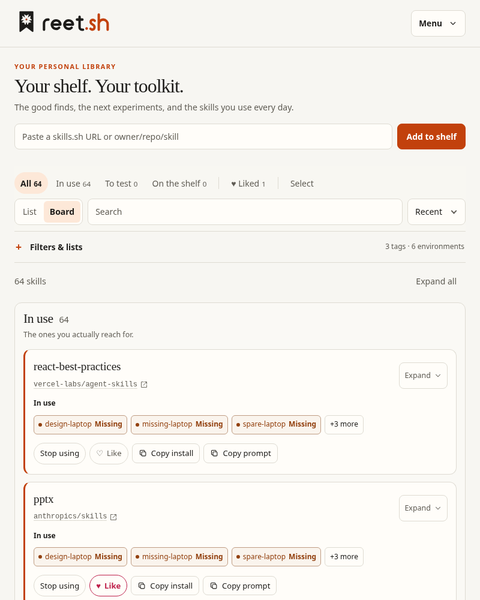
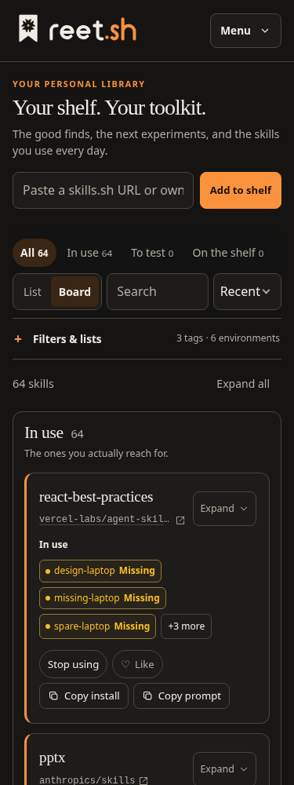
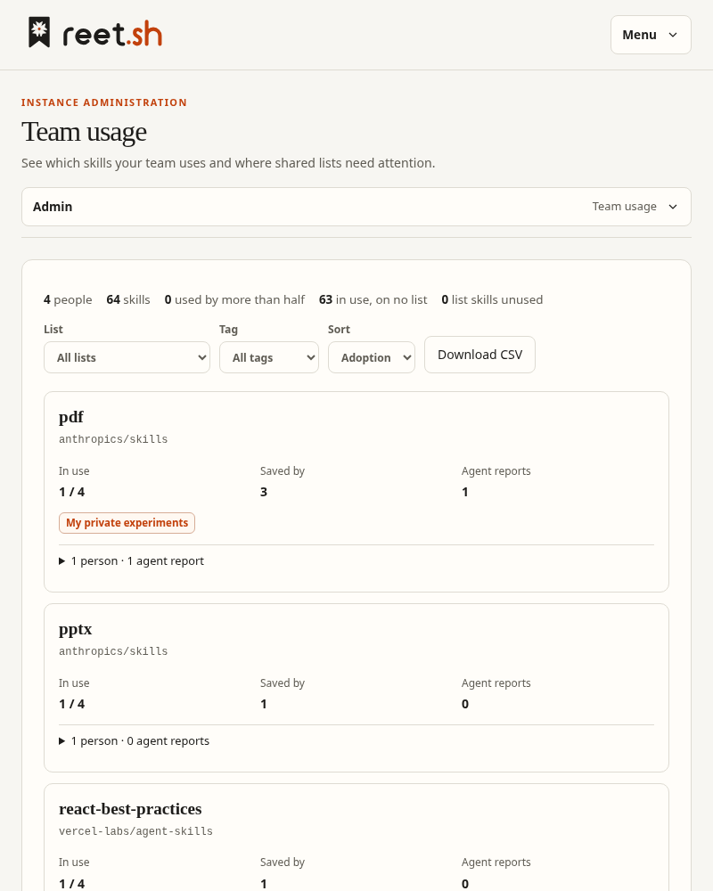
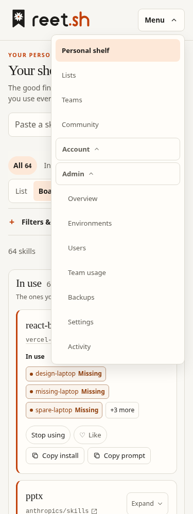
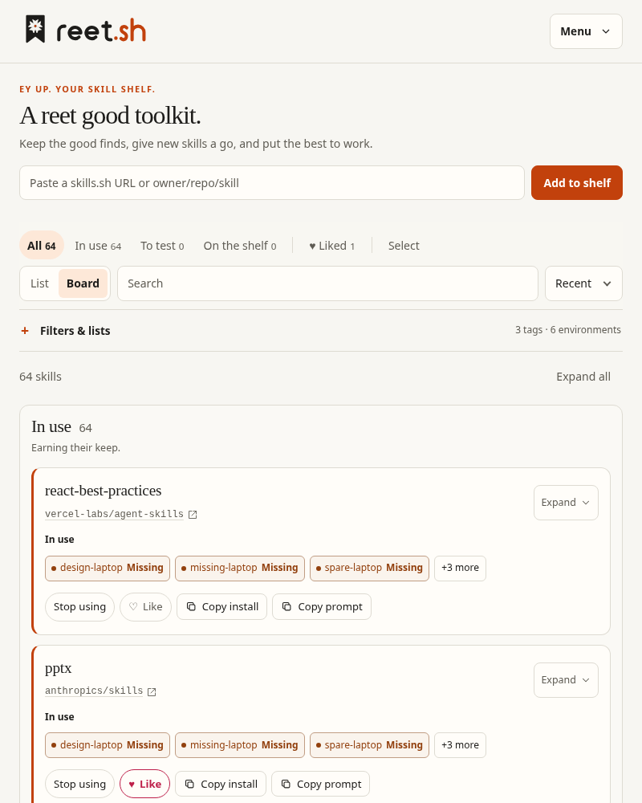
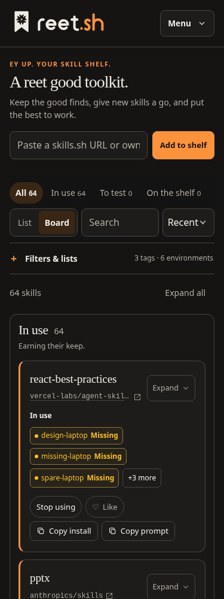
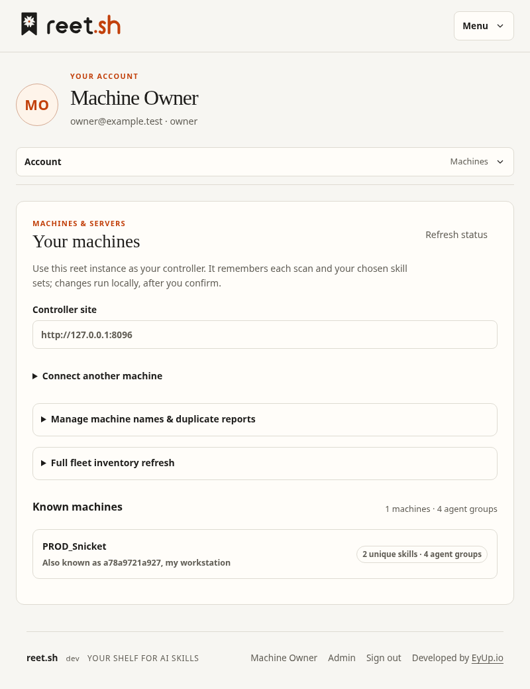

# UI verification — 21 October 2026

## UX follow-up: board and connection flow

The first review implementation builds on `216b3aa` (merged PR #27). It adds an optional, browser-persisted Board/List switch; desktop board columns follow On the shelf → To test → In use and stack below 900px. Stage buttons retain keyboard/touch operation and focus after moving a card. Board cards group History, metadata refresh and removal under More; Escape closes that disclosure and returns focus. Stage changes update shelf flags, not installed files. The existing list layout remains the default.

List settings now clone the saved audience into an independent draft and discard it on Cancel, closing Settings, or switching to People. Publishing an existing non-public list opens a confirmation with the actual description, skills and shared notes before a write. JSON is labelled as a personal shelf backup, with its exclusions described beside the export control and in the README.

Account creates named tokens inside Connect a machine, includes the fresh token in a copyable connection command, and acknowledges a complete recent scan for the chosen machine name. Tokens remain in memory only and disappear on reload. Token revocation requires confirmation. First-run shelf guidance and advanced tools are simplified. Shell installation now prints a safely quoted PATH command and the next steps for connecting or hosting; binary help describes the two journeys and server environment settings.

Validation on the updated source:

- `npm run check`: four machine tests pass; zero Svelte errors or warnings.
- `npm run build`: pass.
- `go test ./...`: all packages pass. Installer fixtures also ran uncached; a copied PATH command resolves the correct binary with spaces, an apostrophe and shell substitution characters in its path.
- 48 browser layout checks: first shelf, List, Board, publication confirmation, account connection, and viewer account × light/dark × 320/375/768/1440px. No document overflow.
- 24 axe scans across those states at 375/1440px: no reported WCAG 2/2.1/2.2 A/AA rule violations.
- Ten additional interactions pass: token creation/copy without local storage, complete-scan acknowledgement, token disappearance/revocation, draft cancellation including nested collaborators, publication preview/Escape, explicit publication, persisted board and keyboard stage moves, More-menu Escape/focus, empty search recovery, and accurate backup coverage. No browser runtime errors.

Browser tests used isolated SQLite fixtures and local Chromium with reduced motion. No production instance, native service installation or deployment was changed. Physical touch, screen readers, Safari/Firefox and native macOS lifecycle behaviour remain outside these checks. Consolidating Sharing & access, team administration, and the mobile navigation are subsequent review work.

This records the initial concepts and shared foundation. See [Library implementation and binary validation](library-implementation.md) for the selected production design and its follow-up checks.

## Collapsible skill cards

Shelf cards in both List and Board now start collapsed. Their overview keeps the skill name and source link, explicit stage, available install counts/weekly trend, deduplicated machine count, tag/list counts and a personal-note indicator. Long names are limited to two lines and long sources are ellipsised in the collapsed view; expanding reveals their full text. Stage moves, Like, Copy install and Copy prompt remain available while collapsed, subject to the account's write permissions. Source links open the original repository/site in a new tab; local-only skills show Unlinked source until linked. Detailed descriptions, tag editors, machine/list chips, history and notes are only rendered when expanded. These detailed actions replace the initial board's More menu. Desktop List cards use a denser two-column row for the overview and actions.

Per-skill expansion is held by the shelf during the current visit, so it survives card moves, filters and switching layouts. An explicit Expand all / Collapse all control operates on the visible shelf. Folding a note editor retains its unsaved draft until reopened on the same card. Native disclosure buttons expose expanded state and reference stable detail containers. Contextual copy-button labels also retain the visible Copied text after activation for speech-input compatibility.

Environment badges remain visible in both card states. They aggregate agent inventories per machine: green Installed means at least one complete, recent agent scan includes the skill; amber Missing requires all reported agent scans to be complete and recent with no occurrence. Neutral Not confirmed covers stale, partial or heartbeat-only inventories. Recent uses the same 14-day window as machine comparison. Status text accompanies the colour, and report freshness updates every minute while the page is open. The shelf indexes each machine's confirmed skill IDs once and shares that index across cards.

## Backup/profile integration (PR #28)

Integrated main through `2676376` (PR #29 destination testing/storage controls), preserving the sealed personal/instance backup service and new Account sections. List/Board and default card expansion now persist in the existing account profile. The toolbar saves layout changes; individual and bulk expansion overrides last for the visit. Read-only users may change display preferences, while name changes and backup writes remain restricted. Migration preserves existing profile preferences and defaults existing users to List with collapsed cards.

Tools links to Account and Admin backups instead of recommending manual database copies. Personal restore wording describes its merge behaviour: matching saved flags, notes and tags are replaced, later-added skills remain, and lists/teams/account settings are excluded. Local-copy and destination removal use keyboard-accessible confirmation dialogs. Backup tables expose labelled, focusable horizontal scrolling regions.

Validation covers profile migration/reopen persistence and invalid layouts, defaults across browser contexts, temporary expansion overrides, toolbar persistence, personal backup creation/verification/download/restore/deletion, instance creation/verification, and viewer preference isolation/write restrictions. Backup pages are checked at 375/1440px with axe. S3 tests use the project's test fixture; no real off-site destination or production restore was exercised.

## Scope and method

The requested Web Design Builder skill was run and its complete output read. Playwright MCP is unavailable, so its MCP-specific phase was skipped. Separate local Playwright tests drove the installed Chromium browser, and axe-core checked rendered pages against its WCAG 2 A/AA and WCAG 2.1 A/AA rules.

The real app was tested against Go servers using isolated SQLite databases under the temporary work directory. Test accounts, invitations, API tokens, skills, lists, and settings were created only in those databases. No existing instance or data was changed. Browser tooling was installed outside the app; the app package manifest and lockfile are unchanged.

## Results

| Check | Result |
| --- | --- |
| `npm run check` | Pass; zero errors and zero warnings |
| `npm run build` | Pass |
| `go vet ./...` | Pass |
| `go test -race ./...` | Pass; all Go packages |
| `git diff --check` | Pass |
| Concept layout matrix | 342 passes: 19 views × 3 directions × 2 themes × 3 widths |
| Concept axe scans | 114 scans; no reported violations: 19 views × 3 directions × 2 themes at desktop width |
| Real app layout and axe matrix | 114 passes: 19 rendered states × 2 themes × 3 widths; no document overflow or reported violations |
| Browser runtime errors | None in completed concept and app runs |

Widths were 375, 768, and 1440 CSS pixels. Desktop captures used a 1000-pixel viewport height; phone captures used 812 pixels. Reduced motion was enabled for the main runs. Wide tables scroll within their labelled regions.

The 19 app states were account sign-in, token sign-in, owner setup with bootstrap, first-run token shelf, populated shelf, tools expanded, tag management dialog, account, shared list, list people, list settings, confirmation dialog, admin with users/rollup/settings, public list, unavailable public link, invitation acceptance, expired invitation, bookmarklet success, and bookmarklet error. Owner setup without bootstrap and a first-run account shelf also passed in the initial integration run.

## Interaction evidence

The explorer passed password mismatch handling, password visibility, sample sign-in navigation, search, likes, notes, removal confirmation, Escape to close the dialog, undo, state switching, and keyboard tab navigation. Phones use a labelled screen selector.

Real server-backed checks passed:

- Owner setup rejects mismatched passwords and creates a session after valid input.
- Show/hide password preserves the bound value.
- Shelf search changes server-backed results.
- Restore from JSON opens the file chooser from a focused button using Enter.
- A personal token is shown once; reloading removes its secret from the page.
- A public list excludes member identity.
- An invitation creates the intended account; a member cannot open admin.
- Failed account sign-in is announced; valid credentials open the shelf.
- Legacy token sign-in rejects a wrong token and accepts the temporary valid token.
- A configured bootstrap credential remains required for owner setup.

## Issues corrected

- Orange selection text measured 4.36:1. It now uses ink with the brand tint.
- Adoption badges measured 4.49:1. The success colour was darkened.
- Public-list primary button text was overridden by a generic action rule. Primary buttons now retain their foreground colour.
- A hidden username input inherited full width and caused token sign-in overflow. The width rule now applies only to visible inputs.
- Admin role selects now have accessible names identifying their user.
- Restore now uses a keyboard-operable button to activate its file input.

Screenshots in `docs/images/ui/` show the final concepts and implemented form. The explorer is `web/concepts/controller.html`.

## Limits

Automated axe results are not a WCAG certification. Screen-reader behaviour, physical touch interaction, high zoom, long translated content, Safari, and Firefox still need manual validation. Checks exercised representative data and roles, not every permission combination or every control on every page. Explorer failure states demonstrate designs rather than real network recovery.

The explorer has no external asset dependencies. The production build emits roughly 62.4 kB of CSS and 177.1 kB of JavaScript (10.5 kB and 54.5 kB gzip). These are build sizes, not measured load times. The explorer is outside the production entry graph.

No deployment was performed. The three directions remain concepts; the app contains the shared Library foundation and improvements described in `ui-redesign.md`.

## Screenshot follow-up: navigation, density and reports

Built on main `8351479` after PR #30, then integrated `4b5a6ff` (PR #31 backup compression/password support) before opening the follow-up PR. The navbar has Account/Admin dropdowns on desktop and a nested Menu on phone/tablet widths, with native links, Escape/focus return and outside dismissal. Each section has its own refreshable URL and section menu:

- Admin: `/admin/overview`, `/admin/environments`, `/admin/users`, `/admin/team`, `/admin/backups`, `/admin/settings`, `/admin/activity`.
- Account: `/account/profile`, `/account/security`, `/account/sessions`, `/account/machines`, `/account/sync`, `/account/tokens`, `/account/backups`, `/account/activity`.

Old Account/Admin hash links resolve to their equivalent page. The old Connect a machine link opens setup on Machines. Navigation uses normal links so Back/Forward and open-in-new-tab work; profile edits and fresh tokens belong to the page and are discarded on navigation. Tokens have a standalone creation/copy/revocation page; setup can also create a token inline. Machine inventory, comparison/reference controls and token lists no longer share one long page. User/rollup data is fetched on the appropriate Admin page.

The shelf puts advanced filters/lists behind a disclosure, removes redundant heading counts/help, uses a compact capture row and stops pinning a tall toolbar on smaller screens. Empty Board stages are hidden below 900px, with their zero counts retained in the stage controls. Collapsed cards prioritise Installed/Missing before unknown reports and show up to three environment badges; +N more expands the card. Copy install, Copy prompt and source links remain visible.

Server-only heartbeat records are excluded from shelf filters/badges and machine comparison, while empty/stale agent inventories remain visible. Reports are retained: Admin Environments and Account Machines have separate collapsed heartbeat diagnostics. Machine/agent inventories are grouped into disclosures. Team usage uses cards at widths up to 1000px, keeping the skill identity with its metrics and expanding person/agent detail on demand. Desktop tables retain the skill/user column when scrolled. The former misleading Machines count is labelled Agent reports. User management actions fold behind Manage.

Validation used an isolated 64-skill fixture with all skills In use, multiple agent inventories and repeated container heartbeat IDs, plus a viewer account:

- Eight pure inventory/status tests pass, including exclusion of heartbeat-only machines without losing empty, stale or server-with-agent inventories.
- `npm run check`: zero errors/warnings; production build passes. `go vet ./...` and `go test -race ./...` pass.
- All seven Admin and eight Account routes load directly. Legacy links, Back, refresh, nested navbar/submenu navigation, collapsed setup, inventory separation and token creation/copy/revocation pass.
- 48 layouts: eight pages × 375/800/1440px × light/dark; no document overflow. Sixteen axe scans cover phone/tablet pages; three additional scans cover open menus at phone/tablet/desktop widths. Final team copy was checked again with axe.
- Menu keyboard opening, Escape/focus return, outside dismissal, bounded badges/reveal, collapsed prompt/source actions, viewer menus and write restrictions pass. No browser runtime errors.

Review captures (fixture data):

These are Chromium checks, not physical Android/iOS, Safari/Firefox or screen-reader certification. No production data was changed or removed.

## Yorkshire voice follow-up

Based on main `f53fe91` (PR #32). Restored Yorkshire character to populated, everyday pages: the shelf introduction and stage hints, sign-in, community, lists, teams, profile, admin and successful saves. Navigation, actions, installation states, privacy statements and destructive/error language retain their precise labels. `docs/voice-and-copy.md` records the approach for future changes. Existing installer/CLI completion copy already carries the voice and was retained.

Validation used a separate copy of the isolated 64-skill fixture:

- `npm run check`: eight inventory/status tests pass, zero Svelte errors/warnings; production build passes. `go vet ./...` and `go test -race ./...` pass.
- Six populated/representative pages at 375/800/1440px in light/dark: 36 layouts without document overflow. Seven axe scans cover these pages and signed-out sign-in at phone width, with no violations of the selected WCAG A/AA rules.
- Populated shelf heading and stage hint render; collapsed Copy prompt copies the real command, source remains available, and the new empty-search message recovers through Clear filters. Signed-out welcome checked; no browser runtime errors.
- Reviewed tablet light and phone dark captures below. Static wording changes have browser verification rather than unit tests that mirror strings. No dependencies added, production data changed or deployment performed. Physical device, other browser and screen-reader checks remain outside this verification.

## Machine alias repair and self maintenance

Built on main `f53fe91`. Account → Machines now supports reviewing a merge/rename, forgetting a whole machine, and generating inventory-only fleet refresh commands. Matching agent/project reports keep the newest scan without unioning stale installs; distinct groups remain. Account-scoped aliases survive restarts and redirect ordinary old-name imports, pruning, heartbeat registration, machine filters and restores. Saved reference snapshots are retargeted without changing their desired contents/revisions; conflicting references abort the entire transaction. Updated sync binaries accept historical host/target aliases.

`reet scan --prune --reconcile --env NAME` explicitly associates the actual hostname with the preferred name before importing a fresh scan. Dry runs send neither repair nor inventory writes. The fleet check counts only complete reports received after its start; it requires running the command on each physical machine and from each tracked project. No install/remove commands are issued. Offline or unscanned scopes are not claimed as refreshed.

Validation:

- `go vet ./...`, `go test -race ./...`, frontend check and production build pass. Zero Svelte errors/warnings; eight existing frontend inventory/status tests remain passing.
- Store/API tests cover duplicate groups, latest inventory selection, preserving reference snapshots/legacy IDs, conflict rollback, account isolation, rename chains/back-to-old-name, restart persistence, alias-aware restore/filtering/heartbeats, whole-machine forget and shelf retention. Viewer writes and anonymous requests are denied.
- CLI tests cover actual-hostname reconciliation before import, preserving installed files, dry-run/no-name/conflict handling, no credential output, old host/target sync aliases and rejection of unrelated hosts.
- Chromium with real CLI execution against isolated fixtures: two machine names/eight agent reports become one preferred name/four agent groups. A refresh prunes five stale reported skill links, updates all four complete reports, moves progress from 0/4 to 4/4, and retains the saved reference. Rename survives reload and old-hostname imports; forgetting removes reports while keeping both shelf skills. Merge cancellation and forget Escape work.
- Six maintenance layouts at 375/800/1440px in light/dark, three axe scans, no document overflow or runtime errors.

This does not alter production records until deployed and used. The repair tests use temporary databases and fake skill folders; physical device/browser and screen-reader checks remain manual.

## Private skills dialog: layout, focus and motion matrix — 25 October 2026

Built on main `e5399b6` plus the fix round `d75b873`. This records what the browser fixture
`web/tests/skill-content.e2e.mjs` now checks for the [Private skills dialog](skill-content-review-ui.md),
what an accessibility scan found, and what was not checked. It adds no component change: the
matrix found no layout or focus defect.

**Layout matrix.** Ten states, each at 1360, 768, 390 and 320px wide in light and dark (eight
size and theme pairs per state): the Pin step with two pins (one with a very long unbroken name)
and two ownership records (one damaged); the Check step before a check, while waiting for the
machine, and with a found folder of 60 long unicode file names; the Adopt step with nothing chosen
and with the 256-file breakdown including a very long unicode path; the record confirmation; the
read-only "Up to date" result with three ownership records; the release confirmation; and the same result after the release, with two records. For each
state the page has no horizontal overflow, the dialog sits inside the window with **Close** in the
header and **Done** in the footer in view, no scrolling table or file list overflows sideways, each
primary action is scrolled to inside the dialog's own body and a hit test at its centre lands on it
(nothing covers it), and a confirmation sits inside the window with both its buttons reachable. The
primary actions are in the scrolling body (**Save pin**, **Check this machine** or **Check again**,
**Record ownership**, **Release ownership**) and in the confirmations; the fixed footer holds **Done**.

**Focus and Escape.** One walk through the dialog is made at 1360 light, 768 dark, 390 light and 320
dark, opened by a real click on the scope's button. Escape in the record confirmation closes only that
confirmation, returns focus to **Record ownership** and sends nothing; **Cancel** does the same;
**Confirm and record** sends one request and focus moves to the Check step's heading because the
button has gone. The same three ways out of the release confirmation leave focus on **Release
ownership** (cancelled) or the records heading (released). Escape on the dialog closes it, writes
nothing and returns focus to the opener, and so does **Done** on a second opening.

**Reduced motion.** The 320px walk runs with `prefers-reduced-motion: reduce`. In every state, and with
both confirmations open, no animation in any open dialog is running and no element in an open
dialog has an animation or a non-zero transition in its computed style. Without the preference the
buttons do transition, so the check is not vacuous; removing the no-preference guard from the
confirmation's entrance animation, as a deliberate break, made the fixture fail.

**Runs.** Four consecutive local runs of the fixture passed against the production build (126, 120,
127 and 123 seconds; the file took about 80 seconds before the matrix). An earlier run of the first
version of the matrix hit a race in an older check, the one that moves the browser clock on by a
minute while the tab is hidden: a read that was already under way landed after the clock had moved
and was stamped as fresh. The fixture now waits for that read before moving the clock
(`settleReads`), and the four runs above are after that fix. The machine-import, control and
public-workspace fixtures also passed.

**Accessibility scan.** `axe-core` 4.10.2 was installed with `npm` in a temporary directory outside
the repository (nothing was added to `package.json` or the lock file) and run through Playwright over a
copy of the same walk, scoped to the topmost open dialog, with the `wcag2a`, `wcag2aa`, `wcag21a`,
`wcag21aa` and `wcag22aa` rule tags. That is 40 scans: the ten states above at 375 and 1440px in light
and dark. With transitions off (reduced motion) there were no violations, and the same with
transitions on and a 600 millisecond wait before each scan. A first pass without that wait reported
`color-contrast` on buttons in 17 of the 40 scans, which disappeared once the transitions had
finished; axe was reading colours part-way through a 150 millisecond transition, so I treat those as
a timing artefact of the scan and not as a contrast defect, though I did not measure the contrast
ratios by hand. Axe also reported `color-contrast` as "incomplete" (it could not decide) in 34 to 36 of the 40
scans and `th-has-data-cells` in 4, and these were not reviewed further. The scan is not a
CI gate and the script is not part of the repository.

**Not checked.** No physical phone or tablet, no screen reader, no Safari or Firefox: only Chromium,
driven by a fixture that answers every API call with synthetic data. The fixture proves what the page
does with those answers, not what a connector or the server would send. Touch target sizes were not
measured. No production data, machine, terminal session or deployment was involved.

## Add a machine in context: layout, focus and motion matrix — 25 October 2026

Built on main `6675d2d` plus the Private skills entry and landing commit `186bbe9`. This records what
the browser fixture `web/tests/add-machine.e2e.mjs` checks for the
[Add a machine dialog](add-machine-in-context.md), what an accessibility scan found, and what was not
checked. The matrix found no layout or focus defect. Three small fixes from earlier reviews went in
first, each with a fixture assertion that failed before the change: the landing now judges the folder
again at the instant it opens the Private skills dialog (a folder that has stopped qualifying opens
nothing and the page says "Private skills can't open on that folder right now."); focus falls back to
the **Add a machine** button when the folder's own button is not drawn; and the landing note goes into
a status region that is already on the page. Two comments (why a context with neither a skill nor an
agent is a Machines-page context, and why the automatic-continue timer is tagged) and two unit
assertion on that context were added too.

**Layout matrix.** Ten states of the dialog, each at 1360, 768, 390 and 320px wide in light and dark
(eight size and theme pairs per state), and the sign-in card the page shows when the sign-in is lost
mid-watch (the dialog's own signed-out sentence is replaced by that card, so the card is what is
checked): loading; the name's validation message; waiting; connected with a paused connector;
waiting for the first scan; ready; still waiting at the 15-minute cap; already here, with the note
that says what an alias was saved under; ready from the Private skills dialog with the three-second
continue notice and its **Cancel**; and the Private skills dialog's landing note. A name of about 100
unbroken characters is used wherever the command block shows. For each state the page does not scroll
sideways, the dialog sits inside the window with neither it nor its body scrolling sideways, the
command block wraps inside its container, and each primary action (**Use**, **Check again**,
**Cancel**, **Copy commands**, the name field or the close button, whichever the state offers) is
scrolled into view and a hit test at its centre lands on it. The dark surface is checked to differ
from the light one, so the scheme change is real. Breaking the block's wrapping on purpose made the
fixture fail at the first size.

**Focus and Escape.** At each of the eight size and theme pairs the dialog is opened by a script
click (no focus moves, as on Safari and Firefox on a Mac), the name is typed and Escape is pressed:
the dialog closes, focus is on **Add a machine**, and no request other than a read was sent. The
same is done from the Private skills dialog through **Not listed? Add a machine**: Escape returns focus to
the folder's button. Closing with the button and the Use landings are checked in the earlier parts of
the file.

**Reduced motion.** With `prefers-reduced-motion: reduce`, no element in the open dialog has an
animation or a transform transition with a non-zero duration, and no animation or transform
transition in it is running (the copy button still fades its opacity over 100 milliseconds, which is
allowed). Landing a new machine from Machines then scrolls with `auto` instead of `smooth` (the same
landing without the preference scrolls `smooth`), and the card keeps its highlight as a still ring
and a changed border colour, with no animation on it.

**Runs.** Four consecutive local runs of the fixture passed against the production build (53, 52, 56
and 52 seconds; the file took about 34 seconds before the matrix), with
`PLAYWRIGHT_CHROMIUM_EXECUTABLE_PATH=/opt/pw-browsers/chromium` and the preview server on port 4173.
The skill-content, machine-import, control and public-workspace fixtures also passed. Full validation
results are recorded in the pull request.

**Accessibility scan.** `axe-core` 4.10.2 was installed with `npm` in a temporary directory outside
the repository (nothing was added to `package.json` or the lock file) and run through Playwright over
a copy of the same walk, scoped to the topmost open dialog (the page for the sign-in card), with the
`wcag2a`, `wcag2aa`, `wcag21a`, `wcag21aa` and `wcag22aa` rule tags and a 700 millisecond wait before
each scan so that transitions had finished. That is 44 scans: the eleven surfaces above at 375 and
1440px in light and dark. There were no violations. Axe reported `color-contrast` as "incomplete" (it
could not decide) in 40 of the 44 scans, and I did not review those or measure the contrast ratios by
hand. The scan is not a CI gate and the script is not part of the repository.

**Not checked.** No physical phone or tablet, no screen reader, no Safari or Firefox: only Chromium,
driven by a fixture that answers every API call with synthetic data. That a screen reader announces
the landing note was not heard; the note is only shown to arrive after its region exists. The landing's
second look is exercised by moving the browser clock on past the 14-day window between pressing
**Use** and the page drawing the landing, not by pausing a connector in the same instant. Touch target
sizes were not measured. No production data, machine, terminal session or deployment was involved.

## Start an agent session: layout, focus and motion matrix — 25 October 2026

This section was built on `f7e47ae` plus the hardening commit `0d09906` and the matrix commit
`721988a`. It records three things for the [Start an agent dialog](start-agent-session.md):

- what the browser fixture `web/tests/start-agent.e2e.mjs` checks;
- what an accessibility scan found;
- what was not checked.

**Defects found and fixed.** The matrix and the scan found three defects. Each fix has a fixture
assertion that failed before the change.

1. **The footer covered fields on narrow screens.** The footer with the status line and **Start**
   was sticky inside the scrolling form. At 390 and 320px, a field scrolled into view (the Folder
   select first) sat underneath it, so a hit test at its centre landed on **Start**. The footer now
   sits below the scrolling fields, outside the scrolling part.
2. **The "Not installed on this machine." reason failed contrast.** It sat in a row faded to 75%
   opacity, and axe reported a `color-contrast` violation in 21 of the dialog scans. Now only the
   agent's name is dimmed, and the reason keeps full contrast.
3. **The locked form couldn't be scrolled by keyboard.** While a request was held or its outcome
   unknown, every field in the scrolling part was disabled, so a keyboard user couldn't reach it to
   scroll (axe `scrollable-region-focusable`, 12 dialog scans). While locked, it is now a focusable
   region named "Your choices".

An earlier review had also found that a validation message stayed in the status line after the
field was fixed. It is now cleared as soon as a field is edited, and replaced on the next attempt.

**Layout matrix.** 24 states, each at 1360, 768, 390 and 320px wide in light and dark (eight size
and theme pairs per state):

- both closed entry points (the Terminals sidebar's **New agent session**, and the machine cards'
  **Start an agent**, including a disabled one);
- the dialog as it opens, with OpenCode not installed;
- a machine with a 60-character unbroken name and a project folder of about 130 characters, with
  three agents not installed;
- the sentence line with a prompt (the process-list line);
- the machine you came from not ready;
- no machine ready;
- an old machine;
- **Other…** with its message;
- a typed relative path with its message;
- a 2,001-byte prompt with its counter;
- the leading-dash rule in the status line;
- **Starting…** while held;
- the lost reply with **Try the same request again**;
- the landing on the new session;
- the nine refusals: folder, agent not installed, one-word prompt, update reet, session limit,
  request changed, access refused, terminals switched off on the server, and reconnecting (kept for
  retry).

For each state:

- the page does not scroll sideways;
- the dialog sits inside the window;
- neither the dialog, its scrolling part, nor any element inside it reaches past the dialog's edges;
- each primary action for that state is scrolled into view, and a hit test at its centre lands on
  it. The primary actions are **Start**, **Try the same request again**, **Starting…**, **Close**,
  the field the message is about, the status line, the entry buttons, or the session pane.

For the long names, the machine and folder selects show what fits. The fixture checks that the
whole value is the selected option's text and that the sentence line, which wraps, holds both in
full. The dark surface is checked to differ from the light one, so the scheme change is real.

Three mutants made the fixture fail:

- `white-space: pre` on the sentence line;
- a fixed `min-width: 640px` on the dialog;
- putting the sticky footer back.

Removing only the `min(…)` cap did not make it fail, because the browser's own dialog style still
caps the width.

**Focus and Escape.** At each of the eight size and theme pairs, the dialog is opened from the
Terminals sidebar and then from the long-named machine's card. A prompt is typed and Escape pressed.
The dialog closes, focus returns to the button that opened it, and no request is sent. Earlier parts
of the file check **Close**, Escape on a held first **Start** and on a held retry (both wait), and
focus after each refusal.

**Reduced motion.** Without the preference, the dialog's buttons have a press (transform)
transition, so the check is not empty. With `prefers-reduced-motion: reduce`, no element in the
open dialog has an animation or a transform transition, and none is running.

**Storage.** During the matrix, nothing was written to browser storage under a key that hadn't
already been written before it: only the workspace's layout preference and the sign-in token's
clean-up. Nothing about a prompt, model or folder was written. The whole file also records IndexedDB
opens, deletes and store writes, and finds none apart from its own recorder self-check.

**Runs.** Four consecutive local runs of the fixture passed against the production build (50, 50,
47 and 49 seconds; the file took about 8 seconds before the matrix), with
`PLAYWRIGHT_CHROMIUM_EXECUTABLE_PATH=/opt/pw-browsers/chromium` and the preview server on port 4173.
The public-workspace, control, machine-import, skill-content, add-machine, terminal-workspace,
terminal-lifecycle and terminal-organisation fixtures also passed. Full validation results are
recorded in the pull request.

**Accessibility scan.**
- **Setup.** `axe-core` 4.10.2 was installed with `npm` in a temporary directory outside the
  repository. Nothing was added to `package.json` or the lock file.
- **How it ran.** It ran through Playwright over a copy of the same walk, with the `wcag2a`,
  `wcag2aa`, `wcag21a`, `wcag21aa` and `wcag22aa` rule tags. Each scan waited 700 milliseconds
  first and covered the open dialog, or the whole page for the closed entry points and the landing.
- **Scope.** 96 scans: the 24 states at 375 and 1440px in light and dark.
- **The dialog, after the fixes.** 84 dialog scans, no violations.
- **The page.**
  - In 4 of the 12 page scans (the Terminals page and the landing, at 375px), axe reported
    `scrollable-region-focusable` on the terminal pane's mobile key row, `.mobile-keys`. That is
    outside this dialog and was not changed.
  - Axe reported `aria-prohibited-attr` as "incomplete" in all 12 page scans: on the terminal
    toolbar and the machine cards' agent chips. I did not review those.
- **Contrast.** Axe reported `color-contrast` as "incomplete" (it couldn't decide) in all 96 scans.
  I did not review those or measure the contrast ratios by hand, so contrast is not shown to pass.
- **Status.** The scan is not a CI gate, and the script is not part of the repository.

**Not checked.**
- No physical phone or tablet, no screen reader, no Safari or Firefox. Only Chromium, driven by a
  fixture that answers every API call with synthetic data.
- Whether a screen reader announces the status line or the locked region's name was not heard.
- Touch target sizes were not measured.
- Landscape phone sizes were not in the matrix.
- No live machine, agent CLI, production service or deployment was involved, so nothing here shows
  an agent starting.

## Phone terminal: keyboard, size and repaint — 26 October 2026

This section was built on main `188236e`. It records what the new browser fixture
`web/tests/terminal-phone.e2e.mjs` checks for the [phone terminal rules](terminal-workspace.md#phones),
how the rules were mutation-checked, and what was not checked.

**Starting point (same synthetic fixture, 390 × 844, keyboard shrinking the visual viewport to 464).**
41 × 10 sent with the keyboard open, 42 × 14 maximised; 14 px text. Every keyboard animation frame
sent a resize, identical sizes were resent, and the size could drop to 1 row.

**What the fixture checks.**
- **Phone (390 × 844, touch).**
  - No stored font gives 11 px and a ticket of at least 50 columns (53 here); a stored 16 still wins.
  - The pane header, terminal toolbar and key row are each at most 42 px tall, and every control in
    them is at least 40 px tall. The user/host stays in the header.
  - Both sideways rows overflow, carry the end fade, fade at the start once scrolled, and have
    `overflow-x: auto`. The key row takes focus and scrolls with the arrow keys.
  - The Alt+Shift+M advice is in the DOM but hidden when maximised; Show sessions stays in the
    terminal toolbar.
  - Keyboard open while typing in the terminal: the site header, the workspace toolbar and the pane
    footer are hidden, and Show sessions is visible. A ten-step keyboard animation sends exactly one
    resize (53 × 24 here, at least 15 rows asserted); the pane ends 0–10 px above the keyboard; the
    same height again sends nothing; closing the keyboard brings everything back.
  - Maximised with the keyboard open: at least 15 rows (55 × 25 here), the pane ends within 2 px of the
    keyboard, and the renderer fits.
  - The page shrunk for the keyboard (`resizes-content`) while the visual viewport reports 91 px less:
    the pane still ends at the keyboard.
  - A 330 px tall screen sends 53 × 8: every frame is at least 20 × 8 and the last row (the agent's
    input line) stays visible.
  - Returning to the page sends exactly two frames on the same socket, one row shorter and then the
    real size. A reattach does the same, ending on the fitted size. The first attach sends no nudge.
- **1360 × 900 and 768 × 900 (mouse).** 14 px text; the pane header, toolbar and screen frame keep
  their padding (`7px 12px`, `5px 8px`, `12px 10px 8px 14px`); no fade; the key row stays hidden; the
  footer is visible; the maximised pane sits 12 px from each edge; the Alt+Shift+M advice shows. A
  shrinking visual viewport while typing does not start the keyboard layout. A 390 × 844 window
  without touch keeps its header too.
- **Before and after, measured.** A separate probe measured the site header, workspace toolbar, pane,
  pane header, toolbar, screen frame, screen, footer and the size sent, normal and maximised. At
  1360 × 900 and 768 × 900 every number was identical before and after. A 768 × 1024 touch tablet
  differed only by the hidden Alt+Shift+M advice (31 px), which gave the maximised screen two more rows.

**Mutation checks.** Each rule was broken in the source, the bundle rebuilt and the fixture run
against it; the unit tests in `web/tests/terminal-sizing.test.mjs` were run too. All 14 mutants were
caught by the fixture; 6 were also caught by the unit tests.

| Rule broken | Caught by |
| --- | --- |
| Floor at 1 row, 2 columns | unit, fixture (8-row floor) |
| No debounce | fixture (one frame per keyboard animation) |
| Identical sizes resent | unit, fixture (same height sends nothing) |
| No repaint on return | fixture (two frames on return) |
| Nudge on the first attach too | fixture (first attach) |
| Visual viewport height always used | unit, fixture (under-reported viewport) |
| Advice shown on touch | fixture |
| 14 px on phones | unit, fixture |
| Site header not hidden / workspace toolbar not hidden | fixture (each) |
| Keyboard layout without touch | unit, fixture (narrow window without touch) |
| Rows keep their padding | fixture (row height) |
| No fade | fixture |
| Floored grid not shifted to show its last rows | fixture (last row visible) |

**Runs.** The full fixture list of `.github/workflows/terminal-browser.yml` ran twice against the
production build, including the terminal workspace, lifecycle, organisation and phone fixtures. The
existing terminal-workspace bounds held: 390 × 844 now has a 576 px screen (was 529) and 390 × 420
has 152 px (was 105). The real browser, broker and tmux test
(`TestTerminalPrivateLifecyclePreservesActualShell`) passed twice with a UTF-8 locale; it now counts
the attachment ticket as a sent size and waits for the debounced phone resize. Without a UTF-8 locale
its emoji step fails in this container on main as well.

**Not checked.**
- No physical phone. The keyboard is simulated by replacing `visualViewport` or resizing the page;
  whether a given Android browser honours `interactive-widget=resizes-content`, and the toolbar
  under-report itself, need the device check in `handoff.md`.
- No real agent: the repaint nudge was checked on the wire and, through the existing real tmux
  fixture, against a shell; whether a particular agent repaints in full after it is a device check.
- Landscape phones (wider than 650 px) keep the tablet layout.
- No accessibility scan was run for this change; no Safari, Firefox or screen reader.

## Projects: layout, focus and motion matrix — 26 October 2026

This section was built on main `cfde296` (Projects PR 3) plus the matrix commit `7d95f48`. It
records what the browser fixture `web/tests/projects.e2e.mjs` checks for [Projects](projects.md)
beyond the behaviour already in it, what an accessibility scan found, and what was not checked.

**Defects found and fixed.**

1. **The Remove worktree details couldn't be scrolled by keyboard.** The dialog's middle part (the
   folder, counts and up to 20 changed paths) scrolls on a small screen but held nothing focusable,
   so a keyboard user couldn't reach it to scroll (axe `scrollable-region-focusable`, 6 dialog
   scans). While it scrolls it is now a focusable region named "Worktree details", with its focus
   ring drawn inside it (outside, the dialog clipped its sides and the footer covered its bottom, a
   review found; the locked Start all and Project forms had the same ring and got the same fix). When
   everything fits it is no tab stop. The fixture presses Tab from **Close** at 320px and expects
   that region focused (it failed before the change), checks the ring's computed offset is inside,
   and checks there is no region or tab stop when the confirmation fits at 1360px. A rerun of the axe
   scan after this change found the same results as below.
2. **The fixture's dark scheme was not dark.** Its synthetic profile saved the theme `light`, which
   pins the light colours whatever the system scheme says, so the earlier "320px in light and dark"
   check ran in light twice. The profile now follows the system scheme, and the matrix checks that the
   page and dialog surfaces differ between the two schemes.

**Layout matrix.** 19 states, each at 1360, 768, 390 and 320px wide in light and dark (eight size
and theme pairs per state), changed under the open page or dialog without a reload:

- the Projects list empty, and loaded with an 80-character unbroken Project name;
- **New project** as it opens, and with a repository on a machine with a 60-character unbroken name
  and a 130-character folder, a typed relative path and the refusal Save gives;
- the Project page with a run whose five repositories are started (one with that long machine and
  folder), failed (attempt 3), removed and pending, with **Open**, **Retry** and **Remove worktree**;
- **Change** with five repositories (one on a machine no longer on the account), and its 409
  `project_changed` with **Reload the Project**;
- **Start all** with every reason shown and **Add a machine**, a lost reply with **Try the same
  request again**, and a 409 `run_in_progress` refusal;
- **Remove worktree** blocked by every check at once (23 changed files with 20 long paths shown,
  commits on no branch, hidden edits, a nested repository, an incomplete check), its confirmation, and
  git refusing the check with its detail line;
- **Delete** and its 409 `project_changed`;
- a Project page that couldn't be read (503), one not on the account, one just deleted, and the
  read-only account's notice.

For each state and pair:

- the page does not scroll sideways;
- an open dialog sits inside the window, and neither it, its scrolling part, nor any element inside
  it reaches past its edges;
- each primary action for that state is scrolled into view and a hit test at its centre lands on it
  (for a link that wraps, the centre of its first line). The primary actions are **New project**, the
  Project link, **Start all**, **Change**, **Delete**, **Retry**, **Remove worktree**, **Open**, the
  dialogs' Save, Start, Remove, Check again, Reload, Close and Keep it buttons, **Add a repository**,
  **Add a machine**, the field a message is about, the status line, the error notice and **Back to
  Projects**, whichever the state has. A box may sit up to 1px past the window's edge after
  scrolling.

Five mutants each made the fixture fail: no `overflow-wrap` on a run member's lines, no
`overflow-wrap` on a Project card, a `min-width: 640px` on the Start all sheet, an entrance
animation on that sheet without the reduced-motion guard, and the Delete dialog not returning focus
on close. The first three were also caught by the fixture's earlier 320px checks; with those switched
off in a copy, the matrix caught each of them.

**Focus and Escape.** At each of the eight size and theme pairs, **New project** (with a name typed),
**Change**, **Start all**, **Delete** and **Remove worktree** (once its check has answered) are opened
and closed with Escape. Each dialog closes, focus returns to the button that opened it, and nothing
but reads is sent. The openers are pressed by a script click with nothing focused, as a click on
Safari, or on Firefox on a Mac, focuses no button, so the returned focus is the dialog's own doing:
Chromium returns focus to what was focused before a modal opened, which hid the focus mutant above
until the click was changed.

**Reduced motion.** Without the preference, the buttons have a press (transform) transition, so the
check is not empty. With `prefers-reduced-motion: reduce`, nothing on the Project page (with a run
open) and nothing in any of the five dialogs has an animation or a transform transition, and no
animation is running.

**Storage.** During the matrix nothing was written to browser storage under a key not written before
it, and nothing holding the long Project name, a folder or a Project id.

**Runs.** Four consecutive local runs of the fixture passed against the production build (131, 129,
128 and 130 seconds; the file took about 98 seconds before the matrix, most of it two deliberate
15-second read timeouts), with `PLAYWRIGHT_CHROMIUM_EXECUTABLE_PATH=/opt/pw-browsers/chromium` and
the preview server on port 4173. The navigation and start-agent fixtures also passed.

**Accessibility scan.**
- **Setup.** `axe-core` 4.10.2 was installed with `npm` in a temporary directory outside the
  repository. Nothing was added to `package.json` or the lock file.
- **How it ran.** Through Playwright over a copy of the same walk, with the `wcag2a`, `wcag2aa`,
  `wcag21a`, `wcag21aa` and `wcag22aa` rule tags, at 375 and 1440px in light and dark. Each scan
  waited 700 milliseconds first and covered the topmost open dialog, or the whole page.
- **Scope.** 76 scans: the 19 states at those four pairs (48 dialog scans, 28 page scans).
- **Before the fix.** 6 violations, all `scrollable-region-focusable` on the Remove worktree
  dialog's details (blocked at 375 and 1440px, and the confirmation at 375px), fixed as above.
- **After the fix.** No violations.
- **Incomplete.** Axe reported `color-contrast` as "incomplete" (it couldn't decide) in 62 of the 76
  scans, 298 element results in all: the element's background "partially overlaps other elements"
  (108) or is "partially obscured by another element" (176), or its text is "too short to
  determine" (14).
  I did not review those or measure the contrast ratios by hand, so contrast is not shown to pass.
  Nothing else was incomplete.
- **Status.** The scan is not a CI gate, and the script is not part of the repository.

**Not checked.**
- No physical phone or tablet, no screen reader, no Safari or Firefox. Only Chromium, driven by a
  fixture that answers every API call with synthetic data that imitates the Go handlers; it proves
  what the pages do with those answers, not what a server or machine would send.
- Whether a screen reader announces the status lines, the run summary or the region's name was not
  heard.
- Touch target sizes were not measured. Landscape phone sizes were not in the matrix.
- A Project with 12 repositories, or 50 Projects, was not in the matrix.
- No live machine, agent CLI, git repository, production service or deployment was involved, so
  nothing here shows an agent starting or a worktree being removed.
