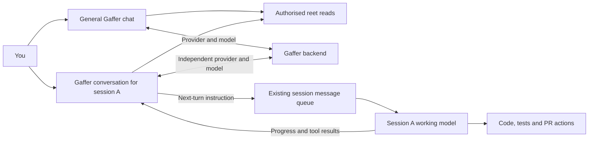

# Reet work orchestration and Eli: staged implementation handoff

Prepared: 1 November 2026. Updated: 6 November 2026. Active direction: the Gaffer
session-companion MVP below. Product decisions and the initial HTTP provider
foundation, provider settings and general/session companion chat are recorded
here. GM3A adds explicit retained-context sharing and scoped MCP reads. GM3B adds
separate worker-message grants and bounded queue receipts. GM4 adds explicit saved
session goals and bounded offline follow-up.

## Active direction: Gaffer session-companion MVP (5 November 2026)

This section records the user's latest decisions and takes precedence over older
sequencing and coordinator-placement proposals in this document. The broader KZ
roadmap remains the direction for durable work across agents, models and machines.
Deliver the first useful companion around existing reet sessions before requiring
that entire domain, cross-machine dispatch and independent-review system.

### Product contract agreed with the user

Gaffer is the user's critical buddy. The model already working on the reet session
does the implementation, runs commands, raises the PR and addresses checks or merge
conflicts. Gaffer reads permitted evidence, asks useful questions and communicates
follow-up instructions to that existing session. Its own provider/model and
conversation are separate from the working model's context and credentials.



Example: inside a session, the user asks, "Look after this session for me and
ensure a PR is raised and issues fixed." Gaffer retains that goal, follows the
working model's progress and requests the next useful action within the agreed
scope. It brings approval requests and scope changes back to the user. It can
explain what happened, what remains, what is blocked and what needs a decision.

| Decision | Agreed behaviour |
| --- | --- |
| Initial delivery | An MVP using reet's MCP foundation, extending its tools and grants where needed |
| Complete MVP scope | Provider settings, floating chat, evidence-based summaries and session follow-up through PR creation, check fixes and conflict resolution by the working model |
| General chat | Outside a session, a separate Zoomies-style Gaffer conversation for general reet questions and permitted activity reads |
| Session chat | Each reet session has its own Gaffer conversation and context; changing sessions must not carry the previous session's conversation into the new one |
| Several sessions | Gaffer can follow several explicitly selected sessions independently, each with its own goal, conversation and progress |
| Activation | The user explicitly asks the session's Gaffer to look after it; opening the widget alone does not start background follow-up |
| Busy worker | Queue instructions for the next turn by default; offer an explicit interrupt option through supported session controls |
| Eligible workers | Initially follow supported structured chats with a verified message channel to the existing model; clearly explain availability for other sessions |
| Offline operation | Persist coordination on the controller; continue without the browser and reconcile after controller restart when the session is available |
| Discretion | Proactively question progress and request next steps within the user's agreed goal; return approval requests and scope changes to the user |
| Context | The followed session's goal, retained conversation history and relevant tool results, subject to the configured provider permissions |
| Gaffer model | Use the user's default Gaffer provider/model, with an optional override per session, independently of the working model |
| Provider parity | Match Zoomies' provider choices, including OpenCode Zen/Go and Ollama Cloud, and its actual backend capability boundaries |
| Deployment | Native controller service and Docker, with backend availability and setup requirements clearly shown |
| Experience | Professionally polished, accessible UI, dynamically populated model choices where supported, and Gaffer's quirky Eli-like personality |
| Repository scope | Change reet.sh only; Zoomies and the other attached repositories are references |
| Development credentials | Implement and test with local fake providers; configure real credentials later through Gaffer settings |

Gaffer must not acquire a parallel coding, shell, GitHub-write or merge path. A
follow-up message uses the working session's existing model, permissions, trust
and approval rules. The discussion did not grant Gaffer permission to answer
worker approval cards or turn on YOLO. A request about PR readiness does not by
itself authorise merging; any merge instruction remains subject to the user's
goal and the worker's existing authority.

### GM3A: retained context and explicit read grants (5 November 2026)

The owner merged #606 as `6f4abb45`; its final head had green checks. The next
slice, [PR #608](https://github.com/eyupio/reet.sh/pull/608)
(`feat/gaffer-context-reads`, based on main `9ab70f83`), implements passive context on explicit Gaffer
sends and the same authorised projection through MCP. The detailed
[conversation/access contract](handoffs/gaffer-conversations.md#gm3a-implemented-context-disclosure-and-scoped-mcp-reads)
records field boundaries, lifecycle, API and recovery.

- Context starts off per conversation/client/scope. Preview before sharing status,
  event metadata or optional user/agent text. Gaffer also applies provider policy
  and pins the grant to provider ID/revision/resolved model; edits require review.
- General reads contain account aggregate counts; session reads stay within the
  selected owned structured session. No global transcript search or live machine,
  GitHub, file, approval, reasoning or raw tool payload reads are added.
- Snapshots are at most 16 KiB / 20 projected events, identify source/read times and
  retention/omissions, and consume the existing 64 KiB Gaffer history budget.
  User/agent prose requires both session and code/log permission; masking is limited.
- Hosted MCP, browser WebMCP and scoped stdio share `reet_list_context_access` and
  `reet_get_context`. Existing shelf scopes grant no context; browser tools and
  clients have separate grants. Legacy API-token/anonymous stdio stays shelf-only.
- Changes use CAS, cancel the current Gaffer answer, invalidate stale sends, and
  recheck access at egress/while streaming/finalisation. Revoked context-derived
  Gaffer pairs are excluded from later provider history. Archives revoke grants.
  Completed-turn receipts persist category/revision/source-time/sequence/digest.
- Fake-backed domain/store/HTTP and browser tests exercise default-off consent,
  provider and account boundaries, revocation, archive, retained counts, omitted
  raw fields, bounds, restart receipts and independent MCP subjects. No paid call
  or new dependency is needed.

Verification at publication: targeted store/domain/HTTP context race tests and all
16 MCP compatibility tests pass. Web check/build pass on the aligned main (two
existing unused-selector warnings). Context sharing passes six width/theme views;
existing chat, settings and MCP account browser suites pass. Strict docs, 51-page
static checks and the 40-view docs browser smoke pass. Full repository race checks
are being rerun on the aligned base; the first full run ended without a complete
report. Final-head CI is the merge gate, not an assumed local pass. No merge was
performed. See the PR for the latest check results.

UX follow-up from the user's tablet screenshot: move Conversation into header
history, put a compact model choice below the composer, and make narrative the
main area. Provider editing opens in a separate dialog; Chat options carries
worker identity/settings/removal, and reply receipts expand on demand. General
and session drafts, exact delivery receipts, explicit context grants and worker
approval boundaries stay under the same contracts. This updates #608 rather than
starting the next automation slice. New width/theme geometry checks require more
than 60% of the normal panel for messages, including the screenshot's 800×1280
shape, with keyboard and focus-return coverage.

This is the GM3 read half; the following GM3B slice supplies worker messages before
GM4 creates offline goals. Opening/closing the widget or enabling read sharing
never starts supervision. The worker retains all coding, PR and approval authority.

### GM3B: explicit worker instructions (6 November 2026)

[PR #612](https://github.com/eyupio/reet.sh/pull/612),
`feat/gaffer-worker-messages`, starts from main `6c5638cf` after merged #608
(`95eb8822`)/#609, and is aligned with main `6c40c7fb` after #610/#611. The
[worker-message contract](handoffs/gaffer-worker-messages.md) records the concrete
plan and implementation. Gaffer remains the critical buddy; the existing session
model remains responsible for all implementation, commands, PRs and checks.

- Separate off-by-default grants bind a conversation/provider/model or MCP client
  to one owned structured session. Context or shelf grants never imply messaging.
- In **Chat options → Worker messages**, save permission, then enable one worker
  instruction for the next request. Ordinary chat stays read-only. One complete,
  validated tool call can queue one instruction and make one provider continuation.
- Stable request ID, originating turn, body digest, grant revision and existing
  `wait` queue item commit together. Matching retries read receipts; altered
  duplicates conflict. No automatic model or delivery retry is introduced.
- Delivery rechecks controller access, current account/client/session/grant and
  Gaffer's provider policy at claim and before handoff. Revoked queued instructions
  are removed. Foreign-owner in-flight delivery becomes uncertain on reconciliation.
- Read queued/sending/accepted/blocked/uncertain/removed receipts in the secondary
  dialog or expanded reply. Accepted is not completed. A failed continuation can
  still have a committed instruction. Explicit confirmed browser stop-and-send is
  separate; neither the model nor MCP can interrupt or answer approvals.
- Hosted/browser/scoped-stdio share three management-only tools. Management now
  discovers 35 tools; read-only writers retain 13 and viewers 11. Credentials cannot
  self-grant. Browser WebMCP retains its existing write confirmation.

Verification: new domain/API/broker race tests pass, including real queue dispatch
with a fake structured peer, policy/model/role/archive fences, partial provider
failure, malformed tools and database-reopen uncertainty. All 16 MCP compatibility
tests pass. Web unit/type/build, the new worker UI matrix, existing chat/context/
settings, account MCP and worker queue browser suites pass. Strict docs build,
51-page validation and the 40-view browser smoke pass. The first full race run passed the changed backend packages but retained the
five known terminal-host environment failures (three missing-tmux/two process-group
checks); a concurrent UI rebuild also invalidated its embedded-web compilation.
The stable-build rerun passes API (416 s), Gaffer (78 s), store (204 s),
broker (51 s), embedded web and every other package except four unchanged
terminal-host environment failures (three missing-tmux/one process-group check).
The queue-ID guard has separate positive race coverage and a negative source-
overlay proof. Review follow-up makes both browser receipt views reconcile
foreign-owner sending states to uncertain without a worker probe, wake or replay;
database-reopen/domain and HTTP tests cover it. Final-head GitHub checks remain
the merge gate; see #612 for their final state. All 20 checks passed on `79f93135`
before main advanced through #610; the combined layout/worker, companion/context
browser matrices, web check/build, vet and strict docs also pass locally. The #610 alignment retains the
Overview progress card and narrative chat dock while resetting one-request worker
intent on close and returning focus to the current entry. All provider and worker tests
use fakes. GM4 is the next bounded slice: durable explicit goals,
background follow-up budgets, multi-session fairness and restart/offline recovery.
Opening/closing chat, saving read/write permission or a one-off relay creates no
such goal. No merge or deployment is part of this implementation.

### GM4: bounded offline session goals (6 November 2026)

The owner merged #612 as `77892506` and the GM4 plan in #617. Runtime
[PR #620](https://github.com/eyupio/reet.sh/pull/620) continues separately on
`feat/gaffer-offline-runtime`, aligned with main `1b10a978`.
The [goal contract](handoffs/gaffer-offline-goals.md) records the selected default:
12 Gaffer reviews over 24 hours, triggered by new worker progress. The UI permits
1–48 reviews over 1–168 hours; at most ten selected session goals are active per
account. Goal activation never grants read/write permissions implicitly.

The controller stores the goal and pins its provider/model and both grants.
Budget, observed cursor and review admission commit with the durable Gaffer turn.
Existing conversation/account concurrency limits still apply, with bounded fair
candidate scanning. Busy/quiet/unavailable workers spend no model requests. Idle
reviews relay one next-turn instruction or ask the user; a prose-only review needs
attention. Two identical instructions per goal are allowed before stopping for
review. Gaffer has no shell, GitHub, approval or interrupt operation.

Pausing/stopping/replacing invalidates stale proposals and removes unclaimed goal
instructions while preserving manual messages and claimed work. Goal authority is
checked at provider egress, message admission, queue claim and handoff. Resume
keeps the remaining budget/expiry and waits for fresh progress. Unchanged active
goals survive browser closure and controller restart. Interrupted reviews and
uncertain delivery require reconciliation and are never replayed. Instance-copy
adaptation pauses goals because external effects may be newer than the snapshot.

The goal dialog keeps the current dock and narrative-led widget. It exposes the
agreed goal, controls, source sequence/time, actual review finish time and usage;
editor/renewal settings are secondary. Only a user can mark the goal complete.
Worker stops/failures and human approvals need the user. Future PR/check monitoring
is delegated to the existing worker, not polled by Gaffer from unchanged evidence.

Fake-backed tests cover consent/pins, atomic multi-handle admission and budgets,
fresh/idle progress, several sessions, queued/in-flight revocation, missing human
input, repeat limits, actual DB reopen and restore, and explicit completion. Goal
browser checks pass eight width/theme views with default limits, reload, Unicode,
confirmation, escaping and focus. The local full race run passes API/Gaffer/store/broker and embedded web, with
only the five unchanged terminal-host environment failures. All 16 MCP checks,
aligned web check/build, goal and existing companion/context/worker/layout browser
matrices, vet, strict docs, 51-page checks and the 40-view docs smoke pass. Final-
head CI and review are recorded on #620. No real credentials, deployment or merge
is authorised.

### Source-grounded feasibility and current gaps

Inspected local reet `d5485e12` and Zoomies `3c4d0962` on 5 November 2026.
Both working trees were used as local references; remote PR state, production
deployments, paid providers and physical devices were not checked for this update.

| Current seam | Reuse and remaining work |
| --- | --- |
| `internal/elicore/provider.go` | Already defines streaming, tool calls, cancellation, usage and optional model listing; only the fake-backed probe is present, with no production caller or adapters |
| Zoomies `internal/assistant/provider/` and settings components | Adapt adapters, provider presets, model listing, testing and useful UX; bind ownership, secrets, routes and design tokens to reet |
| `internal/store/store_chat_events.go` and broker chat subscriptions | Read existing account/session-bound retained history; it is bounded to 1,000 events / 256 KiB and is not necessarily the full native transcript |
| `internal/terminalbroker/chat_queue.go` | Existing persisted next-turn queue outlives the browser, records delivery intent and preserves uncertain outcomes; reuse stable message IDs and its recovery behaviour |
| `internal/api/terminal_chat*.go` | Existing prompt, queue, cancel, live-control and approval routes; their account and capability checks remain authoritative |
| `internal/terminalbroker/inspect.go` | Existing account/session-bound workspace and GitHub reads; unavailable, stale or incomplete evidence must remain visible |
| `internal/api/mcp_tools.json` and `mcp_access.go` | The current 30 tools cover the skills shelf and related metadata, with no session transcript or prompt tools; existing shelf credentials do not authorise session reads or messages |
| Zoomies conversations and repair watches | Useful bounds and durable-attempt patterns; its foreground conversation is saved by the browser after answers, so copying it alone cannot provide offline Gaffer coordination |

Session context should read the existing retained worker events through an
authorised, bounded view. Store Gaffer's own conversation and compact progress
checkpoints separately. Do not introduce native-transcript ingestion or promise
that trimmed worker history can be reconstructed. Distinguish a missing event,
an incomplete summary and a verified current observation.

For MCP, add a small session read/message surface with explicit consent and
account/session binding. The same authorised operations should back Gaffer's
toolbox and MCP transports; internal calls must enforce the same access rules.
Define the session grants before exposing tools. Existing shelf OAuth/manual
credentials retain their current scope. Keep generated hosted/stdio definitions
and supported transport behaviour consistent, and report unsupported paths.

Provider parity must describe real capabilities. Zoomies API adapters offer
tools; its Claude Code, Codex and Copilot subscription backends do not expose
Eli's fleet toolbox. Those CLI backends also need a usable signed-in installation
on the controller host and are unavailable in Zoomies' stock controller image.
Preserve those limits unless a new backend contract is implemented and verified.
OpenCode presets currently use the OpenAI chat protocol, with documented model
protocol exclusions. A provider's model list is not proof that every listed model
supports that protocol or tool use. Fetch model lists where available, show
loading/retry/empty states, and offer an explained manual/default choice where a
backend cannot list models. Do not present fixed aliases as live discovery.
Automated follow-up requires both a tool-capable Gaffer backend/model and an
eligible structured worker. Show those capabilities separately from general-chat
availability and offer a clear route to choosing a suitable Gaffer backend.

### MVP delivery sequence and acceptance

These are proposed reviewable slices, not completed KZ stages or permission to
run parallel agents. Keep settings, UI and runtime changes in reet.sh and refresh
this handoff with each implementation batch.

| Slice | Outcome and gate |
| --- | --- |
| GM0 | Finalise the session-companion contract: map verified structured-worker/provider capabilities, account/session grants, queue receipt mapping, retention, limits, backup/restore and ownership. |
| GM1 | Adapt the provider foundation and account-owned configuration, secret storage and lifecycle, native/Docker availability, model discovery, test/default selection and polished settings UI. Verify adapters with local fake protocol servers. |
| GM2 | Implement server-owned general and session-specific Gaffer conversations, streaming and provider/model overrides; bounded context reads are delivered in GM3A. Restore conversations without replaying calls. |
| GM3 | GM3A implements shared bounded read projections. GM3B supplies separate worker-message grants, a one-request bounded tool loop and durable queue receipts. Prove consent, revocation, account/session separation and definition parity before GM4. |
| GM4 | Implement durable per-session goals and background coordination through the existing worker queue. Prove restart reconciliation, uncertain delivery, concurrent sessions, pause/stop and bounded follow-up. |
| GM5 | Finish the floating widget and session companion experience, evidence-linked summaries, action receipts and quirky personality across desktop/phone and light/dark themes. Validate the complete working flow. |
| GM6 | Complete integrated recovery, permission, provider/deployment and operational checks; document actual limitations, backup/restore behaviour and delivery state. |

Persist the agreed goal, its revision and owner, the bound session, effective
provider/model choice, last observed worker event, pending instruction/receipt,
follow-up limits and coordination state. A single admitted Gaffer turn per
session evaluates new progress or an explicit bounded status recheck. Reconcile
before sending after a restart; uncertain delivery is not a reason to resubmit.
Recheck user access and provider policy on context reads, and goal revision,
access, policy and session eligibility immediately before any queued message.
Pausing prevents new follow-ups, and changing the goal invalidates stale pending
proposals. Show provider/model changes in the timeline; an unavailable choice
stays blocked until the user chooses an alternative.

Use event-driven progress with bounded rechecks for external PR/check changes,
backoff and limits on rounds, repeated instructions, elapsed time and provider
usage. Report spend as unknown when a backend cannot measure it. A worker waiting
for human input, missing capability, unavailable provider/machine, exhausted
limit or an ambiguous outcome must have a recoverable visible state. A turn
ending or a quiet worker alone does not prove the user's goal is complete.

Browser disconnection leaves an explicitly active background goal running.
Closing the panel, cancelling a Gaffer answer, pausing follow-up and interrupting
the working model need clearly distinct user actions and lifecycle semantics.
Cancellation and shutdown must join controller-owned work under the existing
concurrency contracts.

Gaffer should feel quirky like Eli: dry Yorkshire humour, warmth, varied short
lines and the existing cap, brew and measured animation vocabulary. The personality
should make progress pleasant to follow while preserving precise approval,
failure, blocked and stale-evidence messages. Respect reduced motion and the
existing animation preference. The panel names the session and both actual
models, shows Gaffer's queued/sent follow-ups, and gives a concise "what happened /
what remains / needs you" view with evidence and last-observed times. Retain the
current working-model chat, composer, action toolbar and responsive workspace.

### Relationship to the larger roadmap and exact next task

The MVP coordinates conversations with already-created sessions. It can land
without implementing cross-machine artifact preparation, new worker launches,
atomic work claims, autonomous routing or independent-review acceptance. Those
capabilities retain KZ5-KZ12's domain and acceptance dependencies. The MVP's
session-specific goals and message receipts are not a substitute for the future
work/plan/step/attempt/artifact/review domain. Link them explicitly when it exists;
do not equate a followed session, a Gaffer conversation or a green PR with accepted
cross-session work.

Next task: finish GM0 against the current structured-chat capability contract.
The user selected supported structured chats with a verified message channel for
the first MVP. Show an actionable availability reason for other sessions. This
decision preserves experimental-adapter gates and excludes terminal keystroke
automation. Provider/tool and deployment limitations above remain explicit.

The scope realignment was documentation only. KZ0's live discovery measurements and remote
overlap checks, KZ5A's remaining validation and the GM implementation gates remain
incomplete. Validate this edit with local links/anchors and `git diff --check`.
Implementation checks must additionally prove fake-backed provider/tool turns,
session isolation, durable message receipts and restart behaviour, approval
preservation, MCP compatibility and the responsive UI. Record live-provider and
device evidence separately when actually obtained.

### Implementation started: GM1A HTTP provider foundation (5 November 2026)

The agreed plan is captured in [draft PR #600](https://github.com/eyupio/reet.sh/pull/600),
branch `docs/gaffer-session-companion-plan`, head `b42a8958`. The user then asked
to start implementation and explicitly selected local fake providers for tests;
real credentials will be configured later through Gaffer settings.

The first isolated code slice is on `feat/gaffer-provider-foundation`, based on
the plan. Local validation uses reet `d5485e12` plus the plan; the connector
published the plan against remote `367477ed`, whose four touched documentation
blobs matched that checkout. The Git CLI proxy was unavailable, so remote GitHub
operations use the connector. The implementation PR is stacked on the plan PR
and its remote tree retains the newer main changes.

- Adapted the OpenAI chat-completions and Anthropic Messages HTTP adapters into
  `internal/elicore/provider/`. OpenAI-compatible gateways, including the OpenCode
  presets and Ollama endpoints, use the same protocol adapter. Provider presets,
  CLI subscription backends and settings remain subsequent slices.
- Implemented streamed text, fragmented tool calls/results, usage, output-limit
  indication, cancellation, model-list reads and connection checks under the
  existing `elicore.Provider` / `ModelLister` contracts. There is no SDK dependency.
- Adapted both protocol conformance suites and local fake HTTP servers as test
  files. Synthetic credentials stay inside those tests. Source and modification
  provenance is recorded in `internal/elicore/NOTICE.md`.
- Additional regressions reproduced redirects carrying credentials, reflected
  keys in provider errors, oversized multiline events/fragmented tool arguments,
  invalid OpenAI tool indexes and buffered tool delivery after cancellation.
  The adapters now refuse redirects, mask the configured key in errors, bound
  event/tool assembly and terminate before delivering buffered tools on cancel.
- Validation completed: `go test -race ./internal/elicore/...`, `go vet ./...`
  and `npm --prefix web run check` pass. The web check reports zero errors and
  two existing unused CSS selector warnings. The complete repository Go race
  suite passed every package except `internal/terminalhost`; API passed in 372 s,
  store in 171 s and broker in 64 s. The full suite is not green.
- All five terminal-host failures reproduced with `-race -count=1` in an isolated
  unchanged `d5485e12` worktree: `TestListModelsTimeoutKillsTheProcessGroup`,
  `TestTimedOutAddKillsGitsChildrenAndCleansUp`,
  `TestControlAgentServicePreservesTmuxAndChecksEnrollment`,
  `TestPlanServicesSeparatesUnitsAndFiltersEnvironment` and
  `TestInstallAndUninstallUseIndependentServices`. The first two concern process
  cleanup in this environment; the remaining three report missing tmux. No
  terminal-host code or tests changed in this slice. Keep these baseline limits
  explicit and use the implementation PR's final-head CI for its remote tree.
- Toolchain here: `. /workspace/.setup/activate.sh`, Go 1.27.3 and Node 24.19.0.
  Local HTTP fixtures need the execution sandbox's loopback/network permission.
- No production caller, credential storage, provider UI, conversation routes,
  MCP session grants or offline goal worker is enabled by this slice. GM0's
  integration contract and the remaining GM1-GM6 acceptance gates stay open.

Next: complete the account-owned provider configuration and effective network/
data-access contract, then wire test/default/model-list settings. The caller
must provide bounded contexts and enforce allowed provider addresses and any
local-only policy before enabling requests. Continue with server-owned general
and per-session conversations, scoped MCP operations and durable worker-message
coordination in their recorded slices. Preserve the independent Gaffer/working
model identities and quirky UX requirements throughout.

### GM1B: account provider settings (5 November 2026)

Branch `feat/gaffer-provider-settings`, built on the merged HTTP foundation.
Live GitHub reads confirm #600 merged as `f31b032e` and #601 as `54f66f75` on
5 November. #601's source/web/build/test checks passed. This batch opens a new
[draft PR #603](https://github.com/eyupio/reet.sh/pull/603) against main; it does
not merge or deploy. The previous GM1A record
above describes its original checkout and publication conditions.

**Implemented contract**

- `internal/store/store_gaffer.go` owns up to twelve providers per account with
  a unique name, explicit default, revision-checked writes and owned reads.
  Deleting an account cascades to its providers. A paused default stays selected;
  deleting it leaves no default. Editing invalidates its old connection result.
- `internal/gaffer` owns validation, address policy, credentials and bounded
  probes. `cmd/reet` passes the existing stable instance sealer to the API.
  Keys use encrypted envelopes bound to account, row, backend kind and canonical
  address, and are omitted from JSON/audit data. An address/kind change cannot
  forward the old saved key. No environment key import or live test is automatic.
- Browser accounts with write access manage their own settings through
  `/api/v2/gaffer/providers`; test/model-discovery/default/enabled operations
  share existing canonical-origin protection. Viewers, anonymous access and
  API/MCP tokens do not acquire this authority. Only owners/admins can use
  local-network endpoints. A demoted owner can still pause/delete their row.
- Hosted endpoints require HTTPS and public-only DNS results. Local-only means
  loopback, private or Tailnet addresses reachable from the controller. Reject
  metadata/link-local/multicast/unspecified addresses, mixed network scopes and
  redirects. Direct requests validate/pin DNS at dial time; hosted requests may
  use the deployment's trusted forward proxy, which owns its upstream resolution.
  Local traffic bypasses forward proxies. Native and Docker share these rules;
  Docker localhost is the container. No host-model installation is implied.
- Presets cover OpenAI, Anthropic, OpenCode Zen/Go, Ollama Cloud/local and other
  compatible APIs. OpenAI-compatible choices use chat-completions, with protocol
  limitations shown. Subscription CLI backends/capability discovery are still
  pending; do not call this full provider parity or claim listed models work.
- Discovery uses the current draft without persisting it; it has a 20 s bound.
  An explicit connection test uses the saved revision with a 45 s bound. There
  are at most two active probes per account, four across the service and twelve
  per account/minute. Key operations share two slots; saves are limited to thirty
  per account/minute. Shutdown cancels/joins admitted service work. Editing,
  pausing or deleting cancels probes; revision checks reject late results.
- `web/src/lib/GafferSettings.svelte` supplies Account → Gaffer AI cards and the
  editor: live searchable model list, manual fallback, clear errors, preserved
  draft after save failure, saved-key metadata, default/pause/remove, model effort
  where supported, explicit test/cancel and private-network guidance. Requests
  are cancelled on teardown and stale discovery cannot replace newer input.
  The existing portrait and warm Yorkshire copy keep the quirky critical buddy.
- Status, followed-session context and code/log sharing are independent stored
  policy, default off; code/logs require session context. No context is sent by
  this slice. These flags do not grant access to sessions. GM2/GM3 must enforce
  effective account/session grants, current provider policy and context bounds
  on every read/call; GM4 must recheck immediately before queued instructions.
- Full instance DB copies include encrypted rows. Restore clears unreadable keys,
  pauses the affected provider and increments its revision, with an actionable
  re-entry message. Personal shelf exports exclude provider settings/keys.

**Verification and limits**

Local fake-backed domain/store/API race tests, web unit/type checks, production
build, MCP compatibility and strict documentation checks are recorded with this
batch's final PR. The browser matrix covers desktop, 390/320 px, both themes,
CRUD, failure/manual fallback, key privacy, stale requests and viewer access;
account profile and MCP browser checks guard navigation regressions. Evidence is
in [UI verification](ui-verification.md#gaffer-ai-provider-settings-5-november-2026),
and the standalone Gaffer browser workflow retains captures without extending
the terminal-browser job.

Final local results: `npm --prefix web run check` passes (zero errors, two
existing unused-selector warnings); production build and `go vet ./...` pass.
`npm --prefix mcp test` passes all 16 checks, including tool-definition parity.
The Gaffer settings, Account Profile and Account MCP Chromium suites pass. Strict
MkDocs and rendered-site checks pass all 51 pages. Targeted API/domain/store race
checks pass, including the final shutdown and token-refusal regressions.

The complete Go race run on the foundation plus this slice passed API (420 s),
store (193 s), broker (72 s) and every other package except `internal/terminalhost`.
Its same five baseline failures remain: `TestListModelsTimeoutKillsTheProcessGroup`,
`TestTimedOutAddKillsGitsChildrenAndCleansUp` and the three missing-tmux service
checks listed in GM1A above. Those failures were previously reproduced in the
unchanged baseline; no terminal-host source changed here. This is not a green
full-suite result. The branch was then aligned to merged main `54f66f75`, retaining
its independent sync-store changes; vet, targeted Gaffer API race tests and the
complete store race suite (131 s) pass after alignment. GitHub confirms #603 is
open, draft and mergeable; its checks, including the dedicated Gaffer browser
job, have started. Final-head remote CI remains the merge gate.

No real credential, paid provider, physical device, new experimental worker,
subscription backend or production deployment was exercised. A test response is
not a guarantee of model identity, tool support or future health. The complete
MVP remains incomplete: no floating companion widget, Gaffer conversation store,
scoped session MCP tools or background follow-up worker is enabled here.

**Exact next task**

Finish GM0's effective account/session grants, verified structured-worker message
capabilities, receipt/delivery mapping and retention/recovery contract against
current main. Then implement GM2's controller-owned general and per-session
conversations using these providers and bounded context. Keep the working model
separate; only it performs coding, commands and PR work. Subsequent GM3/GM4 add
scoped tools and durable offline goals through the existing next-turn queue,
without answering approval cards or enabling terminal keystroke automation.

### GM0 contract and GM2A conversation runtime (5 November 2026)

[Draft PR #605](https://github.com/eyupio/reet.sh/pull/605),
`feat/gaffer-conversations`, is stacked on provider settings #603. Its docs browser
failure was a stale eight-guide expectation after adding Gaffer's ninth guide;
that test now checks filter/no-JS parity against the initial card count and
explicitly locates Gaffer's guide. The complete local docs browser run passes.
The fix is on #603, which remains owner-controlled and unmerged at this checkpoint.

The [conversation/access contract](handoffs/gaffer-conversations.md) fixes the
account/session/provider boundaries, current structured-worker eligibility checks,
queue-receipt mapping and uncertain-delivery/restart rules before tool integration.
GM2A implements owned general and per-session conversations, versioned provider/
model choices, durable request receipts, partial replies, SSE observation,
cancellation, bounded context/storage and restart interruption without replay.
It sends only explicitly typed Gaffer messages. No worker history, status tool,
MCP grant, worker message or offline follow goal is enabled; no UI uses the new
routes yet. The working model retains all implementation and PR authority.

Verification: the final targeted Gaffer store/domain/API race tests pass, including
actual DB reopen, a UTF-8 output ceiling and cross-account/viewer HTTP refusal.
The full Go race run passes API (477 s), store (239 s), broker (104 s) and all
packages except the same five baseline terminal-host failures recorded above.
The last small metadata/cancel/deadline refinements have additional targeted
race coverage. `go vet ./...`, web checks (zero errors, two existing warnings),
all 16 MCP tests, strict docs/rendered-site checks (51 pages) and the real static
docs browser matrix (40 responsive views and no-JS) pass. No live provider or
physical device was used; the frontend has not changed in this slice.

#603's final settings head `ecaa08be` passes Gaffer browser, web and docs build.
Its Go CI run failed two unchanged wall-clock assertions: offline browse took
102.8 ms against 100 ms, and a retry took 772.7 ms against 650 ms. Both source
tests match unchanged `d5485e12`; both pass five local race repetitions. Only the
failed Go job was requested again; its final result remains a merge gate, not a
reason to weaken those tests or claim CI is green.

Next: build the floating companion UI over these routes, then the contract's
allowlisted context projections and explicit scoped grants for GM3. Prove those
before enabling GM4's durable offline supervision. Backend/subscription parity,
provider/model tool capability and physical/deployed-flow evidence remain open.

### PR #603 review follow-up and current stack (5 November 2026)

This checkpoint supersedes the PR state and immediate next task above. The owner
merged #605 into `feat/gaffer-provider-settings`, producing `628118e8`; #603 is open
against main and includes GM1B settings and the GM2A conversation backend. #606
is the separate draft floating-widget PR, based on #603. Neither #603 nor #606
has been merged into main. Keep changes confined to reet.sh and retain the worker
model's sole coding/PR authority. Scoped context, MCP grants/messages and durable
follow goals are still the integration work after the widget.

**Review and CI fixes**

- Provider dialing previously pinned only the first validated DNS address. A real
  IPv4-only HTTP listener at dual-stack `localhost` reproduces the review finding:
  the old code fails on `::1`, even though IPv4 is reachable. The transport now
  tries the validated literal addresses in order within each family, starts the
  other family after 300 ms (or an immediate first-family failure), and shares a
  ten-second budget. The full address set remains validated before any socket;
  there is no new hostname resolution during dialing. Cancellation joins all
  racers and closes late connections. Hosted forward-proxy behaviour is unchanged.
- The post-merge Go CI failure was `TestBrowseOfflineMachineAnswersAtOnce` at
  106.25 ms against its 100 ms limit. That request test now runs in a
  `testing/synctest` bubble; fixture listeners remain outside it. Scheduler and
  filesystem pauses do not consume its fake time. The 100 ms assertion, all six
  offline/access cases, response checks and no-send/no-audit assertions remain.
  A temporary injected 101 ms sleep fails at exactly 101 ms. Production browse
  code is unchanged, and the injected mutation was restored before final checks.

**Verification at this checkpoint**

The old-code localhost regression fails and the fixed transport passes. Five
race repetitions of the full Gaffer package and focused Gaffer API/offline-browse
checks pass. Coverage includes immediate refusal, same-family fallback, a stalled
family, shared deadline, pre-cancellation, rejected mixed-network address sets and
closing late successful connections. Web check/build, vet, all 16 MCP checks and
the real Gaffer settings Chromium matrix pass. The web check retains two existing
unused-selector warnings. Strict docs and rendered-site checks pass all 51 pages.
The complete Go race run passes API (408.7 s), Gaffer (39.8 s), store (197.1 s),
broker (66.4 s) and every package except `internal/terminalhost`. Its same five
baseline failures remain: three require unavailable tmux, and
`TestListModelsTimeoutKillsTheProcessGroup` /
`TestTimedOutAddKillsGitsChildrenAndCleansUp` fail process-group cleanup in this
environment. No terminal-host source changed. This is not a green full-suite
result; final-head remote CI remains the merge gate. No real credentials, paid
provider, deployment or physical device was used.

Continue #606's widget verification on its own branch. Then implement GM3's
allowlisted context projections and explicit session grants before enabling GM4's
durable offline supervision. Keep uncertain worker-message delivery and approval
cards under the existing queue/worker authority.

### GM2B: floating general/session companion UI (5 November 2026)

[Open PR #606](https://github.com/eyupio/reet.sh/pull/606),
`feat/gaffer-floating-chat`, targets provider/conversation PR #603. #605 was merged
into #603's branch as `628118e8`, not into main. This branch now includes #603's
review/CI fix `d7bfa84e` as well. #603 and #606 remain open; do not merge either
without owner direction. Older records above describe their dated checkpoints.

- `GafferChatWidget.svelte`, the typed API and receipt helpers connect the GM2A
  runtime to a global **Ask Gaffer** launcher for private browser writers. It does
  no provider/conversation work while closed. Public/auth/viewer/legacy modes
  have no launcher. The existing portrait follows motion/reduced-motion settings.
- `SessionScreen.svelte` publishes only active session identity/model to a small
  UI context store. The panel automatically binds active-session mode to that ID,
  also offers general chat, and explains plain-terminal unavailability. It does
  not read or copy worker history; backend ownership checks remain authoritative.
- Desktop chat is modeless, with an expand control; phone chat uses the existing
  dialog shell, visual-viewport/short-screen rules and native modal focus. Escape
  closes and returns focus. The launcher is raised above the worker composer.
- General and session drafts stay separate in memory. Request epochs and aborted
  reads prevent a late response from A replacing B. Closing/switching aborts only
  browser reads and observation, not an admitted provider answer. Reopening reads
  the saved scope and observes any running turn. Cancellation targets only Gaffer.
- Before a send, browser session storage records only account/scope-bound receipt
  metadata, never prompt text or credentials. An uncertain outcome blocks a new
  send until reconciliation; explicit safe retry uses the original ID/body/revision.
  A reload can find an already-admitted receipt without calling the model again.
  Gateway/server failures also retain uncertainty. Retrying the original message
  preserves any newer draft the user has typed while checking delivery.
  Definitive initial refusals retain the draft; a failed retry keeps its uncertainty.
- Provider/model choices are independent of the worker. Discovery/manual fallback
  and explicit application of overrides disclose conversation-history sharing.
  The UI shows requested provider/model per reply, known/unknown usage, truncation,
  partial/error/interrupted state and copy controls. Model text is escaped plain text.
- **Saved chats** lists owned metadata and removes histories, including archived
  worker scopes. Removing a companion stops its answer, leaves the worker alone,
  and does not refund provider credits. Context flags remain future policy:
  only explicitly typed Gaffer messages and completed companion history are sent.

Verification: receipt unit tests, web checks (zero errors, two existing warnings)
and production build pass. The new Chromium matrix and existing Gaffer settings,
session workspace, navigation and phone-layout suites pass. Static docs build and
rendered-site checks pass 51 pages; all 16 MCP checks and the static docs browser
matrix (40 responsive views plus no-JS) also pass. UI captures and exact cases are recorded in
[UI verification](ui-verification.md#gaffer-floating-companion-chat-5-november-2026).
Go vet passes. The full Go race run passes API (471 s), store (246 s), Gaffer
(48 s), broker (76 s) and all packages except four previously reproduced terminal-
host failures: the model-list process-group check and three missing-tmux service
checks. The previously observed git-child timeout check passed on this run. No
Go runtime authority was changed; the full local suite is not green.

No live provider credentials, paid requests, physical device or deployment was
used. Native EventSource is exercised over a synthetic HTTP SSE envelope; the
remaining browser flow uses synthetic API/stream fixtures. Scope is GM2B, not the
complete MVP: no live reet status, worker transcript tool, scoped MCP message,
follow goal or background PR supervision is enabled.

Exact next task: GM3A's account/session grants and bounded context projections,
following [the contract](handoffs/gaffer-conversations.md). Define and test the
allowlisted status/history/tool fields before making any worker data available to
Gaffer or MCP. Then add GM3B's explicit worker-message operations and receipt
mapping over the existing queue; GM4 adds durable offline goals only after those
boundaries are verified. Preserve separate identities, existing approvals and the
quirky critical-buddy voice throughout.

### GM2B browser follow-up: keep controls reachable (5 November 2026)

Final-head widget CI exposed two launcher collisions: the skill editor's **Save
draft** action and the worker's **Queue** action. Fixed offsets did not account
for a growing composer, its queue, work-update card or a page's fixed action dock. The launcher now
measures explicitly marked clearance regions and stays above those in its column.
It observes insertion/removal, size changes, scrolling and viewport changes, and
disconnects its observers/listeners when the launcher unmounts. Other columns
remain usable without unnecessarily moving the launcher.

The previously failing sync-vocabulary and live-chat-controls browser flows pass.
Their additional geometry checks cover the save dock and a multi-line worker
instruction with its queue/live controls in both themes at desktop and phone
widths. The full Gaffer companion browser matrix also passes. Web check/build
retain only the two existing warnings. #603's provider fallback and deterministic
browse-test fixes are carried forward; its full local race result is recorded in
the review checkpoint above. The full phone run subsequently exposed a plain-terminal **Focus terminal**
collision. Its footer and bottom extra-key row now opt into the same clearance
contract; the sideways top key row does not. The launcher also stays inside the
visual viewport above an on-screen keyboard. Phone session tests cover 320/390 px,
keyboard visibility and sideways layout alongside the existing terminal actions.

Provider settings also directs users to Ask Gaffer now that companion chat is
available; only live session context and follow-up remain forthcoming. Final-head
CI remains the merge gate for #606. All final-head GitHub checks on #603
`d7bfa84e` pass, including full Go race, browsers and native-service checks. Both
PRs remain open; neither was merged in this batch.

### GM2B alignment after #603 merged (5 November 2026)

GitHub merged #603 as `b3b8e781` at 19:06 UTC and retargeted #606 to main.
The only merge conflict was `web/package.json`: preserve main's Overview test
commands and Gaffer's receipt tests together. The branch now contains that main
merge, including the independent Overview and sync-dedupe work, without removing
any of their changes. Recheck the merged UI and final-head CI; do not merge #606
without owner direction. The prior PR-state paragraphs are dated checkpoints.

Before alignment, all 24 local phone/dialog/worker/terminal browser groups pass
on `ca976cf4`, including the three formerly blocked controls, keyboard visibility,
clipboard and uploads. The aligned branch must retain these behaviours and its
separate Gaffer/worker identities. Live context, scoped messages and durable
supervision remain the next integration slices.

## Gaffer branding and Eli reuse (1 November 2026)

Historical delivery record. Its PR state and immediate next steps describe the
1 November checkpoint; use the dated active direction above and current records
when continuing the AI companion work.

**Gaffer** is reet's native agent control interface and the user-facing identity
for its structured browser experience. **Eli AI Chat** is the underlying provider/chat
technology being reused from Zoomies where compatible. **OpenCode TUI** is the
agent's original terminal interface; reet's actual CLI TUI remains separate.

Continue Eli reuse rather than creating a competing chat implementation. Preserve
reet's existing sessions, ACP integration, streaming, permissions, trust checks,
request IDs, capability negotiation and agent lifecycle. Additional agents remain
subject to the structured-chat plan's verified adapter gates. Coordinator API
providers and machine-local workers have separate credentials and authority.

The Gaffer naming slice retains existing internal `reet`/`chat` identifiers and
stored preferences. Shared HTML tooltips explain the interface on hover, focus
and touch, including in modal dialogs. OpenCode TUI labels and behaviour remain.

A bounded KZ5A contribution is recorded in [the Eli reuse review](research/eli-reuse.md):
source/licence review, dependency matrix and a test-only fake-backed probe of the
reused provider contract, cancellation and an offered read. No provider adapter,
credential route, second chat UI or orchestration dispatcher is enabled. The
coordinator will be integrated into Gaffer through the documented stages.

KZ0 reconciliation and KZ5A's remaining decisions are unfinished; neither stage
is marked complete. KZ5 and later stages retain their dependencies and acceptance
gates. The dated baseline, original delivery record and history below are preserved.

### Gaffer PR delivery and push discipline

- PR: [#353](https://github.com/eyupio/reet.sh/pull/353), currently draft;
  branch `feat/gaffer-interface`, base `9b8bc17`.
- Every subsequent push to this PR must include an update to this handoff with
  changed scope, validation results, outstanding work and the exact next task.
  Record prior published commits below; the PR head is authoritative for the
  commit containing the current handoff update, avoiding a self-referential SHA.
- Published implementation: `e089ae6`, Gaffer branding, HTML explanations,
  documentation and bounded attributed Eli compatibility probe.
- Published verification: `4369324`, launch-option hover/focus checks and
  phone backlog create/edit retaining `chat: true`. This handoff sync records
  both pushes. `2268cd2` published this push discipline. This final validation
  update records the completed run below.
- Passed: web unit suite, svelte-check (0 errors/warnings), production build,
  go vet, MCP suite, targeted launch/default-interface and disabled/live-toggle/
  plugin-trust session cases, full chat and session-board browser fixtures,
  and Eli fake-backed race/conformance probe. Dialog and phone checks cover
  hover/focus, Escape, actual touch, bounds and light/dark backgrounds.
- Full Go race run: completed with failures in `internal/acpagent`,
  `internal/terminalagent` and `internal/terminalhost`. The ACP orphan cleanup,
  four model-listing fixture failures, process-group cleanup and missing-tmux
  service failures all reproduce on unchanged base `9b8bc17`. None of these
  packages is changed by this PR. All other tested packages pass, including
  the race-enabled API, broker, store and Eli probe. The full suite is not green.
- Live providers/paid turns, real fleet machines, physical phones and
  Safari/Firefox: not checked. Production build retains its large-chunk warning.
- Exact next task for this PR: review the implementation and baseline-failure
  evidence, and rerun the full suite in a test environment with tmux and working
  process-reaping/model fixtures before marking the draft ready. Retain baseline
  failures explicitly rather than expanding this naming PR into process cleanup. For orchestration, complete KZ0's
  access/MCP measurements and KZ5A's remaining decisions from
  [the reuse review](research/eli-reuse.md) before KZ5/KZ6 implementation.
- Publication: branch pushed and draft PR created; no merge or deployment.

## Purpose and relationship to the existing handoff

This document develops the user's proposed durable-work direction for reet.sh:
one goal can move through different agents, models and machines, with reviews by
other agents/models and a record that survives individual sessions. Eli, the
assistant already built into Zoomies, is a candidate conversational interface
and source of reusable provider/chat patterns. Kanzo supplies additional lessons
about shared work, atomic claims and measured operating costs.

The broader product direction is work orchestration. The active first release is
the Gaffer session-companion MVP above. Installation, MCP payload and refresh
improvements remain independent supporting slices; completing those slices is
not a prerequisite for designing the companion or the broader work domain.

**Keep this as a linked companion to `handoff.md`.** The root handoff remains the
entry point for current state, product priorities, standing rules and the active
implementation task. This file owns the GM and KZ stages and their acceptance criteria.
The root file needs only a link, the selected GM/KZ stage when one becomes active,
and the normal completion record. Do not duplicate the full plan in both places.

The existing structured-chat work continues under `docs/structured-chat-plan.md`.
The durable-work stages below fit the roadmap's **richer run orchestration**
direction. They use the existing session and project foundation and preserve
the structured-chat plan's adapter enablement gates. A terminal-based worker can
participate through verified existing capabilities while structured integrations
continue to mature; the first orchestration release need not enable every adapter.

The request that produced this file authorises the handoff and its index entry;
the user subsequently requested a PR to preserve the work. Publishing that
documentation PR does not mark the proposed implementation, migrations, new
permissions or a production rollout as completed or selected for immediate execution.

### How the documents work together

| Document | Owns | Update rule |
| --- | --- | --- |
| `handoff.md` | Current product state, active task, standing rules, checked publication state | Add a short GM/KZ pointer; record the one selected stage and its completion |
| `docs/structured-chat-plan.md` | SC capabilities, adapters, questions and recovery | Preserve its current sequence and gates |
| This file | Active GM scope and broader KZ decisions, dependencies and acceptance evidence | Keep each stage's status and exact next task current |
| `docs/roadmap.md` | Public directions | Update only when an outcome is shipped or a direction changes |
| `handoff-history.md` | Older delivery narrative | Follow the repository's existing archive convention |

Read the latest relevant progress record and the actual code together. The root
handoff contains older checkpoints as well as later progress; an older “next
unchecked task” is not evidence that the task remains undone.

## Evidence and inspected baseline

- reet checkout inspected: `b10a46834c8e41f30cd0db577c467bfd8574d96f`, dated
  1 November 2026. The working tree was clean before this documentation change.
- Additional remote reet files were inspected at
  `97ef35a150c4456433bd701f8ff5f05746d487db` during the initial comparison.
  Reconcile with current main before implementation; this file describes a dated baseline.
- Kanzo inspected: `83a97df1140756bf698046e6d1b970e916ef1b2d`.
- Zoomies/Eli inspected after the user's clarification:
  `b4c67a1413c8274334d18225df4053959861fbc0`. Read `docs/eli.md`, the provider
  interface/conformance suite, chat/toolbox controller, conversation API/store,
  browser conversation state and the separate repair implementation.
- Review method: source and documentation inspection, plus local tool-definition
  size calculation. Neither application's advertised performance was reproduced.
  No live machine was enrolled and no provider-backed agent was run for this review.

### Observations that inform the plan

| Observation | Consequence for reet |
| --- | --- |
| Kanzo has `next_task`, comments and instructions for handing work back to review | Add an explicit work contract and agent participation after the existing session foundation |
| Kanzo selects and moves the next eligible task inside an immediate SQLite transaction | Claiming must be one atomic operation, with replay handling added for reet's distributed clients |
| Kanzo excludes human-only items from automatic selection | Make agent eligibility explicit and enforce it in the domain operation |
| reet's Backlog holds launch plans; Finished describes session termination and does not imply success | Keep work acceptance separate from terminal/session state |
| reet's MCP interface has 30 management tools and 11 read-only tools at this baseline | Measure both discovery profiles and representative responses before optimising |
| The checked-in 30-tool JSON is approximately 71 KB when minified | This is a source-artifact measurement, not an exact model-token or live wire measurement |
| reet has a Go-hosted MCP endpoint, an optional TypeScript stdio bridge, generated definitions and structured outputs | Preserve their compatibility and generated-definition parity |
| Kanzo compares resource use between base and proposed builds | Add reproducible PR evidence appropriate to reet's larger feature set |
| Kanzo polls a small change token before fetching board data | Pilot conditional refresh on one reet collection and measure the result |
| reet already skips hidden-page polling, protects against older replies, and retains last good Home data | Extend those behaviours rather than treating them as missing |
| reet already has binary installation, native services, verified upgrades and recovery | Improve discovery and the first-use journey; reuse the existing installer |

Kanzo's review/done boundary is partly agent guidance. Its atomic queue selection
is implemented in storage, but its MCP instructions are not an authorisation
system. In reet, enforce claim ownership, human acceptance and credential scope
on the server.

## Product architecture: durable work, routed attempts and independent review

### The intended experience

A person can ask a reet coordinator to plan a feature, choose suitable workers,
run implementation on one machine, ask different agents/models to review the
result elsewhere, reconcile findings and return a result for acceptance. The same
work record explains what happened after a browser reload or a worker session ends.

An illustrative workflow, with assignments chosen from the user's actual fleet:

```text
Work: add the export feature
  Planning step        -> chosen planner/model
  Implementation step  -> selected coding agent/model on machine A
  Verification step    -> supported test environment on machine A or B
  Review step 1        -> a different agent/model on machine B, artifact R1
  Review step 2        -> another requested perspective, artifact R1
  Revision attempt     -> implementing agent addresses findings, produces R2
  Re-review            -> required reviewers assess R2
  Human acceptance     -> criteria, test evidence and current review results
```

The roles do not hard-code a particular vendor or imply one model is always best.
The plan records both the requested assignment and the identity actually used.

### Durable records

| Record | Responsibility |
| --- | --- |
| Work item | Goal, acceptance criteria, owner and overall outcome |
| Plan revision | Versioned steps, dependencies, proposed assignments and approval state |
| Step | One bounded objective: plan, implement, test, review or reconcile |
| Execution attempt | One dispatch to a machine/agent/model, with request ID, session link and observed outcome |
| Artifact revision | Exact code or other output the next step may consume |
| Review | Reviewer identity, artifact revision, verdict, findings and evidence |
| Routing policy | User choices and constraints for eligibility, assignment and fallback |
| Coordinator conversation | Planning/explanation attached to the work; durable records remain authoritative |

An implementation attempt may fail or be replaced without losing the work or
rewriting its history. Different steps can use different agents and models.
Reviewers are independent participants; adding two review sessions alone does
not establish that the current artifact passed either review.

### Routing rules

Begin with manual assignments and explicit user preferences. Add suggestions
before autonomous selection. A model may propose a route; the controller decides
whether that route is eligible from observed capabilities and saved policy.

Eligibility includes machine availability, permitted project/repository access,
OS/runtime requirements, installed compatible agent, supported model/mode,
workspace/artifact availability, concurrency and the user's provider/budget/data
preferences. Distinguish configured credentials from a verified successful turn.
Record why candidates were excluded. An unavailable requested model produces an
explicit blocked state or an approved fallback, never a silent substitution.

Keep machine-local worker credentials on their existing machine. An Eli provider
on the controller does not prove that the corresponding worker is installed,
authenticated or authorised on another machine. Coordinator provider credentials
and worker agent sign-in are separate resource types.

### Cross-machine artifacts and reviews

Every review binds to an immutable artifact revision: for git work, repository
identity plus base/head commit and any necessary patch/workspace manifest; for
other work, a bounded content-addressed artifact manifest. A branch name or local
directory alone is insufficient. Uncommitted work needs an explicit verified
snapshot/patch route, or a clear unsupported state.

A destination explicitly prepares the matching workspace and acknowledges the
revision before running a dependent step. Never assume the same folder path or
checkout exists on each machine. Artifact preparation is a distinct reviewed
execution operation, not an extension of the current skill-sync API or a generic
remote shell command.

Reviews record their agent, model/provider where observable, machine, artifact,
criteria, verdict and findings. Changing code invalidates earlier pass decisions
for acceptance of the new revision while retaining them in history. Required
review roles and acceptable independence are policy: “different agent” and
“different model” are separate constraints. Disagreement remains visible until
resolved; a vote count does not turn model agreement into test evidence.

### How Eli fits

Reuse/adapt the useful seams, after a small compatibility spike:

- `internal/assistant/provider.go` and `contract.go`: streaming, tool calls,
  cancellation, provider checking and usage reporting with conformance tests.
- `internal/controller/assistant_chat.go` and `assistant_tools.go`: bounded model
  rounds, explicit tool allowlists, owner/provider selection and observed tool use.
- Conversation API/store and browser assistant components: account-owned saved
  conversations, streamed replies and visible provider/model/tool activity.
- Separate repair records: a useful example of durable attempts, request
  deduplication, budgets and interrupted outcomes, to be compared with reet's
  existing create-request and recovery contracts.

Zoomies chat currently offers a read-only fleet toolbox. Repair writes use a
separate opt-in workflow. Subscription-backed CLI chat has a different capability
contract from API tool-calling providers. These distinctions must survive reuse;
copying the widget does not create a remote multi-agent scheduler.

The active session-companion MVP reads permitted reet/session evidence and
communicates with an existing worker under the user's agreed goal. The later
durable-work coordinator additionally proposes structured plans: the person
reviews assignments, evidence sharing and budget, then starts them through
ordinary domain operations. Its later automation can advance approved steps
within a bounded policy. Plan text and model tool output never directly acquire
arbitrary execution authority.

Gaffer's saved companion conversation is a proposed new reet record, separate
from the worker events already retained by reet. The MVP reads those events under
provider permissions; full native-transcript ingestion/indexing remains deferred.
Its goal and delivery receipts survive conversation trimming. Later work-plan
decisions and acceptance additionally live in the KZ work records.

## Delivery sequence and status

The active first-release sequence is GM0-GM6 above; GM0 is the next design slice.
The table below retains the broader durable-work roadmap. The original handoff
started no stages. The branding follow-up contributes a bounded KZ5A probe; KZ0
and KZ5A remain incomplete, and all other KZ stages remain **not started**. The
current inspection does not establish KZ0's live measurements or remote PR state.

| ID | Deliverable | Depends on | Approximate scope |
| --- | --- | --- | --- |
| KZ0 | Reconcile current work and capture an execution baseline | Selection of this workstream | Small investigation |
| KZ1 | README first-run journey | KZ0 | Small documentation PR |
| KZ2 | Reproducible resource/MCP report | KZ0 | Medium tooling PR; split harness and CI if needed |
| KZ3 | Measured MCP payload reduction | KZ2 baseline | Small or medium compatibility-focused PR |
| KZ4 | Conditional Home refresh pilot | KZ2 baseline | Medium API/browser PR for one collection |
| KZ5A | Eli reuse and orchestration compatibility spike | KZ0 | Bounded investigation/design PR |
| KZ5 | Work/plan/step/attempt/review and routing contract | KZ5A; current orchestration/recovery reconciled | Design-only PR |
| KZ6 | Durable domain, transitions and browser metadata API | KZ5 contract | Backend slices for records, then claims |
| KZ7 | Browser plan, manual assignment and session links | KZ6 | UI/integration slices |
| KZ8A | Explicit MCP work grants and read tools | KZ6; grant contract from KZ5 | Medium permission/protocol PR |
| KZ8B | Atomic agent claims, progress and review handoff | KZ8A; proven claim domain from KZ6 | Medium protocol PR |
| KZ9A | Cross-machine artifact preparation and dispatch | KZ7; explicit execution contract | Bounded workspace/dispatch slices |
| KZ9B | Independent review roles and revision-bound acceptance | KZ8B and KZ9A | Review-policy/integration slices |
| KZ10 | Eli coordinator: read state and propose a reviewable plan | KZ5A and KZ6; execute through KZ7/KZ9A contracts when available | Provider/chat, then proposal UI slices |
| KZ11 | Policy-driven routing and bounded automatic progression | KZ9B and KZ10 | Explicit opt-in automation slices |
| KZ12 | End-to-end acceptance, operational coverage and release readiness | Selected core features above | Bounded hardening/documentation PR |

For the later cross-machine durable-work goal, the recommended core sequence is KZ0 → KZ5A →
KZ5 → KZ6 → KZ7 → KZ8A → KZ8B → KZ9A → KZ9B → KZ10 → KZ11 → KZ12.
KZ10's read/proposal surface can be brought forward once KZ6 exists; dispatch
remains unavailable until its execution prerequisites are delivered. Start with
one implementing role and one independent reviewer, then demonstrate a second
machine and another review role before broader automatic routing.

KZ1–KZ4 are independent supporting improvements. KZ2 precedes KZ3/KZ4
optimisation; those supporting stages do not delay the core design. KZ4 must
coordinate with whoever owns Home, Needs you and session updates. Design can
continue alongside SC work; integrating launch/recovery uses the current verified
contracts. Existing active work keeps its recorded priority until explicitly changed.

These dependencies describe sequencing, not a request to run parallel agents.
Select one bounded slice per PR. A stage that grows beyond reviewable scope is
split with explicit intermediate acceptance criteria before code is expanded.

## KZ0 — Reconcile the active work and establish a baseline

**Outcome:** the next implementer knows what is already shipped, what is active,
which contracts must be preserved and which single stage comes next.

Tasks:

- Read `handoff.md`, `CONTRIBUTING.md`, applicable `AGENTS.md` files, the latest
  SC progress and `docs/roadmap.md`. Inspect branch, status and local changes.
- Check current main and the relevant PR/CI records when available. Record
  verified state separately from branch notes. Preserve unrelated work.
- Look for existing orchestration/work-item work added since this baseline.
  Reuse it or revise this plan before proposing duplicate types and endpoints.
- Record the actual browser and MCP access boundaries for projects, backlog,
  terminal sessions, OAuth and the stdio bridge.
- Map Home's refresh inputs: backlog, sessions/attention, projects, machine
  readiness/health and sync state. Include time-driven freshness transitions.
- Reconcile the clarified goal with any current richer-run work. Map existing
  run/worktree/artifact records before adding plan, step, attempt or review types.
- Recheck Zoomies/Eli at the recorded source revision or a newer explicitly
  inspected revision. Read applicable Zoomies instructions before adapting code;
  do not assume its UI/store/controller contracts fit reet unchanged.
- Recalculate discovery bytes from actual `tools/list` for read and management
  access; retain the static JSON figure only as a secondary comparison.
- Record toolchain versions, available test fixtures and resource measurement
  method. Choose the next bounded stage in the root handoff.

**Acceptance:** a dated baseline names the base SHA, active overlapping work,
verified completion states, measured MCP discovery sizes, constraints and the
selected next task. Unknown live/PR state is labelled unknown. No implementation
is claimed from reading this document.

**First files:** `handoff.md`, `docs/structured-chat-plan.md`,
`docs/session-board.md`, `docs/projects.md`, `docs/mcp.md`,
`internal/api/session_backlog.go`, `internal/api/mcp_server.go`,
`web/src/lib/home/Home.svelte` and `SessionBoard.svelte`.

## KZ1 — Make first use obvious

**Outcome:** a newcomer can choose local binary or Docker deployment, then follow
one supported route to a useful session.

Tasks:

- Put **Run locally** and **Deploy with Docker** together near the README quick
  start. Reuse `scripts/install.sh` and the documented `reet serve` behaviour.
- Explain the local start, owner creation where applicable, persistence location
  and link to native-service installation. Keep the short route short.
- Follow installation with: connect a machine → choose a folder project → save
  work or a prompt → start an installed agent → open the session and review it.
- Keep host installation, controller deployment, connector enrollment and
  provider sign-in distinct. Show platform availability from the current release
  matrix rather than inheriting Kanzo's platform claims.
- Preserve the recently improved Welcome page's wording and reet's Yorkshire
  voice. Use the existing enrollment-command builder for any UI command examples.
- Check that new text describes shipped behaviour. Persistent work acceptance
  remains future behaviour until the later KZ stages are delivered.

**Acceptance:** commands and links match the current implementation; both install
paths are discoverable; one coherent first-use journey is visible; there is no
new installer or runtime change hidden in this documentation slice.

**Validation:** local link/anchor checks, `git diff --check`, consistency with
`docs/binary-installation.md` and CLI help. Do not run an installer or change a
real deployment merely to validate prose. If UI copy is changed as a separate
slice, run its existing public-workspace/first-run fixtures and responsive checks.

**Likely files:** `README.md`, `docs/binary-installation.md`, and the specific
onboarding docs whose instructions actually change.

## KZ2 — Report resource and MCP costs on PRs

**Outcome:** reviewers see comparable costs for base and proposed builds before
optimisation targets are chosen.

### Measurement contract

Start with four measurements:

1. Release executable bytes for one fixed OS/architecture.
2. Built frontend asset bytes, with raw and compressed size labelled separately.
3. Idle controller resident memory after a defined readiness and settling period.
4. MCP discovery and representative reply bytes for both read and management access.

Then add a populated synthetic fixture for list/board API latency, response bytes
and loaded memory if it fits this PR. Keep startup-to-readiness separate from
request latency and from browser rendering; do not label an API timing as page load.

For MCP, measure hosted HTTP and the stdio bridge where their representations
differ. Capture structured content and text content separately and record
duplication in the wire result. Distinguish bytes, characters and estimated
tokens. Any token estimate must name its tokenizer/model; baseline measurement
must work without a paid model call or provider credential.

### Implementation and CI

- Use disposable homes/databases and synthetic accounts, inventories and sessions.
  External metadata fetching, real machines and provider calls are disabled.
- Keep fixtures within production bounds. Include empty, ordinary and populated
  cases; state the exact counts in the report instead of implying unlimited scale.
- Build base and proposed code in separate worktrees with their own lockfiles and
  web assets. Finish each web build before its Go build. Use the same runner and
  alternate repeated timing/memory measurements; report medians and sample count.
- Record base/head SHAs, OS/architecture, toolchains, fixture version, procedure
  and units in machine-readable JSON plus a readable job summary.
- Use a dedicated, bounded workflow/job on an appropriate runner. The existing
  terminal-browser job is near its time budget; add no cases there.
- Run proposed code with read-only repository permissions and no production
  credentials. A GitHub job summary and artifact are sufficient initially.
  A later PR-comment publisher must treat measured artifacts as untrusted data
  and bind them to the actual run and SHA before writing a comment.
- Begin with reporting. Establish repeatability before making resource thresholds
  required checks. Deterministic size budgets and noisy timing limits need
  different policies. Missing measurements are reported as unavailable.

**Acceptance:** rerunning the same build produces stable size results and an
explained timing/memory range; a deliberate larger fixture or payload produces a
visible increase; the report identifies its base/head; no live inventory or secret
is collected. A failed or skipped benchmark cannot look like an improvement.

**Likely files:** proposed measurement scripts under `scripts/`, a fixture near
`mcp/test/fixture` or a dedicated test helper, a dedicated workflow under
`.github/workflows/`, and measurement-method documentation. Final names are chosen
after KZ0; these are locations, not claims that new files already exist.

## KZ3 — Reduce MCP payloads without losing the contract

**Outcome:** a measured reduction in context cost with existing clients and
permission semantics preserved.

Tasks:

- Use KZ2's per-tool breakdown to choose the largest avoidable cost: repeated
  descriptions, unnecessary schema expansion, oversized list records or replies.
- Preserve tool names, input meanings, typed output guarantees, pagination,
  truncation markers, actionable errors and the “write succeeded” retry warning.
- Keep crucial descriptions: shelf state does not install files, stale scans do
  not prove absence, and destructive metadata actions have their existing controls.
- Keep hosted, stdio and Browser WebMCP definitions consistent where supported;
  regenerate `internal/api/mcp_tools.json` from its source and verify parity.
- Test concise mutation summaries while retaining structured output compatibility.
  Measure client-visible results before assuming a shorter text field reduces
  context when the same structured object is also present.
- Consider optional domain profiles or compact defaults only if evidence supports
  them. An existing request's fields or output shape cannot silently change.
  Any incompatible default needs an explicit version/profile transition.
- Preserve optional/nullable schema semantics. Do not copy Kanzo's schema trimming
  mechanically or remove required type information for a byte target.

**Acceptance:** record before/after discovery and reply measurements for the same
fixtures. Existing SDK/protocol/OAuth checks pass, generated tools match, old
arguments still work, and frozen shelf evaluation answers remain obtainable.
Choose and document a useful reduction target after the baseline; there is no
invented token-saving percentage in this handoff.

**First files:** `mcp/src/server.ts`, `output.ts`, `response.ts`,
`mcp/test/export-tools.mjs`, `internal/api/mcp_tools.json`,
`internal/api/mcp_server.go`, `mcp/test/` and `mcp/evaluations/README.md`.

## KZ4 — Pilot efficient Home refreshes

**Outcome:** one chosen Home collection refreshes conditionally, with measured
payload/query savings and existing freshness behaviour preserved.

Start with the account's backlog collection unless KZ2 identifies a better
bounded target. Retain independent refreshes for the other Home inputs. Extending
the mechanism to sessions, attention or machine health is a separately bounded
follow-up with its own invalidation coverage.

Tasks:

- Choose an account/view-scoped ETag or revision mechanism using the existing HTTP
  conventions. Validate authorisation before replying “unchanged”. Use private
  cache controls; do not introduce a shared cache for private data.
- Make every mutation relevant to the chosen response invalidate its revision.
  A cheap revision must not require rebuilding the entire expensive response.
- Include relevant role/access changes. Avoid exposing another account's changes
  through a global instance counter. Revisions must remain valid across controller
  restart, restore and account changes; use an epoch/identity where necessary.
- Preserve explicit refresh after a local write, cancellation on page exit,
  visibility handling, stale-response protection and last-good-data errors.
- Await a poll before scheduling the next. Back off transient failures and keep
  a bounded fallback if the conditional mechanism is unavailable.
- Keep the browser clock advancing when the payload is unchanged. Machine or
  inventory staleness can change with elapsed time alone. An unchanged database
  revision cannot freeze last-seen badges or pending-request expiry.
- Before touching session/attention refresh, map broker-memory changes and SC
  question/approval events as well as SQL writes. A database-only counter may
  miss these events. Preserve the existing SSE chat transport.

**Acceptance:** unchanged data avoids the full response; relevant writes appear
within the chosen refresh contract; account boundaries hold; older replies cannot
undo newer state; a server restart/restore does not pin the browser to old data;
time-based states still change; hidden tabs and slow requests do not pile up work.
Record transfer/query evidence and exactly which collection is covered.

**First files:** `web/src/lib/home/Home.svelte`, `SessionBoard.svelte`,
`web/src/lib/sessionBacklog.ts`, `internal/api/session_backlog.go`,
`internal/store/store_session_backlog.go` and their tests.

## KZ5A — Check the Eli reuse boundary

**Outcome:** a small evidence-backed reuse plan, before porting a chat widget or
building a second orchestration stack.

Tasks:

- Compare Zoomies' provider/stream/tool/usage contracts with reet's existing ACP
  worker path. Name the coordinator API-provider path and machine-local agent
  path separately, including cancellation, identity and credential ownership.
- Identify the smallest reusable provider core and conformance fixtures. Assess
  a narrow adaptation first; extract a shared package only if both products need
  the same stable contract and its versioning/ownership is clear.
- Inspect imports, auth, route, Svelte-state, Markdown, redaction, storage and
  secret-management dependencies. Record reuse as-is, adapt, or keep product-local.
  Read existing source/license obligations before copying code.
- Demonstrate provider streaming, cancellation and a permitted read tool against
  fake providers in a disposable local harness. No real API credential or model
  spend is required for the spike.
- Inventory Eli repair patterns that help with durable attempts, deduplication,
  budgets and interrupted publication; retain reet's own verified launch contracts.
- Decide where the coordinator UI appears and how conversations attach to work,
  how provider access is configured, and how a proposed plan becomes versioned
  domain data. Use Gaffer as the user-facing identity and Eli as the technical reuse reference.

**Acceptance:** a dependency/reuse matrix, one minimal fake-backed contract probe,
the proposed coordinator/worker boundary and a concrete KZ5 decision list.
Subscription CLI chat is not labelled a remote worker or a tool-capable provider
without measured support. No whole Zoomies subsystem is copied during the spike.

**Source map:** Zoomies `internal/assistant/{provider,contract}.go`,
`internal/controller/{assistant_chat,assistant_tools,eli_repairs}.go`,
`internal/api/handlers_assistant_{chat,conversations}.go`,
`internal/store/queries_assistant_conversations.go`, and
`web/src/lib/assistant/`. Reet entry points are its current ACP, broker, MCP,
account/credential and chat UI modules from `handoff.md`.

## KZ5 — Agree the work orchestration contract

**Outcome:** an implementation-ready design for one goal carried through steps,
attempts and independent reviews across agents, models and machines.

This stage is a design-only slice. It resolves the decisions below before schema,
UI and credential changes are implemented. Record the chosen contract and its
trade-offs; routine implementation details can be settled by the implementer.

### Proposed starting model

| Concept | Proposed role |
| --- | --- |
| Work item | Account-owned intent with stable ID, title, acceptance criteria, plan revisions and outcome |
| Plan/step | Versioned objectives, dependencies, roles, approved assignments and bounded progression |
| Folder project | Existing machine/folder execution context; each attempt names its actual context |
| Session draft | Existing versioned launch plan, retaining its stable create-request semantics |
| Session | One actual terminal or structured conversation, linked by an authoritative record |
| Attempt | One execution of one step, binding machine, agent, requested/observed model, session and result |
| Artifact/review | Exact produced revision and the reviewers' evidence/verdicts for that revision |
| Progress entry | Bounded, authored update; not a copied transcript |
| Claim | Durable assignment of one executable step/attempt to a verified principal with replay protection |
| Work acceptance | Human outcome decision after required current-revision review and evidence gates |

Proposed work states are `idea`, `ready`, `in_progress`, `review`, `done` and
`cancelled`. A blocked reason can accompany in-progress/review work without
reclassifying terminal state. Human-only eligibility is explicit. Final labels
and transition rules belong in the KZ5 decision record.

### Decisions to resolve

- **Placement:** how work appears alongside the current session board without two
  unexplained Backlogs or an unrelated new navigation system. Choose an integrated
  view or a clearly labelled mode using the existing shell and project context.
- **Identity:** use stable opaque IDs; optional readable references are display
  only. Preserve machine/folder project IDs. Decide how one logical work context
  names several explicitly registered execution locations and a canonical repository
  identity. Do not equate a repository name or matching path with access proof.
- **Lifecycle:** separate work acceptance from shell exit and agent turn completion.
  An agent requests review; a human accepts done or returns it with a reason.
  Decide reopen, cancel, archive and active-claim edit behaviour explicitly.
- **Ownership:** start with personal account ownership. Shared lists/teams confer
  no implicit work or terminal access. A removed project leaves history readable
  to its owner but requires explicit rebinding before another launch.
- **Plan progression:** define step dependencies, allowed implementation/review
  concurrency, plan-version approval, failed-attempt retry and a bounded revision
  loop. Start with a small fixed role sequence; arbitrary DAG scheduling can wait.
- **Assignment:** record requested and observed machine, agent, model/provider,
  effort/mode and workspace. Define eligibility, explicit override, fallback,
  resource contention and unavailable/unknown authentication states.
- **Review:** choose required roles and independence rules, structured verdicts and
  findings, current-artifact binding, stale-review behaviour, disagreement handling
  and final human acceptance. Reviewer completion is not an acceptance vote by itself.
- **Artifacts:** define commit/patch/manifests, bounded transfer, destination
  preparation, ownership, acknowledgement, retention and failure cleanup. Decide
  whether the initial implementation accepts only reachable committed git revisions.
- **Storage:** choose bounded fields, item/note/claim limits, pagination, retention
  and version checks. Store authored work metadata and small summaries; preserve
  the existing separation from ACP transcripts and native agent stores.
- **Claims:** define atomic selection of eligible ready steps, deterministic ordering, idempotency scope,
  claim generation, conflict handling and owner recovery. Never release a claim
  merely because the browser disconnects or a timer expires.
- **Launch links:** define the transaction boundary between work, frozen draft,
  create request, actual session and a lost reply. Resolve “request recorded, result
  unknown” explicitly. A claim alone does not start a terminal or grant shell access.
- **MCP access:** define separate work grants, for example `work:read`,
  `work:claim` and `work:update`, with explicit account/project binding. Names are
  proposed until reconciled with the existing OAuth and manual-credential model.
  Existing `mcp:read`/`mcp:write` grants keep their shelf meaning.
- **Recovery and data ownership:** specify account deletion, project/machine
  removal, session-history removal, backup/restore, export/import and downgrade.
  Restoring older data must invalidate obsolete claim authority.
- **Coordinator:** specify which state Eli can read, provider-specific data access,
  proposal schemas, conversation retention, budget accounting and cancellation.
  A conversation proposes versioned plan changes; execution consumes approved
  records through the same API/domain used by the browser.

**Acceptance:** state/transition tables for work, steps, attempts and reviews;
field/limit and access matrices; claim/replay and launch-recovery protocols;
artifact/routing/review rules; and migration/export coverage are recorded. A
worked example covers implementation on A, review on B and a new code revision
invalidating prior passes. Resolve outstanding product decisions before dependent
behaviour. Use a controller-owned durable state machine; a new service or worker
transcript store is not required.

## KZ6 — Implement the work domain and browser metadata API

**Outcome:** work, plans, steps, attempts, artifact references and review records
persist; transitions and claims are correct under concurrency; authorised browser
users can manage metadata. Split record/migration work from claim/API work if the
combined change is too large for one review.

Tasks:

- Add additive store migrations for the KZ5 model. Keep domain transition and
  claim rules separate from handlers and Svelte views, using existing transaction
  patterns and bounded parsing.
- Bind every read/write to the owning account and, where applicable, the project.
  Validate linked session ownership and context server-side; a submitted ID is
  never sufficient proof of access.
- Require version checks for edits and state changes. Implement claim selection
  and assignment in one transaction per ready step, excluding ideas, human-only
  steps, unmet dependencies and steps already claimed or outside the permitted
  context. Several review steps may be eligible concurrently when the plan allows.
- Persist the claimant, generation, request binding and result needed for replay.
  A repeated claim request returns the original result, including a prior empty
  result; the same request ID with different input is refused. Choose retention
  bounds explicitly so expired replay records cannot silently duplicate work.
- Reject stale generations after owner release/reassignment. Keep claims during
  transient disconnects; show stalled/unknown state and offer explicit owner recovery.
- Add bounded progress entries and review transitions. Derive actor identity from
  the signed-in user or authenticated credential, not an arbitrary author string.
- Enforce review-artifact and attempt/assignment bindings even before automatic
  dispatch is added. New artifact revisions preserve history and invalidate old
  acceptance gates atomically. Record requested identity separately from observation.
- Reuse browser account/origin/rate-limit conventions for new browser metadata
  routes. Existing browser-only backlog routes retain their authentication rules.
- Include the new records in the chosen instance/personal backup and export
  formats. Version import behaviour and test it. Account removal and retention
  must cover notes and claims, not just the main item row.

**Acceptance cases:** two separate connections claiming the same sole ready item;
lost-reply retry; same request ID with different arguments; stale edits; another
account/project/session ID; owner reassignment; agent attempting done; human-only
item; full/oversized notes; restore and migration. Failure must leave a recoverable
state. A restored database must not accept an old active claim token.

**Likely files:** a feature-local domain module if justified, additive files under
`internal/store/` and `internal/api/`, registration in existing initialisation,
backup/export code identified in KZ0, and focused regression tests. New names and
routes follow KZ5 rather than being fixed by this preliminary handoff.

## KZ7 — Add the browser work flow and session links

**Outcome:** a person can define a plan, manually assign implementation and review
roles, run supported steps through existing launch controls, and continue in another
session without losing the work identity. Multi-machine preparation follows in KZ9A.

Tasks:

- Implement KZ5's chosen placement using the existing Home/project/session
  components. Keep keyboard actions, focus restoration, touch targets, light/dark
  themes, reduced motion and honest offline/stale states.
- Support create/edit, ready/human-only eligibility, progress, review, accept,
  return and owner recovery using domain-authorised transitions.
- Show steps, attempts, requested/observed agent and model, actual machine, artifact
  revision and reviewer status. Begin with explicit assignment; show why a selected
  candidate is unavailable. Retrying creates a distinct attempt under the same step.
- Link work explicitly to session context. Reuse the frozen draft and stable
  terminal create-request ID. Do not auto-launch from a claim, a saved prompt or
  a status edit.
- Add or reuse an authoritative launch/link operation so a create request whose
  response is lost can be reconciled. Avoid separate uncoordinated browser writes
  that leave an orphan session or duplicate launch on retry.
- Retain existing account, machine, folder, agent/model, worktree, trust and YOLO
  checks at launch. A work item's saved intent is not consent to bypass them.
- Keep terminal Finished and work Done distinct in labels and filters. An exited,
  lost, cancelled or quiet session cannot automatically satisfy acceptance criteria.
- A second session adds another attempt/link to the same work item. Present the latest
  progress, previous session links and reviewer feedback without copying native
  conversation history into controller records.
- Show stale-version conflicts with a reload/reapply path. A late tab cannot
  reopen accepted work or overwrite a newer assignment accidentally.

**Acceptance journey:** create work → start session A → record partial progress →
end A → continue explicitly in session B → request review → return with feedback →
submit review again → accept. Work ID and progress survive browser/controller
restart; removed session history is represented honestly; private data stays
account-scoped. Include a lost launch reply and an offline machine case.

Use the existing synthetic session-board, launch, project and chat fixtures as
appropriate. Add new browser cases to a job with headroom, not terminal-browser.
Do not infer a paid-agent integration from a mocked UI journey.

## KZ8A — Add explicit MCP work access and read tools

**Outcome:** clients can discover and read only the work explicitly granted to
them, with old shelf credentials retaining their existing authority.

Tasks:

- Implement KZ5's grant model in hosted discovery, OAuth consent, manual
  credentials and per-call enforcement. New work permissions need explicit consent;
  existing credentials receive no additional work authority automatically.
- Bind access to account and permitted project(s). Recheck revocation, expiry,
  role and project access for each call. Read denial must not leak hidden IDs,
  progress entries, project names or terminal details.
- Add a small read surface, provisionally `reet_list_work` and `reet_get_work`,
  with steps, attempts, revision/review summaries, filters, bounded pages and compact
  summaries. Details are fetched separately and expose only the permitted context.
- Reconcile the stdio bridge's current REST-token path with the new work grants.
  Expose work tools there only when the same boundaries can be enforced. An
  unsupported transport reports that limitation instead of silently using broad
  REST credentials. Existing shelf tools remain compatible.
- Keep Browser WebMCP work exposure out of this slice unless its confirmation
  and grant contract is explicitly included and tested. UI opt-in is not a
  substitute for server enforcement.
- Extend generated definitions and KZ2 reporting when available; otherwise record
  a reproducible discovery/reply byte snapshot without waiting for the CI tooling.
  Discover only authorised tools; descriptions stay precise and small.

**Acceptance:** old credentials remain shelf-only; consent reduction, expiry,
revocation and account disable take effect; cross-account/project reads fail;
hosted discovery and supported bridges agree on shapes; clients can page work
without obtaining private prompts or unrelated session transcripts.

**First files:** `internal/api/mcp_access.go`, `mcp_oauth.go`, `mcp_server.go`,
`mcp_browser.go`, `internal/store/store_mcp*.go`, `mcp/src/` and MCP protocol tests.

## KZ8B — Let agents claim, report progress and request review

**Outcome:** an authorised agent participates in the same durable work records
as the browser, with atomic assignment and recoverable retries.

Proposed minimal additions are `reet_claim_work_step`, `reet_add_work_progress` and
`reet_submit_step_result`; final names and schemas follow KZ5 and the current MCP
contract, incorporating KZ3 changes if that supporting stage has shipped.
Avoid a generic update-everything tool that lets agents accept their own work,
change account/project ownership or launch sessions.

Tasks:

- Route all calls through the KZ6 domain operations and KZ8A grants. Keep claim
  selection and transition atomic, using the tested persisted replay record.
- Require a stable request ID for a claim and claim-generation proof for owned
  progress/review writes. Prevent duplicate progress entries when their result is
  lost; define request IDs for those writes too.
- An implementing step submits an artifact/result for review. A reviewing step
  submits its verdict/findings for the assigned artifact. Enforce the role and
  artifact identity; neither operation accepts the whole work item as done.
- Derive the actor from authenticated access. A client display name is a label,
  not ownership proof. Human-only tasks and ideas remain ineligible for agent claim.
- Return explicit no-work, conflict, revoked, stale-claim and retry guidance.
  Credential revocation blocks future writes without automatically reassigning work
  that may still be running on a machine.
- Give the client a short operational contract: read the item's context and
  acceptance criteria; claim eligible work; record useful progress; request review
  with evidence and limitations; leave acceptance to the person.
- Pass work/session context to an agent only through supported, explicit launch
  or tool configuration. Verify how credentials are delivered before adding an
  automatic connection. The first version can use a manually configured authorised
  MCP client; no token is inserted into a prompt, URL, repository or progress note.
- Keep claiming separate from execution. No terminal keystroke automation,
  implicit shell command, adapter enablement or skill installation is introduced.

**Acceptance:** two real protocol clients against a disposable local fixture
cannot claim the same eligible item; a lost-response retry returns the same claim;
duplicate progress/review requests are idempotent; stale/revoked principals cannot
write; agents cannot set done; the browser sees progress and can recover a stalled
claim. Measure discovery/reply costs against KZ2.

## KZ9A — Prepare artifacts and dispatch across machines

**Outcome:** a step can consume the exact preceding result on another permitted
machine, with observed preparation and a recoverable dispatch record.

Tasks:

- Implement the KZ5 artifact contract. A reachable immutable git commit is a
  useful first supported format; keep dirty-workspace transfer unavailable until
  a bounded verified patch/snapshot path exists.
- Bind preparation to the permitted account, destination connector, registered
  folder/project and artifact revision. Resolve repository identity explicitly.
  Reuse managed worktree infrastructure where it fits; never overwrite an
  occupied/dirty user workspace to satisfy a routing proposal.
- Record a durable prepare request and destination acknowledgement before the
  dependent step runs. Include prerequisites and toolchain/platform limitations;
  a matching source commit alone does not prove matching build dependencies.
- Use negotiated typed connector commands and fixed operations. Preserve existing
  mixed-version behaviour: unsupported peers report why dispatch is unavailable.
- Respect workspace exclusivity. Concurrent reviewers may use isolated prepared
  views; two writers cannot silently share a mutable worktree. Enforce read-only
  review execution only where the agent/runtime contract supports it.
- Recheck eligibility and the approved plan/assignment revision immediately before
  launch. A machine going offline or a model disappearing leaves an explicit
  blocked/unknown attempt; fallback follows recorded policy.
- Recover lost prepare/create replies by their stable request identities. Retain
  ambiguous attempts for reconciliation rather than dispatching a duplicate.

**Acceptance:** implementation produces R1 on A; B acknowledges R1 and runs its
assigned step. Wrong commit, dirty destination, unavailable dependency, old peer,
offline destination and lost reply all produce bounded recoverable states. Session
links identify the actual destination and observed artifact, not the plan's guess.

## KZ9B — Enforce independent reviews for the current revision

**Outcome:** review requirements can specify different agents/models and assess
the current output, with disagreement and stale results represented honestly.

Tasks:

- Add review-role policy: required role(s), agent/model independence constraints,
  permitted machines, scope and evidence requirements. Requested model identity
  and observed identity remain distinct; unknown observation is shown explicitly.
- Persist per-review verdict, findings, severity/location where applicable,
  unresolved questions, test evidence, reviewer attempt and artifact revision.
  Use bounded validated results rather than scraping arbitrary final-chat prose.
- Give reviewers the artifact, acceptance criteria and required evidence. Keep
  implementation discussion optional so an independent review need not inherit
  the implementer's confidence or conclusions.
- A revision R2 retains R1 reviews as history and makes them stale for R2 gates.
  Re-review may be targeted, but acceptance names which required current-revision
  checks were actually repeated and which evidence remains missing.
- Reconcile disagreement explicitly: route findings back for revision, request an
  additional perspective within policy, or ask the person. An extra passing
  reviewer cannot silently erase an unresolved blocking finding.
- Keep final human acceptance and any subsequent PR/merge action separate.
  Work Done records accepted outcome; it does not imply a merge or deployment.

**Acceptance:** a coding attempt and at least two configured review perspectives
produce attributable results; same-model review is refused when policy requires
another model; a changed revision invalidates prior passes; a late R1 review
cannot approve R2; disagreements and missing evidence remain visible. Demonstrate
different machines using KZ9A's acknowledged artifact.

## KZ10 — Bring an Eli-style coordinator into reet

The active GM slices bring provider chat and an existing-session companion
forward. This KZ stage retains the later work-plan/routing responsibilities.
Reuse the GM foundation when implementing it; session message delivery is distinct
from dispatching new KZ work attempts and does not satisfy those prerequisites.

**Outcome:** a person can discuss a goal, inspect fleet/work evidence and receive
a structured plan with proposed agent/model/machine assignments.

Deliver in bounded slices: provider/read-only conversation first, versioned plan
proposal second, existing dispatch integration third. KZ5A decides whether these
are small adaptations or a shared core with Zoomies.

Tasks:

- Adapt the provider/stream/conformance boundary and the account-owned provider
  configuration. Preserve per-provider data access, cancellation, request/output
  bounds, usage visibility and redaction. Do not copy Zoomies' instance identities,
  provider secrets or conversation records into reet.
- Offer an explicit allowlist of reet work/fleet read operations with the caller's
  existing permissions. Keep project source, artifact contents and other machine
  data subject to their recorded provider-access policy.
- Persist bounded coordinator conversations linked to work. Work/plan records
  remain authoritative if the conversation is deleted, shortened or rephrased.
  A page reload must not replay provider calls or dispatch work.
- Validate structured plan proposals against known step types, dependencies,
  capability/routing constraints and limits. Show assignments, reasons, evidence,
  likely unavailable choices and budget assumptions for review.
- Let the person edit the plan and explicitly start approved steps through the
  KZ7/KZ9A domain operations. Where prerequisites are absent, planning works but
  dispatch says what is missing. Provider text cannot directly issue arbitrary
  controller or connector commands.
- Let the coordinator explain blocked attempts, conflicting reviews and missing
  evidence. Display actual agent/model/machine activity rather than a generic
  “Gaffer is working” state that hides who is running.

**Acceptance:** a fake-backed streamed conversation proposes a valid work plan;
invalid/unknown routes are refused or shown unavailable; ownership/provider-data
boundaries hold; edited plan revisions remain consistent; cancellation ends a
model request; reloading restores work without repeating calls. Show one complete
manually approved implementation/review journey through delivered execution APIs.

## KZ11 — Add policy-driven routing and bounded automatic progression

**Outcome:** reet can choose among eligible assignments and advance approved work
within explicit limits, without requiring a human click between every safe step.

This is a later opt-in layer. Manual assignment and execution remain useful and
supported independently of it.

Tasks:

- Add saved role preferences and eligibility filtering before model-driven route
  suggestions. Explain selected/excluded candidates and allow an explicit override
  within capabilities and permissions. Route to compatible available resources;
  do not claim a universal “best model” from names or marketing.
- Persist approved plan/policy revisions, concurrency limits, allowed fallback,
  review independence, maximum attempts/review cycles, wall time and provider/tool
  usage limits. If spend is not measurable, display unknown and enforce the
  available request/usage/time caps rather than pretending to enforce a currency cap.
- A controller-owned durable dispatcher atomically admits ready steps, records
  intent before effects and reconciles connector outcomes. Several controllers or
  restart recovery must not run the same step twice; prove the actual deployment
  ownership/locking contract before enabling background dispatch.
- Allow opt-in progression from a successful implementation artifact to the
  required independent reviews, then back to a bounded revision attempt if policy
  permits. New scope, an unapproved route or an exhausted loop becomes Needs you.
- Pause/stop must prevent new admissions promptly. Cancel or retire existing
  machine attempts through the verified lifecycle contract; distinguish “stop
  requested” from observed termination. Preserve unresolved reviews and artifacts.
- Record route reasons and observed outcomes for later improvement. Compare
  models only on comparable tasks/evidence; a single passing review is not a
  quality ranking. Keep automatic fallback visible in the timeline.

**Acceptance:** deterministic eligibility fixtures; two simultaneous dispatchers;
restart after recorded intent and after a lost reply; unavailable requested model;
disallowed fallback; exhausted attempt/cost/time budget; stop during active review;
stale plan/policy revision; and one loop needing human input. All leave an honest,
recoverable work state with no silent model substitution or duplicate execution.

## KZ12 — Prove the complete workflow and document operations

**Outcome:** the integrated feature has evidence for its promised behaviour,
documented limits and a recoverable rollout route.

Tasks:

- Run the KZ7 acceptance journey through browser plus MCP clients using the same
  disposable controller records. Include restart, disconnect, late reply, revocation,
  two claimants, owner reassignment and a removed project/machine/session.
- Add one implementation on A, independent review on B and another review role,
  revision R2 with stale R1 reviews, explicit reconciliation and human acceptance.
  Exercise manual assignments before the optional policy-driven path.
- Exercise a local fake or stub-backed agent where needed. Separately record any
  real adapter/provider/device checks that are actually performed. Do not spend
  provider credits or enroll a user's fleet as an automatic test side effect.
- Verify instance and personal backup/restore, export/import, bounded growth and
  account cleanup with work items, progress, session links and claims present.
- Re-run KZ2's representative workload if available, or record a bounded resource
  and MCP payload comparison, to expose incremental costs. If KZ4 is delivered,
  confirm it covers newly included responses or documents its remaining scope accurately.
- Document stalled claims, explicit release/reassign, review/acceptance, unknown
  launch results, archival and restore invalidation. State which transports can
  participate and how people configure agent access.
- Use the repository's existing feature rollout convention if one exists. A
  deployment can leave new features unavailable until ready; disabling work UI or
  MCP must retain data and leave existing terminals usable. Document downgrade
  compatibility before calling rollback supported.
- Update the README and shipped-behaviour docs, then the roadmap and root handoff
  according to verified delivery. CI success alone does not publish a release or
  establish production adoption.

**Acceptance:** all promised transitions and failure paths have evidence; current
session, project, approval, question and shelf behaviour still passes its relevant
regressions; operational recovery is documented; unresolved platform/provider
checks are named. Release/merge/deployment state is recorded from actual records.

## Boundaries and deferred work

Keep one Go binary, one SQLite database and the existing embedded Svelte app.
Begin with account-owned general/session Gaffer conversations and explicit goals
for eligible existing sessions. The broader work domain adds personal work
ownership and explicit assignments, then verified cross-machine preparation and
policy-driven progression in its named stages. A new service or message broker
is not required.

Deferred unless separately selected: arbitrary DAG/workflow editors, recurring
work, cross-instance federation, shared/team work permissions, automatic MCP injection
into every agent, and full worker-transcript indexing. A bounded staged dependency
model, cross-machine repository/artifact identity and opt-in progression are in
scope at their specified stages. Kanzo-style git synchronisation
of the controller database is outside this plan; reet retains its controller and
reviewed distribution model.

Reference images already have bounded draft/upload behaviour. Reuse that contract
for session launches; a second durable attachment store is a separate decision.
Preserve existing session IDs, request IDs, shelf stages, sync approval gates,
private transport negotiation and adapter capability gates throughout these stages.

## Validation and handoff discipline

For this documentation-only delivery, validate local links, source-path references,
stage IDs, internal anchors, whitespace and consistency with inspected code. No
application suite is required solely for prose.

For implementation, use targeted regressions while developing. Complete the
repository's current required checks before PR handoff; re-read the workflows
because requirements can change. At the inspected baseline the standard sequence is:

```sh
(cd web && npm run check && npm run build)
go vet ./...
go test -race ./...
(cd mcp && npm test)
git diff --check
```

Finish the web build before Go builds/tests: `web/dist` is embedded. Run relevant
browser/protocol/integration checks in addition to the standard sequence. Existing
examples include `web/tests/session-board.e2e.mjs`, MCP SDK/OAuth tests, and the
launch/session/chat fixtures. Use their documented server/port configuration and
disposable state. Validate claim races with separate database connections or
processes; a single in-memory client does not establish concurrency correctness.

After each selected stage, update this file's status and the root handoff's active
entry. Record:

```text
Task ID and scope:
Base SHA and overlapping active work reconciled:
Branch / commit / PR:
Behaviour added:
Compatibility / migration / permissions behaviour:
Measurements before and after, including method and units:
Checks actually run and their results:
Platform, device and live-provider checks not performed:
Known limitations or unresolved decisions:
Exact next unchecked task and first files to read:
Publication / deployment state, verified from actual records:
```

Leave a stage incomplete when its acceptance gate fails. Record the failing case
and recoverable state, then select the smallest remaining task. Preserve unrelated
local edits and other workstreams' progress entries.

## Resume instructions

For the currently selected companion MVP, read the active GM section and root
handoff, inspect current code/local changes and complete GM0 before runtime
changes. Reconcile the current worker, provider, message-queue and MCP access
contracts. Then select one GM implementation slice and record its evidence.

When the broader KZ workstream is selected, start with KZ0 reconciliation, followed
by the remaining KZ5A work and KZ5. Reuse delivered GM functionality instead of
creating another provider/chat or message-delivery stack. KZ1-KZ4 can be selected
separately as supporting work. Preserve structured-chat and recovery contracts.

Suggested continuation request:

> Read handoff.md and docs/work-orchestration-handoff.md, starting with the active
> Gaffer session-companion MVP. Complete GM0 against the current verified
> structured-session and MCP access contracts, preserving unrelated work. Keep
> Gaffer as the critical buddy that messages the existing working model, retain
> the broader KZ roadmap, and update both handoffs for each selected slice.

### 5 November 2026 realignment record

- User decisions recorded: general chat plus a Gaffer conversation per session,
  explicit multi-session follow-up, independent provider/model overrides, durable
  offline continuity, bounded discretion, permitted retained context and verified
  structured-worker eligibility. Quirky Eli-like personality is a requirement.
- Source review: local reet `d5485e12` and Zoomies `3c4d0962`; existing provider
  probe, bounded history, durable queue, worker controls, inspection and MCP access
  were compared with Zoomies provider and conversation capabilities.
- Scope: handoff realignment only. No production adapters, credentials, runtime
  routes, migrations, worker control, deployment or experimental gates changed.
- Next design slice: GM0. The broader KZ dependencies and unfinished gates remain.
- Validation: `git diff --check` passed; all three newly added local Markdown
  links/anchors, touched-document fence balance and the active source paths were
  checked. No application suite or paid-provider call was run for this prose edit.
- Publication branch: `docs/gaffer-session-companion-plan`. The associated draft
  PR is authoritative for its head and review state; no merge or deployment is
  part of this plan-capture task.

### Delivery record for this file

The following record describes the original 1 November documentation delivery.

- Completed: source-grounded staged handoff and a short root-handoff index entry.
- User clarification incorporated: route steps across agents, models and machines,
  support independent revision-bound reviews, and evaluate Zoomies' Eli as the
  coordinator/provider/chat foundation.
- Application implementation: none.
- Runtime tests/provider/device checks: none for this documentation task.
- Documentation validation: stage definitions, Markdown fences, whitespace,
  root-to-companion link and locally available pinned source paths were checked.
- Publication: prepared for a documentation-only PR at the user's request. The
  associated GitHub PR record is authoritative for branch, commit and review state;
  creating the handoff does not establish a merge, release or deployment.
- Exact next task on selection: KZ0 baseline reconciliation.

## Source references

The fixed references below preserve the evidence behind the proposal. Use current
main and the latest shipped documentation when executing a stage.

| Source | Evidence |
| --- | --- |
| [reet root handoff](https://github.com/eyupio/reet.sh/blob/b10a46834c8e41f30cd0db577c467bfd8574d96f/handoff.md) | Existing priority, execution rules, code map and progress records |
| [Structured-chat plan](https://github.com/eyupio/reet.sh/blob/b10a46834c8e41f30cd0db577c467bfd8574d96f/docs/structured-chat-plan.md) | SC sequence, capability gates and recovery contract |
| [Roadmap](https://github.com/eyupio/reet.sh/blob/b10a46834c8e41f30cd0db577c467bfd8574d96f/docs/roadmap.md) | Richer run orchestration direction |
| [Session board](https://github.com/eyupio/reet.sh/blob/b10a46834c8e41f30cd0db577c467bfd8574d96f/docs/session-board.md) | Draft/session stages, idempotent launch, bounds and refresh behaviour |
| [Projects](https://github.com/eyupio/reet.sh/blob/b10a46834c8e41f30cd0db577c467bfd8574d96f/docs/projects.md) | Existing folder-project identity and browser-only access |
| [MCP contract](https://github.com/eyupio/reet.sh/blob/b10a46834c8e41f30cd0db577c467bfd8574d96f/docs/mcp.md) | Credential scopes, tool counts, output limits and supported transports |
| [MCP hosted implementation](https://github.com/eyupio/reet.sh/blob/b10a46834c8e41f30cd0db577c467bfd8574d96f/internal/api/mcp_server.go) | Discovery and text/structured result handling |
| [MCP tool definitions](https://github.com/eyupio/reet.sh/blob/b10a46834c8e41f30cd0db577c467bfd8574d96f/internal/api/mcp_tools.json) | Static discovery-size measurement input |
| [Binary installation](https://github.com/eyupio/reet.sh/blob/b10a46834c8e41f30cd0db577c467bfd8574d96f/docs/binary-installation.md) | Existing installer, native service, upgrade and recovery paths |
| [Home implementation](https://github.com/eyupio/reet.sh/blob/b10a46834c8e41f30cd0db577c467bfd8574d96f/web/src/lib/home/Home.svelte) | Independent refresh inputs, generation guards and last-good-data handling |
| [Kanzo MCP](https://github.com/emanuele-em/kanzo/blob/83a97df1140756bf698046e6d1b970e916ef1b2d/src/mcp.rs) | Short tools/replies, claims, progress and review guidance |
| [Kanzo storage](https://github.com/emanuele-em/kanzo/blob/83a97df1140756bf698046e6d1b970e916ef1b2d/src/store.rs#L742) | Atomic eligible-task selection and transition |
| [Kanzo browser](https://github.com/emanuele-em/kanzo/blob/83a97df1140756bf698046e6d1b970e916ef1b2d/src/app.js#L1139) | Change-token polling and request scheduling |
| [Kanzo resource measurements](https://github.com/emanuele-em/kanzo/blob/83a97df1140756bf698046e6d1b970e916ef1b2d/.github/resources/measure.py) | Repeated base/head measurements and MCP payload capture |
| [Kanzo resource workflow](https://github.com/emanuele-em/kanzo/blob/83a97df1140756bf698046e6d1b970e916ef1b2d/.github/workflows/resources.yml) | Separate unprivileged measurement job |
| [Zoomies Eli documentation](https://github.com/eyupio/zoomies/blob/b4c67a1413c8274334d18225df4053959861fbc0/docs/eli.md) | Providers, read-only chat tools, saved conversations and separately authorised repairs |
| [Eli provider contract](https://github.com/eyupio/zoomies/blob/b4c67a1413c8274334d18225df4053959861fbc0/internal/assistant/provider.go) | Provider-neutral stream, calls, usage and cancellation |
| [Eli provider conformance tests](https://github.com/eyupio/zoomies/blob/b4c67a1413c8274334d18225df4053959861fbc0/internal/assistant/contract.go) | Common observable adapter contract |
| [Eli tool boundary](https://github.com/eyupio/zoomies/blob/b4c67a1413c8274334d18225df4053959861fbc0/internal/controller/assistant_tools.go) | Explicit allowlist and bounded tool loop |
| [Eli conversation records](https://github.com/eyupio/zoomies/blob/b4c67a1413c8274334d18225df4053959861fbc0/internal/store/queries_assistant_conversations.go) | Account-owned, bounded saved coordinator conversations |
| [Eli repair workflow](https://github.com/eyupio/zoomies/blob/b4c67a1413c8274334d18225df4053959861fbc0/internal/controller/eli_repairs.go) | Separate durable repair/attempt lifecycle; a reuse reference, not a reet scheduler |
